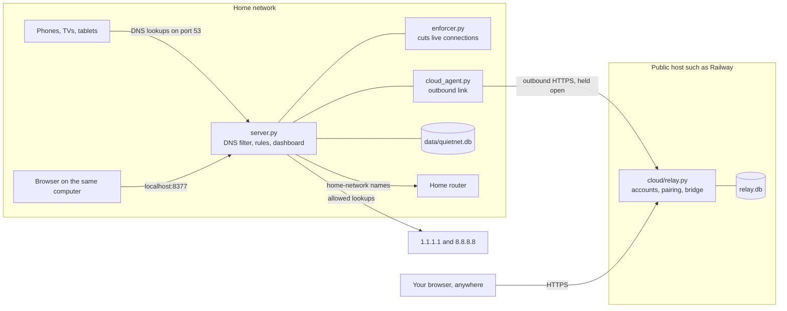
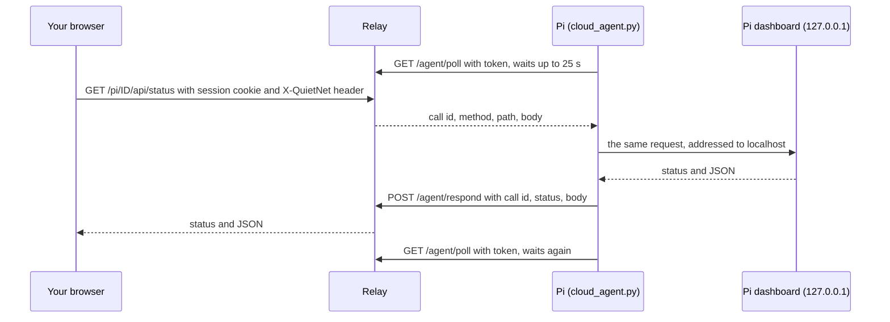

# How QuietNet works

This document explains how QuietNet is built, for someone who wants to change it or check what it does. The [README](../README.md) covers installing and using it.

Related documents: [Guide for agents](../AGENTS.md) · [API reference](API.md) · [Testing](TESTING.md) · [Known issues](KNOWN_ISSUES.md)

## The parts

QuietNet is two programs. One runs in the home, on a Raspberry Pi or a Mac. The other, the relay, is optional and runs on a public host so the home program can be reached from outside.



| File | Lines | Job |
| --- | --- | --- |
| `server.py` | ~2,400 | DNS filter, rules engine, network scan, dashboard web server, start-up |
| `names.py` | ~900 | Finds names for the devices on the home network (see [Device names](#device-names)) |
| `enforcer.py` | ~880 | Steers a chosen device's traffic through the Pi and drops what is blocked |
| `cloud_agent.py` | ~370 | Holds an outbound connection to the relay and runs relayed requests locally |
| `cloud/relay.py` | ~1,500 | The relay: accounts, pairing codes (and the install command shown with them), and the bridge between browser and Pi |
| `static/index.html` | ~780 | The dashboard: one page, no build step, no outside scripts |
| `services.json` | | The apps and services that can be blocked, and the addresses each uses |
| `junk_domains.txt` | | The built-in advert and tracker list |
| `install.sh` | ~700 | The one-line installer for a Pi: installs Docker if asked, downloads QuietNet, starts and pairs it (see [The installer](#the-installer)) |

Everything uses the Python standard library only. A test enforces this (`tests/test_packaging.py`).

## What happens to one lookup

Every device has a DNS setting: the address of the "phone book" it asks when it needs to find a site. A device pointed at QuietNet sends each lookup to port 53 on the QuietNet computer, over UDP (or TCP for large answers).

QuietNet listens on every IPv4 address of the computer and, where the computer has IPv6, on every IPv6 address too (`start_dns6()`, IPv6-only sockets on the same port, so the two never clash), for devices the router has told to use an IPv6 address for DNS. If IPv6 can't be opened, it prints why and carries on with IPv4 alone; `S.dns_ipv6` says whether it is listening.

Over IPv4 the router's address sharing keeps the internet away from the filter, but over IPv6 this computer's public address can be reached directly, and only the router's firewall (which some routers ship switched off) would stop strangers. So the IPv6 listeners answer only the home network (`v6_source_allowed()`, used by `udp_server()` on the IPv6 socket and by `TCPServer6.verify_request()`): `::1`, link-local (`fe80::/10`) and unique-local (`fc00::/7`) addresses, IPv4 home addresses written the IPv6 way, and public addresses inside the home network's own ranges. Anything else is dropped without an answer. The ranges come from this computer's own addresses (`own_ipv6()`: `/proc/net/if_inet6` on Linux, `ifconfig` on a Mac; a range narrower than `/64` is widened to `/64`). A background thread, `ipv6_watcher()`, reads them again every minute (`IPV6_RECHECK`), together with the IPv6 neighbour table (`ipv6_neighbours()`: `ip -6 neigh` on Linux, which is why the Pi image installs `iproute2`; `ndp -an` on a Mac).

`answer_query()` in `server.py` handles each one:

1. **Read the question.** `parse_question()` pulls out the name and the record type. A packet it cannot read is never passed on: it gets a "format error" answer with the same id (`unreadable_reply()`), or no answer at all if it is too short to have a header or is itself an answer (answering answers could set two servers bouncing packets back and forth).
2. **Work out who asked.** `device_address()` files an IPv4 device reaching the IPv6 listener (`::ffff:192.168.1.23`) under its plain IPv4 address and drops any zone suffix (`%eth0`). Lookups from QuietNet's own computer (`127.0.0.1`, `::1`, or any of its own IPv6 addresses) are filed under its network address. A device asking from a real IPv6 address is matched to its IPv4 address by hardware address (`refresh_ipv6_view()`: each IPv6 neighbour is looked up among the IPv4 devices from the last scan and the current neighbour table) and filed under that, so all its own rules apply. If it can't be matched and any rule names a particular device or group (an internet switch, a blocked service or an enabled schedule; `device_rules_exist()`), the answer is "refused", so the device asks QuietNet's IPv4 address instead, where its rules are known. With no such rules it is answered and filed under its IPv6 address, as a separate device (known issue 5).
3. **Answer the "use the network's DNS" signals.** `use-application-dns.net` (`NO_SUCH_NAME_SIGNALS`) gets "no such name", which makes Firefox switch off its own secure DNS. `mask.icloud.com` and `mask-h2.icloud.com` (`BLOCKED_SIGNALS`) get the blocked answer, which makes Apple devices switch off iCloud Private Relay for the network. These answers are the same for every device, paused or not, whatever the rules say, and are recorded as blocked so the owner can see which devices tried to bypass QuietNet. Other `icloud.com` names are unaffected.
4. **Decide whether the name is one QuietNet tracks.** Names ending `.local`, `.lan`, `.home`, `.internal` or `.arpa`, and names that are not valid web addresses (single words with no dot among them), are not checked against the rules or recorded. What happens to them:
   - If this device's internet is off right now (the kill switch, its own or its group's switch, or an all-internet schedule: `internet_cut()`), they get the blocked answer, so they can't be used to get data out. This includes home-network names such as `printer.local`, which stop working on that device too.
   - Otherwise, home-network names (`.local`, `.lan`, `.home`, `.internal`, `.home.arpa`, and single words with no dot such as `nas`, except when asked with one of the record types used to check DNS signatures, `SIGNATURE_TYPES`, which go to the internet, since a device checking signatures asks those about top-level names such as `com`) and reverse lookups of home or private addresses (10.x, 172.16–31.x, 192.168.x, 169.254.x, 127.x, and the IPv6 equivalents) go to the home router, never to the public servers (`is_home_name()`, `ask_router()`). The router's address is read from the routing table (Linux only) and looked up again every five minutes (`ROUTER_RECHECK`). If it isn't known (as on a Mac), or the router itself asked, the answer is "no such name"; if the router doesn't answer, "server failure". If the same question (name and type) arrives while QuietNet is still waiting on the router for it (`router_waiting`), the answer is "server failure" rather than a second ask, so a router that sends its lookups back to QuietNet by another route can't make the two ask each other for ever. Router answers are not remembered.
   - Anything else (reverse lookups of public addresses, names with odd characters) goes to the public servers as usual, and is not remembered either.
5. **Apply the rules.** `decision()` returns blocked or allowed, and why. See the next section.
6. **Record it.** The time, the device's address, the name and the verdict go onto a queue. A background thread writes the queue to the database once a second.
7. **Answer.**
   - Blocked: the device is told the address is `0.0.0.0` (or `::` for IPv6), to be remembered for 60 seconds. Other record types get an empty answer. The upstream server is never contacted.
   - Allowed, and a remembered answer is at hand (see below): it is sent at once, with the asker's own id and question (keeping the letter case it asked with) and every lifetime reduced by the seconds it has spent in memory. Its addresses still count towards the enforcer's list.
   - Allowed, otherwise: the question goes to 1.1.1.1, falling back to 8.8.8.8. The answer's lifetime is cut to 120 seconds (`MAX_TTL`) so that a later block, bedtime or kill switch takes effect within about two minutes. The addresses in the answer are remembered in memory for the enforcer, and the answer itself is remembered for next time.
   - No reply from either upstream: the device is told "server failure".

**Remembered answers.** `answer_cache` holds answers from the internet for the shortest lifetime of any record in them (already cut to 120 seconds), filed under the name (lower case), the record type, the class, and what the question asked of the answer: whether it carried a settings record, whether that asked for signature records (the "DO" flag), and whether it asked the server not to check signatures (the "CD" flag; `cache_key()`, `question_settings()`). The internet's answer depends on all three, so an answer fetched for one kind of question is never handed to another; in particular an unchecked answer fetched for a device that turned checking off never reaches a device that relies on the checks. Up to 5,000 are kept (`MAX_CACHED_ANSWERS`; the oldest is dropped first). It is only looked at after `decision()` has allowed the name for the device asking, so it only ever replaces the trip to the internet: a block, a bedtime or the kill switch bites on the very next lookup. Every rule change (`rules_changed()`) clears it as well. Only good answers ("found" or "no such name") are kept, never failures, empty replies, answers marked as cut short, answers with no lifetime, or answers over 4,096 bytes (`MAX_CACHED_SIZE`; a TCP answer can be 64 KB, and this keeps the memory used small). Over UDP, a remembered answer bigger than the asking device said it can take (512 bytes, or the size in its settings record) is not given; the question goes to the internet as before, which tells the device to ask over TCP. Over TCP any size is given. It has its own small lock, `answer_cache_lock`.

Lookups over UDP are handled by a pool of 64 threads. At most 256 are in hand at once (`MAX_DNS_WAITING`), and at most 16 from any one device (`MAX_DNS_PER_DEVICE`), so one busy or broken device can't stop everyone else's; beyond that, new lookups are dropped and devices ask again. Lookups over TCP share 64 connections (`MAX_TCP_CLIENTS`), at most 8 from any one device (`MAX_TCP_PER_DEVICE`); more are closed at once. Both shares count a device by `device_address()`, so an IPv4 device asking over IPv6 shares its count with itself over IPv4.

A device is identified by its IP address. If the router hands a device a different address, its name and rules do not follow it. The README advises reserving addresses in the router.

## The order rules are checked in

`decision(domain, client, paused)` checks in this order and stops at the first match:

| # | Check | Result | Reason code |
| --- | --- | --- | --- |
| 1 | Kill switch is on | blocked | `kill` |
| 2 | Internet is switched off for this device or its group | blocked | `off` |
| 3 | An all-internet schedule is in force for this device, its group or the house | blocked | `schedule` |
| 4 | The name, or a parent of it, is on your **blocked** list (skipped while paused) | blocked | `you` |
| 4 | The name, or a parent of it, is on your **allowed** list | allowed | `allowed` |
| 5 | The name belongs to a service blocked for this device, its group or the house | blocked | `service` |
| 5 | The name belongs to a service blocked by a schedule in force | blocked | `schedule` |
| 6 | The name is on the advert list (skipped while paused, or if advert blocking is off) | blocked | `list` |
| 7 | Otherwise | allowed | none |

Checks 1 to 3 never apply to QuietNet's own computer (`is_this_computer()`: `127.0.0.1`, `::1` and its network address). Its lookups are its link to the relay, its clock and its list downloads; cutting them would mean a Pi under the kill switch could not be switched back on from outside. Checks 4 to 7 apply to it as to any device. The dashboard agrees: its device list never shows this computer as switched off (`internet_off_for()`), and `POST /api/internet` refuses to switch this computer's internet off, since it would have no effect. Checks 1 to 3 live in one place, `internet_cut()`, which `decision()` calls first.

Points that follow from this order:

- **Step 4 walks from the most specific name upward.** For `a.b.example.com` it checks `a.b.example.com`, then `b.example.com`, then `example.com`. The first block or allow found wins, so an allow on `safe.example.com` beats a block on `example.com`.
- **An allow beats a service block.** If `youtube.com` is on the allowed list, a YouTube service block or homework schedule will not stop it. Only the kill switch, the internet switch and all-internet schedules come before allows.
- **Pause affects only steps 4 (your blocks) and 6 (adverts).** Service blocks, schedules, switched-off devices and the kill switch stay in force. Allows still apply while paused.
- **Unblocking an advert-list name creates an allow.** `unblock()` removes your block; if the advert list would still block the name, it adds the name to the allowed list so the unblock sticks.
- **Blocking a name removes allows beneath it.** `block("example.com")` deletes allows for `example.com` and anything under it.

### Scopes

A rule applies to one of three scopes, written as text:

- `all`: the whole house
- `group:<id>`: a named group of devices
- `device:<ip>`: one device

A device is subject to all three at once: `all`, its own, and its group's (a device is in at most one group). Deleting a group deletes its service blocks, its internet switch and its schedules.

### Schedules

A schedule has a scope, a set of weekdays (0 = Monday), a start and end time, and either "all internet off" or a list of services. Times are the QuietNet computer's local clock. In the Pi container that clock is set by `docker-compose.yml`, which shares the Pi's own time zone file (`/etc/localtime`) with the container and sets `TZ` to read it; the image includes the time zone tables (`tzdata`). Without this, the container would run on UTC and schedules would be out by an hour or more.

When the end is earlier than the start, the window runs overnight. The whole window belongs to the day it started: a Sunday 21:00–07:00 schedule covers Sunday evening and Monday morning. The list of schedules in force is worked out at most once every five seconds.

## The enforcer

A DNS block stops a device finding an address. It does nothing to a connection already open, such as a film mid-stream. The enforcer closes that gap for devices you choose, one at a time. It runs on Linux only and needs root or the `NET_RAW` and `NET_ADMIN` container rights.

Every two seconds, and at once whenever a change is saved on the dashboard (`Enforcer.poke()`), it asks `server.enforcement_plan()` what to do. Working out the plan means asking `decision()` about every name looked up recently, for every enforced device, so each answer is remembered (`S.plan_cache`) and worked out again only for names not seen before, or when something has changed: any rule (each change calls `rules_changed()`, which bumps `S.rules_version`), the pause, the schedules in force, the enforced devices or this computer's address. The whole plan is worked out afresh at least once a minute regardless. The addresses for each blocked name are always read fresh. Then the enforcer:

1. **Hands back anyone who has left the plan.** A device switched off, or one whose address now belongs to a different device, is told the router's real hardware address at once (three times). If the router's hardware address isn't known yet, the device stays listed and forwarding stays on, so it keeps its internet, and the next tick tries again.
2. **Checks it is safe to steer.** It turns on the kernel's packet forwarding and turns off "redirect" messages (which would tell a device to go straight to the router), reading each setting from `/proc/sys` and saving the old value. Then it reads forwarding back. If forwarding is still off, as it is in a container that may not change it, steering would cut the device off, so it doesn't steer, and says why on the device page (`status()["problem"]`). It also asks every firewall tool present (`nft`, `iptables`, `iptables-legacy`) whether another firewall would drop passed-on traffic: Docker's "drop" forwarding rule, or a chain that drops or rejects everything, as firewalld's does. In the kernel each firewall table decides on its own, and an accept in one table does not override a drop in another, so `forward_blockers()` judges every `ip` and `inet` table's forwarding chain separately (leaving out QuietNet's own table, and `ip6`, `bridge` and `arp` tables, which never see the IPv4 traffic QuietNet passes on). It reads each chain's rules in order: an accept for traffic coming in and going out on the Pi's own network connection clears that chain; a drop or reject that applies to all traffic, before any such accept, blocks it. It follows jumps and gotos that apply to all traffic, and ignores those that only some traffic takes. As in the kernel, a chain reached by a goto that runs out of rules goes back to the last jump and carries on after it (firewalld's zone chains end that way), and only ends at the forwarding chain's own policy when no jump came before. Any table still blocking counts as unsafe. The device page names every table in the way, each with a command that suits it (`nft_advice()`, `iptables_advice()`): an `iptables -I DOCKER-USER` accept for Docker's table, an `iptables -I FORWARD` accept for a chain made with `iptables` without Docker (such as ufw's), and an `nft insert rule` accept naming the real table and chain for anything else (such as firewalld's). The commands are joined so one run clears every blocker. They last until that firewall reloads (known issue 4). It fails closed: if a firewall tool that is present can't list its rules, that also counts as unsafe (the one exception: `iptables-legacy` reporting that the old firewall isn't loaded at all, which means it holds no rules). The Pi image includes the `iptables` commands for this reading, since Docker on some Pis keeps its rules where `nft` can't see them. A clean result is remembered for 30 seconds; a failure is asked again next tick.
3. **Drops what is blocked.** It loads a small firewall table (`nft`, or `iptables` if `nft` is missing). Each `nft` load deletes the previous table and defines the new one as a single step, because loading a table that already exists would add to it and leave old rules behind. With `iptables`, every command waits for the firewall lock, the chain and the jump into it are re-checked every tick (if either had to be put back, or the chain no longer holds the rules loaded, they are loaded again), and the rules only count as loaded if every command worked. While no device has ever been enforced, or once the last one's rules have been emptied, no `iptables` commands run at all; if removing the chain failed, it is emptied on a later tick. For a device whose internet is off (the kill switch, its internet switch, or an "all internet" schedule), it drops everything not addressed to the Pi itself. Otherwise it drops only the addresses that QuietNet handed out, in the last six hours, for names blocked for that device by you, by a service block or by a schedule. The advert list is left out, because advert names often share addresses with ordinary sites. Pausing advert blocking pauses your own blocks here too.
4. **Steers the device.** It sends the device an ARP message saying "the router's address is at the Pi's hardware address". The device then sends its outgoing traffic to the Pi. The message is repeated every tick because devices forget it. It only steers a device whose hardware address matches the one recorded when enforcing was switched on (filled in the first time it is seen, if it wasn't known then).

Between ticks, it listens for a steered device asking "who is the router?". It answers at once, again within a third of a second, and again at about 1.0, 1.1 and 1.6 seconds (`ANSWER_AT`). One thread sends all these answers; a device that asks again before its answers have gone out just has its plan restarted, so a flood of questions (which anyone on the network could forge) costs one entry per steered device, not a thread per question. A device believes the most recent answer, but Linux ignores a second answer for about a second after the first, so if the real router answered first, only the later answers stick. Without them the device would go straight to the router for up to two seconds after every question. In a two-container test, a device that had been cut off for a while got nothing through in 60 to 146 seconds of trying. In the first few seconds after the kill switch is turned on, though, up to about three seconds of traffic can still get through (known issue 45).

It never steers the router, the Pi itself, or anything outside the Pi's own network (`target_problem`). The Pi's own address is not fixed: `address_watcher()` in `server.py` looks it up again every 10 seconds while it is still `127.0.0.1` (a Pi may start before its network is ready), and every minute after that. A new address is passed to the enforcer and counts as a rule change; a lost network keeps the last good address. When the enforcer is running, the dashboard refuses those addresses when enforcing is switched on; otherwise it can only refuse this computer and addresses that are never devices, and the enforcer skips the rest later. A device-specific problem (a different device on the address) is reported for that device alone (`status()["problems"]`); a problem that stops all steering is in `status()["problem"]`.

Only the outgoing direction passes through the Pi. Replies travel from the router to the device directly.

**Notes on disk.** Which devices are steered and which settings were changed are written to `enforcer_state.json` in the data folder as they happen. At start-up `_recover()` removes any leftover firewall table, adopts the leftovers as its own, and hands those devices back. If the enforcer can't start at all, it still removes the table; if no devices were steered it also restores the settings and removes the notes, but if devices were steered it leaves every setting as it is and keeps the notes, since they can't be handed back without the network. If it can't start only because the network isn't up yet, it keeps looking every 15 seconds.

When the last device is released, the kernel settings are put back. On shutdown, `_teardown()` tells every device the router's real hardware address five times, from the Pi's own hardware address (switches and Wi-Fi ignore frames that claim to come from another machine). It then removes the firewall table and restores the settings. If devices couldn't be handed back, forwarding is left on and the notes kept for the next start. The program waits for this to finish before it exits, both on Ctrl-C and on `docker stop`.

Limits: it works on IPv4 only, so a connection a device already has over IPv6 is not cut (the device page says so; known issue 5); it blocks by address, so two services sharing an address are both affected; and it relies on the device using QuietNet for DNS, since that is how QuietNet learns which addresses belong to which name.

## Remote access

A Pi at home cannot usually accept connections from the internet. So the Pi connects outward to the relay and waits, and the relay passes browser requests down that connection.



**Pairing.** On the relay website you create a QuietNet and get a code such as `A1B2-C3D4`, valid for 15 minutes. Opening the page after that issues a fresh one. For a new Pi, the page shows the one-line install command with the relay's address and the code filled in (see [The installer](#the-installer)), which passes them to the container as `QUIETNET_CLOUD` and `QUIETNET_PAIR`. For a Pi already running QuietNet, you enter the code and the relay's address on the Pi's dashboard (or set `QUIETNET_CLOUD` and `QUIETNET_PAIR` yourself). The Pi sends the code to `/agent/pair` and gets back a 48-character token, which it saves in `data/cloud.json`. The relay keeps only a SHA-256 hash of the token (`token_record()`), so a copy of `relay.db` can't be used to pose as a Pi; it works out the hash from each request's token, finds the Pi through its index and compares in constant time. The code is then cleared and cannot be used again.

**Only https:// to another computer.** A relay address typed without a scheme gets `https://`. One starting `http://` (whatever the capital letters) is refused before anything is sent, unless the host is `localhost`, `127.0.0.1` or `::1` (a relay on the same computer, for development): `insecure_relay()` in `cloud_agent.py`. The refusal is final, so a `QUIETNET_PAIR` code with such an address is not tried again. A Pi paired with such an address by an older version never contacts it: its Remote access card shows the error until it is paired again with `https://` or forgotten. A Pi started with `QUIETNET_PAIR` keeps trying its code if the relay is busy, limiting, unreachable or gives an answer it can't read: after 5 seconds, then 10, 20, 40, and then every minute (`PAIR_RETRY_MAX`). It stops only when pairing works or the relay says the code is wrong, used or expired. The Remote access card and the log say when the next try is.

**Certificates.** The Pi checks the relay's HTTPS certificate on every call, and this is never switched off. Python from python.org on a Mac has no certificate list of its own until "Install Certificates.command" is run, so if Python's list is empty, `tls_context()` in `cloud_agent.py` borrows the system's own (`/etc/ssl/cert.pem` on a Mac, and the usual files on Linux). If a certificate still can't be checked, the message names that fix rather than saying the relay can't be reached. The community advert list download in `server.py` uses the same shared settings, so it works on that Python too.

**Keeping the link up.** Any error in the Pi's link, including a cut-off or unreadable answer during a relay restart, is caught. The link tries again after 1 second, then 2, 4 and up to 30, and the Remote access card says what happened.

**The bridge.** `Bridge` in `relay.py` keeps a queue of waiting calls per Pi. A browser request is queued and its thread waits up to 30 seconds for the answer. The Pi handles up to eight calls at once, each in its own thread, so the several calls a dashboard page makes don't queue behind each other. A Pi can only answer calls that were sent to it. Its answers may be up to 16 MB (a week of a busy device's history is large), but only for a call that is really waiting for that Pi (named in an `X-QuietNet-Call` header), and anyone can pair a Pi of their own, so a token alone isn't enough. Room for large answers (over 64 KB) is shared out by `BigAnswers`: one at a time per account, across all its Pis (so pairing extra Pis of your own gets you no more room), and at most 48 MB across every account (`BIG_ANSWER_BUDGET`). An answer waits up to 10 seconds for room; if none comes, the Pi gets `503` and the browser is told at once that the answer was too large to pass on right now. Room is taken from the stated size and given back once the browser has the answer, or straight away if it has given up; reading stops if the browser stops waiting, and every request body must arrive within 30 seconds (`BODY_SECONDS`). A request's first line and headers must arrive within 10 seconds (`HEADER_SECONDS`, which also covers the wait for the next request on a kept-open connection), or the connection is dropped, so a sender trickling header bytes can't hold one of the 300 places for ever. Only one copy of each answer is kept. An answer bigger than 12 MB is replaced on the Pi by a short "too much to send" message, so the browser hears at once. Each Pi may have one poll waiting at a time (a new one ends the old one), and at most 150 Pis wait at once (`MAX_POLLS`), so waiting Pis can never take every thread from browsers. A Pi not heard from for 40 seconds is treated as offline. Removing a QuietNet also forgets its queue.

**Limits on the relay as a whole.** `RelayServer` handles at most 300 connections at once (`MAX_CONNECTIONS`); one beyond that gets a short "busy" reply, with the usual protective headers, and is closed. An account may hold at most 10 QuietNets, paired or waiting (`MAX_PIS_PER_ACCOUNT`), and pair at most 20 a day. If the relay ever answers a poll with 401, the Pi discards its token and must be paired again.

**Accounts and sessions.** Who may sign up is set by `QUIETNET_SIGNUP`: `first` (the default: only while no account exists, so the person who set the relay up), `open` or `closed`; the start-up log says which is in force. In `first` mode the new account's row is added only if there are still no accounts, in the same statement, so two sign-ups arriving together on a new relay can't both get in; the one that loses gets the usual answer. Signing up shows the sign-in form with a note, and the answer is the same whether or not the email already had an account (an existing account is left untouched), so the form can't be used to find out who has one. Every sign-up try counts towards the hourly limit. Signing up does not sign you in: you then sign in with that email and password. A session cookie is `user.number.expiry.signature`. `number` is the account's session number (`users.session_gen`), and the signature covers the first three parts and the account's password record. Signing out adds one to the number (`end_sessions()`), so every copy of that account's cookie, in any browser, stops working; a change to the password record does the same. Checking a session is one small database read. Cookies in the older three-part form count as signed out.

**Limits that survive a restart.** The counts behind the limits on guessing (`Throttle`) are kept in memory and also written to a `throttle` table in `relay.db` on every change, and read back at start-up (`Throttle.load()`), dropping anything older than a day (the longest window any limit uses). At most 1,000 times are kept per name and 10,000 names at once; under a flood the oldest half of the names is forgotten, in the database too.

**Not running as root.** The relay's container starts as root, because Railway mounts its storage volume owned by root. At start-up, `main()` opens the listening port first (so a port below 1024 still works), then `drop_privileges()` hands the data folder and the relay's own files in it (`relay.db` and the files SQLite keeps beside it, `DATA_FILES`) to the `nobody` user and group (65534), or to `QUIETNET_RUN_AS=uid:gid`, drops the extra groups, the group and the user in that order, and checks root is really gone (it refuses to start if not, or if the system refuses any of those changes, with a plain message naming `QUIETNET_RUN_AS`). Handing over never follows a link, and touches only those names, and only when each is a plain file with no other names (`hand_over()`): otherwise a fault in the relay, once running as `nobody`, could leave a link to a system file such as `/etc/shadow` in the folder for the next start, still as root, to hand over. Only then is the database opened. If the folder can't be handed over, it stays root and warns, rather than be unable to use its database. Started as an ordinary user, it changes nothing.

**The install command on the relay's page.** Each "Waiting to be paired" card in `Relay.home()` shows, first, "New Pi? Run this one line on it:" and the command made by `install_command()`: `curl -fsSL <INSTALL_URL> | sh -s -- --relay <relay address> --code <code>`. Below it come the manual steps for a Pi already running QuietNet, with the code in large type. An account with no QuietNets is told to name a Pi, create a code and run the line shown (`GETTING_STARTED`). The relay never fetches the installer itself; only the Pi does. `INSTALL_URL` is `QUIETNET_INSTALL_URL`, or the `install.sh` on GitHub's `main` branch. The relay's own address comes from `relay_address()`, read on every request, in this order: `QUIETNET_RELAY_URL` (trailing `/` removed; used only if `usable_relay_url()` accepts it: `https://`, or `http://` to exactly `localhost` or `127.0.0.1`, written in small letters, so the page never offers a line the installer would refuse), then `https://` plus `RAILWAY_PUBLIC_DOMAIN` (which Railway sets), then `https://` plus the request's `Host` header. Because the command is pasted into a shell on someone's Pi, and the `Host` header comes from whoever sent the request, each candidate is used only if it is a plain address: letters, digits, dots and dashes with an optional port (`HOST_RE`, `RELAY_URL_RE`). If none is, the command shows `https://your-relay-address` with a note to replace it. The whole command is passed through `html.escape()`. The page has no script: the command box selects all of itself on a click (CSS `user-select: all`).

**What the relay stores.** Email addresses, password records (PBKDF2-SHA256, 240,000 rounds, a fresh salt each), each account's session number, the list of Pis with a hash of each token (never the token itself), recent wrong guesses and attempts for the limits, and one signing secret. History and rules stay on the Pi and pass through only while a page is open.

## The installer

`install.sh` at the top of the repository puts QuietNet on a Raspberry Pi, or any Debian or Ubuntu style Linux, with one line:

```bash
curl -fsSL https://raw.githubusercontent.com/lpobjoy/QuietNet/main/install.sh | sh -s -- --relay https://RELAY --code A1B2-C3D4
```

(`--relay` and `--code` are optional, and must be given together.) It is plain POSIX `sh`, so it runs under dash (Debian's `sh`), busybox ash and bash. Everything is inside functions, and the only line that does anything is the last, `{ main "$@"; exit $?; }`: a download cut off part-way is either a syntax error or defines functions and stops, and never runs half the steps.

**Options.** `--relay URL`, `--code CODE`, `--yes` (answer yes to every question), `--ref NAME` (branch or tag, default `main`), `--uninstall`, `--help`; each also as `--opt=value`. An unknown option prints the usage and exits with code 2; a bad value gets a short message and exits 2. From the environment: `QUIETNET_DIR` (default `/opt/quietnet`), `QUIETNET_REPO` (default `lpobjoy/QuietNet`), `QUIETNET_REF` (the default for `--ref`). `QUIETNET_SYSROOT` and `QUIETNET_TTY` exist only for the tests: they move `/etc` and the terminal into a test folder.

**Checks before anything runs.** Every value from the command line or environment is checked before it is used, so nothing in it can be read by the shell or Docker as anything but what it is meant to be:

- The relay address may hold only letters, digits and `. : / _ -`. A bare host gets `https://`; trailing slashes are dropped. `http://` is accepted only for `localhost` and `127.0.0.1` (so `http://localhost.evil` is refused), matching what `cloud_agent.py` insists on.
- The code must look like `A1B2-C3D4`; small letters are turned into capitals.
- `--ref` may hold letters, digits, dots, dashes, underscores and slashes, with no `..` and no leading `-` or `/`. `QUIETNET_REPO` must be `owner/name`.
- `QUIETNET_DIR` must be a full path of ordinary characters, and not `/` or a top-level folder such as `/usr` or `/opt`, because it is replaced on every update.

**What it does, in order** (`main()`):

1. Refuses anything but Linux (on a Mac it points to `Start QuietNet.command`); warns on an original Pi Zero or Pi 1 (armv6).
2. Works out how to get administrator rights: none needed as root, otherwise `sudo` for every step that needs it, every `docker` command included, so the person need not be in the `docker` group. When it will use `sudo`, it runs `sudo true` once at the start, with sudo's own messages showing, and stops if that fails (not allowed to use sudo, or no terminal to type the password on: it suggests `ssh -t`). With neither root nor sudo, it stops and says to run as root.
3. Makes a temporary folder (`mktemp -d`), removed when the installer exits however it exits.
4. **Docker.** If `docker` is missing it asks (on `/dev/tty`, because when piped from curl the script's own input is the script) whether to install it, then downloads `https://get.docker.com` into the temporary folder and runs it as root. With no terminal and no `--yes` it stops and explains. If Docker's script fails it points to Docker's own install guides for Debian and Raspberry Pi OS, and for Ubuntu. It then requires `docker compose version` to work, naming the package for each kind of system (`docker-compose-plugin` from Docker's packages, `docker-compose-v2` on Ubuntu; Debian's own `docker.io` has no plugin, so it points to Docker's guide rather than Debian's old `docker-compose`), and if the Docker service isn't answering tries `systemctl start docker` once.
5. **Name clash.** If a container called `quietnet` exists from a different Compose project (or with no project label), it stops, naming the folder it was started from and how to stop it, and noting that its history would not carry over. A container from project `quietnet` (the installer's own, or one started with `docker compose up` in a folder called `QuietNet`) is simply taken over, data volume and all.
6. **Download.** Fetches `https://codeload.github.com/<repo>/tar.gz/<ref>` with `curl` (with retries) or `wget`, unpacks it in the temporary folder, and checks it holds a single folder with `server.py`, `Dockerfile` and `docker-compose.yml`. A failed download changes nothing on the Pi.
7. **Install the files.** Replaces only a folder that is missing, empty, or already holds QuietNet (`server.py` and `docker-compose.yml`); a folder with anything else stops the install (`dir_is_ours`). These checks run as root, so a folder the person cannot read never looks empty, and a folder that cannot be listed is never replaced. A folder holding `data/` or `.git` (a working copy of QuietNet, with its own history and rules) is never replaced either. The new files are copied into a fresh sibling folder (`/opt/quietnet.new.XXXXXX`), then swapped in with two moves; if the second move fails, the old folder is moved back. Nothing outside QuietNet's own folders is deleted.
8. **Port 53.** Reads `ss -lntup` as root. systemd-resolved (spotted by name or by its `127.0.0.53`/`127.0.0.54` address) can be switched off there: after asking, it writes `/etc/systemd/resolved.conf.d/quietnet.conf` (`DNSStubListener=no`), re-points `/etc/resolv.conf` from `stub-resolv.conf` to `/run/systemd/resolve/resolv.conf` if it was a link to the former, so the Pi's own lookups keep working, and restarts systemd-resolved. A running QuietNet's own listener is ignored. Any other program on port 53 (Pi-hole, dnsmasq) stops the install, naming it. Without `ss` it warns and carries on.
9. **Forwarding.** Writes `net.ipv4.ip_forward=1` to `/etc/sysctl.d/90-quietnet.conf` (skipped if already there) and applies it with `sysctl --system`, or `sysctl -w` if that fails. This is only needed for "Cut live connections", but costs nothing otherwise.
10. **Start.** `docker compose -p quietnet up -d --build` in the install folder. With a relay, `QUIETNET_CLOUD` and `QUIETNET_PAIR` are set for that one command only (through `env`), never written to a file; `docker-compose.yml` passes them into the container. Commands that might read input are given `/dev/null`.
11. Waits up to 30 seconds for the container to be running, or stops and points to `docker logs quietnet`.
12. Prints the Pi's home-network address (from `ip -4 route get 1.1.1.1`, or `hostname -I` skipping IPv6, `127.x` and `172.17.x`), says to set it as the router's DNS server and to reserve that address for the Pi, gives the dashboard address with the `ssh -L 8377:localhost:8377 <user>@<address>` tunnel line for reaching it from another computer, and, when pairing, says the Pi should appear on the relay's page within a minute.

**Where things go.** Program files: `/opt/quietnet` (or `QUIETNET_DIR`). Compose project name: `quietnet`, so the container is `quietnet` and the household's history and rules are in the Docker volume `quietnet_quietnet-data`, never in the program folder. That is why re-running the installer is an update: the folder is replaced, the image rebuilt and the container recreated, and the volume is kept.

**What it changes on the Pi** besides its own folder and container: Docker itself, if it was missing and the person agreed (with whatever Docker's script changes); `/etc/sysctl.d/90-quietnet.conf`; and, only if systemd-resolved held port 53 and the person agreed, `/etc/systemd/resolved.conf.d/quietnet.conf` and the `/etc/resolv.conf` link.

**Uninstall** (`--uninstall`, which can't be combined with `--relay` or `--code`) runs `docker compose -p quietnet down --rmi local` in the install folder, or `docker rm -f quietnet` if the folder is gone. It leaves a `quietnet` container from another project, or with no project label, alone (with a warning), and removes the install folder only if it is QuietNet's. It keeps the data volume and prints the command to delete it, and if the forwarding or systemd-resolved files exist, says how to undo each.

**Pairing on a re-run.** `cloud_agent.py` uses `QUIETNET_CLOUD` and `QUIETNET_PAIR` only while the Pi is not paired, so `--relay` and `--code` on a re-run pair only a Pi that isn't paired yet; the closing message says so. The code is in no file, but Docker keeps it in the container's settings until the next run without `--code` (known issue 88).

## Security model

| Threat | Defence | Where |
| --- | --- | --- |
| A web page you visit tries to call the local dashboard | The dashboard listens on `127.0.0.1` only and refuses any request whose `Host` is not `localhost` or `127.0.0.1` | `Web.local_only` |
| Another website shows the dashboard inside itself and tricks someone into clicking | Both servers send `X-Frame-Options: DENY` and `frame-ancestors 'none'` on every answer | `Web.end_headers`, `Relay.end_headers` |
| A web page posts a forged form to the local dashboard | Changes must be sent as exactly `application/json` (a type that merely *mentions* it, such as `text/plain; application/json`, is refused, since browsers send that without asking), which a cross-site page cannot do without permission the server never gives; and if the browser says which page sent the change, it must be on this computer (any port, for SSH tunnels) | `Web.json_from_our_page` |
| A web page signs you out of the relay by sending your browser to `/logout` | Opening `/logout` only shows a "Sign out?" page. Signing out is a form post that must carry a token made from the session cookie and the relay's secret, which another site can't read. (An `Origin` check wouldn't work: with `Referrer-Policy: no-referrer`, browsers send `Origin: null` even from the relay's own pages) | `sign_out_token`, `Relay.sign_out_page`, `Relay.sign_out` |
| A web page makes your signed-in browser call the relay | Relayed API calls need an `X-QuietNet: 1` header that another site cannot add; the cookie is `SameSite=Lax` and `HttpOnly` | `Relay.pi_request`, `set_cookie` |
| Someone else's account reaches your Pi | Every `/pi/<id>/…` request checks the Pi belongs to the signed-in user | `Relay.my_pi` |
| A stolen or edited session cookie | The cookie is `user.number.expiry.signature`, signed with a secret kept in the relay's database over the account's password record; it lasts 14 days. Signing out bumps the account's session number, which ends every copy of its cookie in every browser; a password change does the same | `make_session`, `read_session`, `end_sessions` |
| Another site signing a visitor in to the attacker's account (login forgery), or posting the relay's other forms | A form post whose `Sec-Fetch-Site` header is `cross-site` or `same-site` is refused with `403`; pages can't change or remove that header. Applies to `/login`, `/signup`, `/logout`, `/pis/new` and `/pis/<id>/delete`. Requests without the header (older browsers such as Safari before 16.4, and programs) are let through, so those browsers are still exposed to login forgery (known issue 7) | `Relay.from_another_site` |
| A copy of `relay.db` used to pose as someone's Pi | Pi tokens are stored only as a SHA-256 hash; a token stored as plain text by an older version is hashed at start-up | `token_record`, `hash_old_tokens`, `Relay.agent` |
| Finding out who has an account | Sign-up gives the same answer, and takes as long, whether or not the email already has one; an unknown email at sign-in takes as long to refuse as a wrong password | `Relay.do_signup`, `Relay.do_login` |
| A hostile value reaching the firewall | `/api/enforce` accepts only a real IPv4 address; addresses to drop come from parsed DNS answers | `Web.handle_post`, `answer_ips` |
| Text injected into the dashboard | The page escapes every value it inserts, ids and counts included, with `esc()` or `num()`; the relay escapes Pi names | `static/index.html`, `relay.py` |
| Guessing passwords or pairing codes | Wrong guesses are counted and capped, per account and overall; wrong pairing codes per network address (20 in 10 minutes) and overall (200), so one stranger can't stop everyone pairing; the counts are kept in `relay.db`, so restarting the relay doesn't reset them; pairing codes last 15 minutes; an unknown email takes as long to refuse as a wrong password | `Throttle`, `Relay.do_login`, `Relay.agent_pair` |
| Keeping the relay busy checking passwords | Every sign-in counts, right or wrong: 30 per account and 60 per network address in 15 minutes (a browser that signed in before has its own cap of 30 and skips the per-address one). At most four passwords are checked at once; a sign-in that waits 5 seconds for a turn is told the relay is busy | `Relay.do_login`, `PASSWORD_CHECKS_AT_ONCE` |
| Swamping the relay | At most 300 connections, 150 waiting Pis, one poll per Pi, 10 seconds for the headers and 30 for a body to arrive, one large answer per account and 48 MB of them in all; 10 QuietNets per account | `RelayServer`, `poll_slots`, `Bridge.poll`, `Relay.handle_one_request`, `read_body`, `BigAnswers`, `Relay.new_pi` |
| A stranger locking the owner out by guessing wrongly on purpose | A browser that has signed in to the account before carries a signed `qn_known` cookie and gets its own looser limit (20 wrong guesses in 15 minutes) instead of the shared ones; it still needs the right password. The cookie can only be had by signing in, is signed over the password record (a new password voids old ones), and is removed at sign-out | `known_device_token`, `Relay.do_login`, `Relay.sign_out` |
| Steering the router, the Pi itself or another network | The enforcer only steers ordinary addresses on the Pi's own network, and the dashboard refuses others | `enforcer.target_problem`, `Web.handle_post` |
| Floods of lookups or slow connections | At most 256 lookups in hand, and 16 from any one device (more are dropped; devices retry); at most 64 TCP connections, 8 from any one device, each with 8 seconds to send its question; relay connections that stall for 30 seconds are dropped; history capped at two million rows, trimmed 5,000 rows at a time so the trim never holds up DNS answers | `udp_server`, `TCPServer.take_slot`, `recv_exact`, `Relay.timeout`, `prune_history` |
| Using names the filter doesn't check to get data out while a device's internet is off | Unchecked names (home endings, reverse lookups, odd characters) get the blocked answer while internet is off; unreadable packets are never passed on | `answer_query`, `internet_cut`, `unreadable_reply` |
| Home-network names reaching public servers | Home names, single-word names and reverse lookups of private addresses go only to the home router; a question already waiting on the router gets "server failure" rather than a second ask, so the two can't loop | `is_home_name`, `ask_router` |
| Devices taking their lookups past QuietNet | Firefox's secure-DNS signal name gets "no such name" and Apple's Private Relay names are blocked, for every device, whatever the rules | `NO_SUCH_NAME_SIGNALS`, `BLOCKED_SIGNALS`, `answer_query` |
| The Pi's relay token crossing the internet unprotected | A relay address starting `http://` is refused unless the host is this computer; a saved one is never contacted | `cloud_agent.insecure_relay` |
| A fault in the relay being used with root's powers | The relay hands its data folder to `nobody` (or `QUIETNET_RUN_AS`) and stops being root before it opens the database or answers any request | `drop_privileges` |
| A forged `Host` header putting shell commands into the install line the relay shows | The relay's address is used only if it is letters, digits, dots, dashes and a port; otherwise a placeholder is shown. The whole line is HTML-escaped | `relay_address`, `usable_relay_url`, `HOST_RE`, `RELAY_URL_RE`, `Relay.home` |
| Hostile values reaching the installer's shell commands, or the installer deleting the wrong folder | Every option and setting is checked against a short list of allowed characters before anything runs; the install folder can't be `/` or a top-level folder, and is replaced only if it is empty or already QuietNet's, checked as root; a folder that cannot be listed, or that holds `data/` or `.git`, is never replaced | `check_relay`, `check_code`, `check_ref`, `check_repo`, `check_dir`, `dir_is_ours` in `install.sh` |
| What the installer downloads being changed | Not defended: it installs whatever is on GitHub's `main` branch (or `--ref`), with no signature check, over HTTPS only (known issue 86) | `download_source` in `install.sh` |
| A device on the home network feeding QuietNet hostile names or packets | Every packet reader is bounded and stops at anything malformed; names are tidied to plain text of at most 40 characters and escaped in the dashboard; a device may name only its own address (Bonjour answers, announcements and NetBIOS names are believed only from the address they are about); UPnP descriptions are fetched only from the answering device's own address, without redirects, at most 16 KB of headers and 64 KB of description, the whole exchange in 2 seconds, and refused if they declare a document type or entities; the whole naming round has a 5-second budget | `names.py` |
| A forged DNS answer | The filter accepts an answer only from the server it asked, with the matching id and the same question | `forward_udp`, `same_question` |
| Very large requests | Bodies over 64 KB are refused unread (except a paired Pi's answers to the relay, up to 16 MB) | `MAX_BODY` in both servers, `MAX_ANSWER` |
| Other accounts on the same machine reading history or tokens | The data folders and `cloud.json` are readable by their owner only | `init_db`, `CloudAgent._save` |

Two things to keep in mind:

- **The relay has full control of a paired Pi.** Anything the dashboard can do, a request from the relay can do, including the kill switch and the enforcer. Host the relay yourself and protect that account.
- **Anyone on the home network can use the DNS filter.** It listens on every network address of the computer, IPv4 and IPv6. Over IPv6 it answers only home addresses (see "Listening" above); over IPv4 it relies on the router's address sharing. It should not be exposed to the internet.

Gaps in these defences are listed in [Known issues](KNOWN_ISSUES.md).

## What is stored

### On the Pi: `data/`

| File | Contents |
| --- | --- |
| `quietnet.db` | SQLite database, described below |
| `community_list.txt` | The downloaded community advert list, one address per line |
| `cloud.json` | Relay address, token and Pi id, once paired |

Tables in `quietnet.db`:

| Table | Holds |
| --- | --- |
| `queries` | Every lookup: time, device address, name, blocked or not. Pruned to 30 days and two million rows, every 10 minutes. Two indexes: by device then time (the device page, and each device's last lookup), and by time (today's totals, and finding old rows to prune) |
| `blocked`, `allowed` | Your own address rules |
| `service_blocks` | (scope, service) pairs |
| `internet_off` | Scopes whose internet is off. The scope `all` is the kill switch |
| `schedules` | Timed rules |
| `groups`, `device_group` | Group names and which device is in which |
| `devices` | Names you gave devices |
| `seen` | Devices found by the network scan: address, hardware address, host name |
| `enforced` | Devices with "cut live connections" on |
| `settings` | `junk_on` and `paused_until` |

Rules are also held in memory (the `State` object) and reloaded from the database at start-up by `init_db()`. Every change writes both, holding `db_lock`, and calls `rules_changed()` so the enforcer's remembered plan is worked out again. A freshly downloaded community list calls it too, since it changes block decisions.

**Locks.** `db_lock` guards the database and the rules in memory. Answering a lookup never takes it: `decision()` reads only memory, recorded lookups go onto a queue for the log writer, and the addresses remembered for the enforcer (`S.resolved`) have their own small lock, `resolved_lock`. So a dashboard question, a history trim or a history clear can't hold up DNS answers. Remembered answers (`answer_cache_lock`) and the questions waiting on the home router (`router_waiting_lock`) also have small locks of their own, and never take `db_lock`.

The dashboard's history questions (today's totals in `/api/status`, the device list's last lookups and 24-hour counts, the activity list and its marker) use a second connection to the same file, `read_db`, opened read-only (`PRAGMA query_only=1`, so the database refuses any change sent through it) and guarded by its own `read_lock` (`read_sql()`). The write-ahead log lets it read while the main connection writes, and it sees everything the main connection has saved, so a slow history question never holds up a rule change, the log writer or another dashboard call. It is reopened whenever `init_db()` runs. Reads of the small tables (rules, devices, groups, the scan's findings) still use the main connection and `db_lock`; they are quick. The network scan waits for device names before taking `db_lock`, and holds it only to save what it found.

**History questions.** Each device's last lookup (`LAST_SEEN_SQL`, for the device list) is found by hopping from one device to the next in the device-then-time index, reading one row for each, so the work grows with the number of devices, not the size of the history. Pruning runs as two steps, each 5,000 rows at a time with the lock let go between steps: rows older than 30 days, found through the time index (`PRUNE_OLD_SQL`), then any rows beyond two million, found by row number (`PRUNE_SURPLUS_SQL`). Clearing one device's history (`clear_history()`) works the same way: 5,000 of its rows at a time through the device-then-time index (`CLEAR_DEVICE_SQL`), letting go of the lock between steps, and only rows already there when the clear began. The clear runs in a thread of its own and `POST /api/clear-history` answers at once, since a busy device's clear can take longer than the relay waits (30 seconds). While it runs, the device's page may briefly show part of its history. Clearing everyone's is a single statement, done before the answer, which the database does quickly by emptying the table.

**Activity marker.** Each answer to `/api/activity` that was asked with `since` carries a marker (`activity_marker()`): a short hash of the device and time window, the row number of the device's newest entry and the time of its oldest inside the window (one index step each: `NEWEST_FOR_DEVICE_SQL`, `OLDEST_IN_WINDOW_SQL`), and everything that changes a block decision or label (the rules version, the pause, the advert switch, the schedules in force and the advert lists' sizes). When the page sends back the current marker, the answer is "unchanged" and the list is not built. "Newest" is found by time, so an entry saved with an earlier time than the newest already there would not change the marker until a newer one arrives.

**Advert count.** The number of names on both advert lists together is worked out when either list is loaded or downloaded (`count_junk()`), not on every status call.

### On the relay: `relay.db`

`users` (email, password record, session number `session_gen`), `pis` (id, owner, name, token hash, pairing code and when it was issued, last seen), `throttle` (each limit's name and its recent times, as a JSON list), `meta` (the signing secret). `pis` has indexes on the token, the pairing code and the owner. The new column and table, the indexes, and the hashing of any plain-text tokens are all added at start-up to an existing database too.

## Background work

`server.py` starts these threads:

| Thread | Does |
| --- | --- |
| Web server | One thread per dashboard request |
| UDP listener | Receives lookups and hands each to a pool of 64 workers |
| TCP server | One thread per TCP lookup |
| Log writer | Saves recorded lookups once a second; prunes old history every 10 minutes |
| Name refresher | Every two minutes, and soon after a scan, asks the devices on the network for their names (see [Device names](#device-names)) |
| Name listeners | Hear Bonjour announcements and the DHCP requests devices broadcast when they join or rejoin (each only if it can be opened; on Linux the DHCP one reads packets through a filter and never takes port 67) |
| Address watcher | Looks up this computer's network address every 10 seconds until it has one, then every minute |
| Enforcer | Ticks every two seconds (Linux with the right permissions only) |
| Cloud agent | Polls the relay when paired |
| Scan, list download | Started on demand from the dashboard |

The **network scan** knocks on every address of the home network and lists the devices that answer. On Linux it reads the network's real size from the routing table; elsewhere it assumes the usual 254 addresses. A network bigger than 1,024 addresses (`MAX_SCAN`) is scanned only in the block of 1,024 around this computer, and the answer says so (`S.scan_info`: the network, how many addresses, and whether it was capped).

The **dashboard page** refreshes the status, devices and controls every four seconds, but only when the previous refresh has finished, no dialog is open and the browser tab is visible; it catches up as soon as the tab is shown again. An open device's activity list is fetched every 30 seconds on the timer (`ACTIVITY_EVERY`), and at once whenever the person opens a device or changes something. An answer that arrives after the person has moved to another device or time period is ignored. The activity fetch always sends `since`: the marker from the last answer if it came with the same device and time period, or empty otherwise (and after a device is opened afresh). On `{"unchanged": true}` the list already shown is kept; a plain list from an older Pi through the relay is still accepted. The page's script uses nothing newer than Safari 12 understands. At start-up it measures whether the browser honours flex `gap` (Safari before 14.1 does not), and if not adds the class `nogap` to the page, whose style rules space rows with margins instead. When the last scan was cut short (`scan.capped`), the Devices page says that only the addresses nearest this computer were checked.

## Device names

Most home routers (BT's Smart Hub among them) answer few or no "which name has this address?" questions, so a reverse lookup alone leaves most devices unnamed. `names.py` asks the devices themselves, in the ways they already answer, and suggests the best name it hears. The dashboard shows the suggestion, marked as one, with a **Use this name** button that saves it as an ordinary device name. Nothing is named without the owner pressing it.

**Where names come from, best first** (when two disagree, the first wins):

| Source | Shown as | How | Good for |
| --- | --- | --- | --- |
| DHCP | `DHCP` | Hears the requests devices broadcast when they join or rejoin the network, and reads the name (option 12) and software label (option 60) from them, also from the 'file' and 'server name' fields when the device says it put options there (option 52). On Linux it reads a copy of arriving packets through a packet socket with a system filter that passes only UDP to port 67, so it never takes the port; elsewhere it binds 255.255.255.255:67. Matched to an address by hardware address. Nothing is ever sent on port 67 or 68 | Most phones, tablets and laptops, but only when they join or rejoin (switching on, restarting, reconnecting to Wi-Fi) while QuietNet is running. Lease renewals go straight to the router and are not heard |
| Bonjour (mDNS) | `Bonjour` | Asks "which name has this address?" on UDP 5353: once to the Bonjour group address 224.0.0.251 (20 devices per packet) and once straight to each device, from a passing port, with the "answer me directly" bit set. Also listens to the group for devices announcing their own address, and for the device-information record (the owner's own name for the device and its model) | Apple devices, many printers, TVs, smart speakers and Linux computers |
| Windows network (NetBIOS) | `Windows network` | Sends each device the "what are your names?" question on UDP 137 and takes the first name unique to it with the "workstation" ending | Windows computers, network drives, Samba |
| UPnP (SSDP) | `UPnP` | One "who is there?" call (`M-SEARCH`, `ssdp:all`) to 239.255.255.250:1900 per round. Each device that answers gives the address of a short description, which is downloaded and its friendly name, maker and model read | TVs, Sonos, games consoles, routers |
| The router | `router` | A reverse lookup through the system's resolver (`reverse_name`), as before; the network scan stores what it finds | Whatever the router knows |

**Tidying.** Names are tidied for people (`tidy_name`): control characters and invisible marks are removed; from names with no spaces the home endings (`.local`, `.lan`, `.home`, `.internal`, `.home.arpa`, `.localdomain`) and the home domain (from `/etc/resolv.conf`) are dropped, and anything after a remaining dot; dashes become spaces only when every part between them is at least three characters and starts with a letter (`Lewiss-iPhone` becomes `Lewiss iPhone`, `DESKTOP-4F2K1JQ` stays); at most 40 characters; a bare address, or a word such as `localhost`, is no name; so is a name a machine made up (`looks_generated`): 12 or more hexadecimal digits once dashes, underscores and colons are taken out (the identity numbers Google Cast devices use as their Bonjour name, bare hardware addresses), or a word ending in 12 or more of them (`Sonos-000E58A1B2C3`), so the next source's friendly name wins. Bonjour's device-information name (such as "Lewis's MacBook Pro") is preferred to its network name.

**Detail.** Alongside the name, `hint_detail` gives a model or maker, but only one a device reported about itself: Bonjour's model, UPnP's maker and model, or DHCP's software label (`MSFT 5.0` is shown as "Runs Windows", `android-dhcp-…` as "Runs Android", anything else as given). There is no table of hardware makers. A device with no name or detail whose hardware address has the "locally administered" bit set gets the note "Private Wi-Fi address, so probably a phone, tablet or laptop": phones, tablets and laptops make up such an address for each Wi-Fi network.

**One round.** `hint_refresher` passes every device in the neighbour table (except this computer) to `NAMER.round()`. Only private IPv4 addresses are asked about, at most 256. Each source runs on its own thread and the round waits at most `ROUND_SECONDS` (5 seconds); a source still busy then is left behind, and not started again until it finishes. Inside, Bonjour and NetBIOS listen for 2 seconds, UPnP for 1.5 seconds, then downloads up to 16 descriptions, 8 at a time. Reverse lookups run 16 at a time. Nothing here runs on a lookup or a dashboard request. What each source said is kept per device for 6 hours (phones answer only when awake), with the device's hardware address: if the address passes to a different device, its old name is dropped. Bonjour announcements heard between rounds are kept with the time they were heard and the hardware address that had the address then (or, if that was not yet known, at the next round); they are used only for that device, and only for 6 hours from when they were heard, however many rounds pass. A UPnP description is reused for an hour; its address is noted as soon as a download starts, and a failed one is not tried again for an hour. A finished network scan starts a round at once (`NAMES_WANTED`).

**Everything heard is untrusted.** Packet readers stop quietly at anything malformed: names may use "pointers" to earlier text, but each must point further back than the last (so they can't loop), at most 16 of them, and a name is at most 255 bytes; at most 64 records per packet, 512 packets per listening window and 9,000 bytes per packet; DHCP options are read with a fixed limit and every length checked. Names are only ever text, and the dashboard escapes them. A device may only give a name for its own address: a Bonjour answer to "which name has this address?" is believed only when it comes from that address (so a Mac asleep behind a Bonjour Sleep Proxy is named once it wakes), and the same holds for announcements and NetBIOS answers. The tables of things heard hold at most 1,024 entries each.

**UPnP downloads** go only to exactly the address the answer came from, which must be a device on the home network (`location_allowed`): plain `http://`, no user name, no other host. Redirects are not followed (anything but `200 OK` is refused), the headers may be at most 16 KB and the body at most 64 KB, an answer sent in pieces (`chunked`) is refused, and the whole exchange, from connecting to the last byte, must finish within 2 seconds however slowly it arrives. It is done over a plain connection with the time left set before every read (`fetch_description`), because Python's own web client limits each read, not the whole answer. A document declaring its own type or entities (`<!DOCTYPE`, `<!ENTITY`), or containing zero bytes, is refused before it is read as XML.

**What the Pi sends and listens to.** Every two minutes: a Bonjour question to 224.0.0.251:5353 and to each device's port 5353; a NetBIOS question to each device's port 137; one UPnP call to 239.255.255.250:1900 and, for devices that answer, an HTTP request to their own description address (at most hourly each); and reverse lookups. It listens on 224.0.0.251:5353 (bound to the group address, so the system's own Bonjour service, avahi or mDNSResponder, keeps every message sent straight to it) and for DHCP requests: on Linux through a packet socket with a system filter (`DHCP_FILTER`: UDP to port 67 only), which needs the container's NET_RAW permission and never takes port 67, so a DHCP server on the Pi (dnsmasq, a hotspot) can start before or after QuietNet; elsewhere on 255.255.255.255:67 (broadcasts only, so a DHCP server on the same computer still gets the requests sent to it). On Linux, if the packet socket or its filter can't be opened there is no DHCP listener: it never falls back to taking port 67. If a listener can't be opened (its port is in use, or it needs admin rights, as on a Mac for port 67), the log says so once and names are still found the other ways. `--no-device-names` turns all of this off; the tests use it.

## Settings

Command line, `server.py`: `--dns-port` (default 53), `--web-port` (default 8377), `--no-browser`, `--no-device-names` (don't ask the home network for device names).

| Environment variable | Used by | Meaning |
| --- | --- | --- |
| `QUIETNET_DATA` | `server.py` | Folder for the database and lists. Default: `data/` beside the program |
| `QUIETNET_CLOUD` | `cloud_agent.py` | Relay address, used only if the Pi is not yet paired |
| `QUIETNET_PAIR` | `cloud_agent.py` | Pairing code, used once at first start |
| `PORT` | `relay.py` | Port to listen on. Default 8080 |
| `QUIETNET_RELAY_DATA` | `relay.py` | Folder for `relay.db`. Default: `data/` beside the program |
| `QUIETNET_STATIC` | `relay.py` | Path to the dashboard page, if not in the usual place |
| `QUIETNET_SIGNUP` | `relay.py` | Who may create an account: `first` (the default: only while there are no accounts), `open` or `closed`. Unset or empty means `first`. Any other value counts as `closed`, with a warning at start-up. The start-up log says which is in force |
| `QUIETNET_RUN_AS` | `relay.py` | `uid:gid` to run as once root is given up at start-up. Default `65534:65534` (nobody). `0:0` keeps root. A value it can't read means nobody, with a warning |
| `QUIETNET_RELAY_URL` | `relay.py` | The relay's own public web address, shown in the install command on the home page. Used only if it is `https://` plus a plain host and optional port, or `http://` to exactly `localhost` or `127.0.0.1` (`usable_relay_url`), the same rule as `install.sh`. Unset or unusable: `RAILWAY_PUBLIC_DOMAIN`, then the request's `Host` header |
| `RAILWAY_PUBLIC_DOMAIN` | `relay.py` | Set by Railway. The relay's address for the install command when `QUIETNET_RELAY_URL` is unset |
| `QUIETNET_INSTALL_URL` | `relay.py` | Where the install command fetches `install.sh` from. Default: `https://raw.githubusercontent.com/lpobjoy/QuietNet/main/install.sh`. Read once at start-up |
| `QUIETNET_DIR`, `QUIETNET_REPO`, `QUIETNET_REF` | `install.sh` | Install folder (default `/opt/quietnet`), GitHub repository (default `lpobjoy/QuietNet`) and branch or tag (default `main`). See [The installer](#the-installer) |
| `TZ` | Pi container | Time zone for schedules and the clock. `docker-compose.yml` sets it to `:/etc/localtime`, the Pi's own zone, shared into the container. Set it by name (`TZ=Europe/London docker compose up -d`) to choose another. Never leave it empty, which means UTC |

Fixed values worth knowing, all near the top of their files:

| Value | Setting | File |
| --- | --- | --- |
| Upstream DNS servers | `UPSTREAMS` = 1.1.1.1, 8.8.8.8 | `server.py` |
| Lookups in hand, overall and per device | `MAX_DNS_WAITING` = 256, `MAX_DNS_PER_DEVICE` = 16 | `server.py` |
| TCP connections, overall and per device | `MAX_TCP_CLIENTS` = 64, `MAX_TCP_PER_DEVICE` = 8 | `server.py` |
| Answers remembered | `MAX_CACHED_ANSWERS` = 5,000, each at most `MAX_CACHED_SIZE` = 4,096 bytes | `server.py` |
| "Use the network's DNS" signal names | `NO_SUCH_NAME_SIGNALS` = `use-application-dns.net`; `BLOCKED_SIGNALS` = `mask.icloud.com`, `mask-h2.icloud.com` | `server.py` |
| Home-network endings sent to the router | `HOME_ENDINGS` = `.local`, `.lan`, `.home`, `.internal`, `.home.arpa` | `server.py` |
| How often the router's address is looked up | `ROUTER_RECHECK` = 300 s | `server.py` |
| Most addresses one scan covers | `MAX_SCAN` = 1,024 | `server.py` |
| History kept | `KEEP_DAYS` = 30 | `server.py` |
| Longest answer lifetime | `MAX_TTL` = 120 s | `server.py` |
| Community list source | `COMMUNITY_URL` (StevenBlack hosts) | `server.py` |
| Session length | `SESSION_HOURS` = 14 days | `relay.py` |
| Browser wait for the Pi | `CALL_TIMEOUT` = 30 s | `relay.py` |
| Pi poll wait | `POLL_TIMEOUT` = 25 s | `relay.py` |
| Pi counted offline after | `OFFLINE_AFTER` = 40 s | `relay.py` |
| Pairing code lifetime | `PAIR_CODE_MINUTES` = 15 | `relay.py` |
| Wrong passwords before a wait | `LOGIN_LIMIT_PER_EMAIL` = 5 in 15 minutes | `relay.py` |
| Wrong pairing codes before a wait | `PAIR_LIMIT_PER_ADDRESS` = 20 in 10 minutes from one network address; `PAIR_LIMIT_OVERALL` = 200 in 10 minutes | `relay.py` |
| Sign-ins, right or wrong | `LOGIN_TRIES_PER_EMAIL` = 30, `LOGIN_TRIES_PER_ADDRESS` = 60, `LOGIN_TRIES_KNOWN_BROWSER` = 30, each in 15 minutes | `relay.py` |
| Password checks at once | `PASSWORD_CHECKS_AT_ONCE` = 4, each waiting up to 5 s | `relay.py` |
| Connections at once | `MAX_CONNECTIONS` = 300, of which waiting Pis `MAX_POLLS` = 150 | `relay.py` |
| Time for a request's first line and headers to arrive | `HEADER_SECONDS` = 10 | `relay.py` |
| Time for a request body to arrive | `BODY_SECONDS` = 30 | `relay.py` |
| Large answers held at once | One per account; `BIG_ANSWER_BUDGET` = 48 MB in all; `BIG_ANSWER_WAIT` = 10 s | `relay.py` |
| QuietNets per account | `MAX_PIS_PER_ACCOUNT` = 10; successful pairings `PAIR_LIMIT_PER_ACCOUNT` = 20 a day | `relay.py` |
| Largest request body | `MAX_BODY` = 64 KB | `server.py`, `relay.py` |

## Adding a blockable service

Add an entry to `services.json`:

```json
{"id": "bluesky", "name": "Bluesky", "cat": "Social", "domains": ["bsky.app", "bsky.social"]}
```

`id` is lower-case letters and digits and must be unique. List base addresses only; everything beneath each one is covered. An address may belong to one service only. `tests/test_packaging.py` checks all of this.
