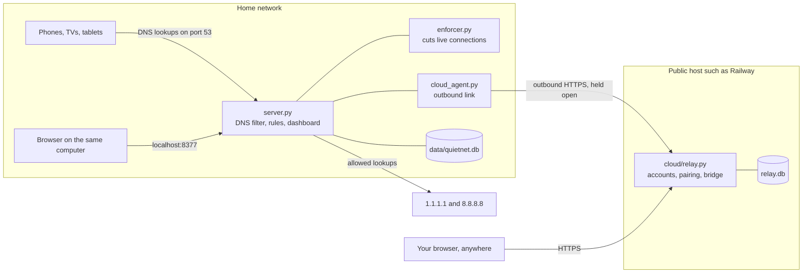
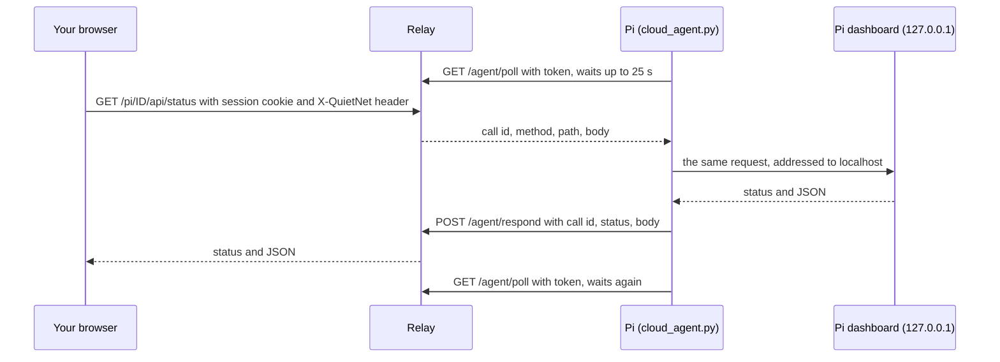

# How QuietNet works

This document explains how QuietNet is built, for someone who wants to change it or check what it does. The [README](../README.md) covers installing and using it.

Related documents: [Guide for agents](../AGENTS.md) · [API reference](API.md) · [Testing](TESTING.md) · [Known issues](KNOWN_ISSUES.md)

## The parts

QuietNet is two programs. One runs in the home, on a Raspberry Pi or a Mac. The other, the relay, is optional and runs on a public host so the home program can be reached from outside.



| File | Lines | Job |
| --- | --- | --- |
| `server.py` | ~1,180 | DNS filter, rules engine, network scan, dashboard web server, start-up |
| `enforcer.py` | ~280 | Steers a chosen device's traffic through the Pi and drops what is blocked |
| `cloud_agent.py` | ~155 | Holds an outbound connection to the relay and runs relayed requests locally |
| `cloud/relay.py` | ~490 | The relay: accounts, pairing codes, and the bridge between browser and Pi |
| `static/index.html` | ~700 | The dashboard: one page, no build step, no outside scripts |
| `services.json` | | The apps and services that can be blocked, and the addresses each uses |
| `junk_domains.txt` | | The built-in advert and tracker list |

Everything uses the Python standard library only. A test enforces this (`tests/test_packaging.py`).

## What happens to one lookup

Every device has a DNS setting: the address of the "phone book" it asks when it needs to find a site. A device pointed at QuietNet sends each lookup to port 53 on the QuietNet computer, over UDP (or TCP for large answers).

`answer_query()` in `server.py` handles each one:

1. **Read the question.** `parse_question()` pulls out the name and the record type. A packet it cannot read is passed to the upstream server untouched.
2. **Decide whether the name is one QuietNet tracks.** Names ending `.local`, `.lan`, `.home`, `.internal` or `.arpa`, and names that are not valid web addresses, are passed on without being checked or recorded. These are home-network names, and they keep working even during the kill switch.
3. **Apply the rules.** `decision()` returns blocked or allowed, and why. See the next section.
4. **Record it.** The time, the device's address, the name and the verdict go onto a queue. A background thread writes the queue to the database once a second.
5. **Answer.**
   - Blocked: the device is told the address is `0.0.0.0` (or `::` for IPv6), to be remembered for 60 seconds. Other record types get an empty answer. The upstream server is never contacted.
   - Allowed: the question goes to 1.1.1.1, falling back to 8.8.8.8. The answer's lifetime is cut to 120 seconds (`MAX_TTL`) so that a later block, bedtime or kill switch takes effect within about two minutes. The addresses in the answer are remembered in memory for the enforcer.
   - No reply from either upstream: the device is told "server failure".

A device is identified by its IP address. If the router hands a device a different address, its name and rules do not follow it. The README advises reserving addresses in the router.

## The order rules are checked in

`decision(domain, client, paused)` checks in this order and stops at the first match:

| # | Check | Result | Reason code |
| --- | --- | --- | --- |
| 1 | Kill switch is on | blocked | `kill` |
| 2 | Internet is switched off for this device or its group | blocked | `off` |
| 3 | An all-internet schedule is in force for this device, its group or the house | blocked | `schedule` |
| 4 | The name, or a parent of it, is on your **blocked** list (skipped while paused) | blocked | `you` |
| 4 | The name, or a parent of it, is on your **allowed** list | allowed | `allowed` |
| 5 | The name belongs to a service blocked for this device, its group or the house | blocked | `service` |
| 5 | The name belongs to a service blocked by a schedule in force | blocked | `schedule` |
| 6 | The name is on the advert list (skipped while paused, or if advert blocking is off) | blocked | `list` |
| 7 | Otherwise | allowed | none |

Points that follow from this order:

- **Step 4 walks from the most specific name upward.** For `a.b.example.com` it checks `a.b.example.com`, then `b.example.com`, then `example.com`. The first block or allow found wins, so an allow on `safe.example.com` beats a block on `example.com`.
- **An allow beats a service block.** If `youtube.com` is on the allowed list, a YouTube service block or homework schedule will not stop it. Only the kill switch, the internet switch and all-internet schedules come before allows.
- **Pause affects only steps 4 (your blocks) and 6 (adverts).** Service blocks, schedules, switched-off devices and the kill switch stay in force. Allows still apply while paused.
- **Unblocking an advert-list name creates an allow.** `unblock()` removes your block; if the advert list would still block the name, it adds the name to the allowed list so the unblock sticks.
- **Blocking a name removes allows beneath it.** `block("example.com")` deletes allows for `example.com` and anything under it.

### Scopes

A rule applies to one of three scopes, written as text:

- `all`: the whole house
- `group:<id>`: a named group of devices
- `device:<ip>`: one device

A device is subject to all three at once: `all`, its own, and its group's (a device is in at most one group). Deleting a group deletes its service blocks, its internet switch and its schedules.

### Schedules

A schedule has a scope, a set of weekdays (0 = Monday), a start and end time, and either "all internet off" or a list of services. Times are the QuietNet computer's local clock.

When the end is earlier than the start, the window runs overnight. The whole window belongs to the day it started: a Sunday 21:00–07:00 schedule covers Sunday evening and Monday morning. The list of schedules in force is worked out at most once every five seconds.

## The enforcer

A DNS block stops a device finding an address. It does nothing to a connection already open, such as a film mid-stream. The enforcer closes that gap for devices you choose, one at a time. It runs on Linux only and needs root or the `NET_RAW` and `NET_ADMIN` container rights.

Every two seconds, and at once whenever a change is saved on the dashboard (`Enforcer.poke()`), it asks `server.enforcement_plan()` what to do, then:

1. **Hands back anyone who has left the plan.** A device switched off, or one whose address now belongs to a different device, is told the router's real hardware address at once (three times). If the router's hardware address isn't known yet, the device stays listed and forwarding stays on, so it keeps its internet, and the next tick tries again.
2. **Checks it is safe to steer.** It turns on the kernel's packet forwarding and turns off "redirect" messages (which would tell a device to go straight to the router), reading each setting from `/proc/sys` and saving the old value. Then it reads forwarding back. If forwarding is still off, as it is in a container that may not change it, steering would cut the device off, so it doesn't steer, and says why on the device page (`status()["problem"]`). It also asks every firewall tool present (`nft`, `iptables`, `iptables-legacy`) whether another firewall would drop passed-on traffic: Docker's "drop" forwarding rule, or a chain that ends by rejecting, as firewalld's does. That counts as unsafe too, until the rules accept traffic coming in and going out on the Pi's own network connection (the advice shown adds exactly that). It fails closed: if a firewall tool that is present can't list its rules, that also counts as unsafe (the one exception: `iptables-legacy` reporting that the old firewall isn't loaded at all, which means it holds no rules). The Pi image includes the `iptables` commands for this reading, since Docker on some Pis keeps its rules where `nft` can't see them. A clean result is remembered for 30 seconds; a failure is asked again next tick.
3. **Drops what is blocked.** It loads a small firewall table (`nft`, or `iptables` if `nft` is missing). Each `nft` load deletes the previous table and defines the new one as a single step, because loading a table that already exists would add to it and leave old rules behind. With `iptables`, every command waits for the firewall lock, the chain and the jump into it are re-checked every tick (if either had to be put back, or the chain no longer holds the rules loaded, they are loaded again), and the rules only count as loaded if every command worked. For a device whose internet is off (the kill switch, its internet switch, or an "all internet" schedule), it drops everything not addressed to the Pi itself. Otherwise it drops only the addresses that QuietNet handed out, in the last six hours, for names blocked for that device by you, by a service block or by a schedule. The advert list is left out, because advert names often share addresses with ordinary sites. Pausing advert blocking pauses your own blocks here too.
4. **Steers the device.** It sends the device an ARP message saying "the router's address is at the Pi's hardware address". The device then sends its outgoing traffic to the Pi. The message is repeated every tick because devices forget it. It only steers a device whose hardware address matches the one recorded when enforcing was switched on (filled in the first time it is seen, if it wasn't known then).

Between ticks, it listens for a steered device asking "who is the router?". It answers at once, again within a third of a second, and again at about 1.0, 1.1 and 1.6 seconds (`ANSWER_AT`). One thread sends all these answers; a device that asks again before its answers have gone out just has its plan restarted, so a flood of questions (which anyone on the network could forge) costs one entry per steered device, not a thread per question. A device believes the most recent answer, but Linux ignores a second answer for about a second after the first, so if the real router answered first, only the later answers stick. Without them the device would go straight to the router for up to two seconds after every question. In a two-container test, a device that had been cut off for a while got nothing through in 60 to 146 seconds of trying. In the first few seconds after the kill switch is turned on, though, up to about three seconds of traffic can still get through (known issue 45).

It never steers the router, the Pi itself, or anything outside the Pi's own network (`target_problem`). When the enforcer is running, the dashboard refuses those addresses when enforcing is switched on; otherwise it can only refuse this computer and addresses that are never devices, and the enforcer skips the rest later. A device-specific problem (a different device on the address) is reported for that device alone (`status()["problems"]`); a problem that stops all steering is in `status()["problem"]`.

Only the outgoing direction passes through the Pi. Replies travel from the router to the device directly.

**Notes on disk.** Which devices are steered and which settings were changed are written to `enforcer_state.json` in the data folder as they happen. At start-up `_recover()` removes any leftover firewall table, adopts the leftovers as its own, and hands those devices back. If the enforcer can't start at all, it still removes the table; if no devices were steered it also restores the settings and removes the notes, but if devices were steered it leaves every setting as it is and keeps the notes, since they can't be handed back without the network. If it can't start only because the network isn't up yet, it keeps looking every 15 seconds.

When the last device is released, the kernel settings are put back. On shutdown, `_teardown()` tells every device the router's real hardware address five times, from the Pi's own hardware address (switches and Wi-Fi ignore frames that claim to come from another machine). It then removes the firewall table and restores the settings. If devices couldn't be handed back, forwarding is left on and the notes kept for the next start. The program waits for this to finish before it exits, both on Ctrl-C and on `docker stop`.

Limits: it works on IPv4 only; it blocks by address, so two services sharing an address are both affected; and it relies on the device using QuietNet for DNS, since that is how QuietNet learns which addresses belong to which name.

## Remote access

A Pi at home cannot usually accept connections from the internet. So the Pi connects outward to the relay and waits, and the relay passes browser requests down that connection.



**Pairing.** On the relay website you create a QuietNet and get a code such as `A1B2-C3D4`, valid for 15 minutes. Opening the page after that issues a fresh one. You enter the code and the relay's address on the Pi's dashboard (or set `QUIETNET_CLOUD` and `QUIETNET_PAIR`). The Pi sends the code to `/agent/pair` and gets back a 48-character token, which it saves in `data/cloud.json`. The code is then cleared and cannot be used again.

**The bridge.** `Bridge` in `relay.py` keeps a queue of waiting calls per Pi. A browser request is queued and its thread waits up to 30 seconds for the answer. The Pi handles up to eight calls at once, each in its own thread, so the several calls a dashboard page makes don't queue behind each other. A Pi can only answer calls that were sent to it. Its answers may be up to 16 MB (a week of a busy device's history is large), but only for a call that is really waiting for that Pi (named in an `X-QuietNet-Call` header), and only two such uploads are read at once; anyone can pair a Pi of their own, so a token alone isn't enough. An answer bigger than 12 MB is replaced on the Pi by a short "too much to send" message, so the browser hears at once. A Pi not heard from for 40 seconds is treated as offline. If the relay ever answers a poll with 401, the Pi discards its token and must be paired again.

**What the relay stores.** Email addresses, password records (PBKDF2-SHA256, 240,000 rounds, a fresh salt each), the list of Pis with their tokens, and one signing secret. History and rules stay on the Pi and pass through only while a page is open.

## Security model

| Threat | Defence | Where |
| --- | --- | --- |
| A web page you visit tries to call the local dashboard | The dashboard listens on `127.0.0.1` only and refuses any request whose `Host` is not `localhost` or `127.0.0.1` | `Web.local_only` |
| Another website shows the dashboard inside itself and tricks someone into clicking | Both servers send `X-Frame-Options: DENY` and `frame-ancestors 'none'` on every answer | `Web.end_headers`, `Relay.end_headers` |
| A web page posts a forged form to the local dashboard | Changes must be sent as exactly `application/json` (a type that merely *mentions* it, such as `text/plain; application/json`, is refused, since browsers send that without asking), which a cross-site page cannot do without permission the server never gives; and if the browser says which page sent the change, it must be on this computer (any port, for SSH tunnels) | `Web.json_from_our_page` |
| A web page makes your signed-in browser call the relay | Relayed API calls need an `X-QuietNet: 1` header that another site cannot add; the cookie is `SameSite=Lax` and `HttpOnly` | `Relay.pi_request`, `set_cookie` |
| Someone else's account reaches your Pi | Every `/pi/<id>/…` request checks the Pi belongs to the signed-in user | `Relay.my_pi` |
| A stolen or edited session cookie | The cookie is `user.expiry.signature`, signed with a secret kept in the relay's database; it lasts 14 days | `make_session`, `read_session` |
| A hostile value reaching the firewall | `/api/enforce` accepts only a real IPv4 address; addresses to drop come from parsed DNS answers | `Web.handle_post`, `answer_ips` |
| Text injected into the dashboard | The page escapes every value it inserts, ids and counts included, with `esc()` or `num()`; the relay escapes Pi names | `static/index.html`, `relay.py` |
| Guessing passwords or pairing codes | Wrong guesses are counted and capped, per account and overall; pairing codes last 15 minutes; an unknown email takes as long to refuse as a wrong password | `Throttle`, `Relay.do_login`, `Relay.agent_pair` |
| A stranger locking the owner out by guessing wrongly on purpose | A browser that has signed in to the account before carries a signed `qn_known` cookie and gets its own looser limit (20 wrong guesses in 15 minutes) instead of the shared ones; it still needs the right password. The cookie can only be had by signing in, is signed over the password record (a new password voids old ones), and is removed at sign-out | `known_device_token`, `Relay.do_login`, `Relay.sign_out` |
| Steering the router, the Pi itself or another network | The enforcer only steers ordinary addresses on the Pi's own network, and the dashboard refuses others | `enforcer.target_problem`, `Web.handle_post` |
| Floods of lookups or slow connections | At most 256 lookups in hand (more are dropped; devices retry); at most 64 TCP connections, each with 8 seconds to send its question; relay connections that stall for 30 seconds are dropped; history capped at two million rows, trimmed 5,000 rows at a time so the trim never holds up DNS answers | `udp_server`, `TCPServer`, `recv_exact`, `Relay.timeout`, `prune_history` |
| A forged DNS answer | The filter accepts an answer only from the server it asked, with the matching id and the same question | `forward_udp`, `same_question` |
| Very large requests | Bodies over 64 KB are refused unread (except a paired Pi's answers to the relay, up to 16 MB) | `MAX_BODY` in both servers, `MAX_ANSWER` |
| Other accounts on the same machine reading history or tokens | The data folders and `cloud.json` are readable by their owner only | `init_db`, `CloudAgent._save` |

Two things to keep in mind:

- **The relay has full control of a paired Pi.** Anything the dashboard can do, a request from the relay can do, including the kill switch and the enforcer. Host the relay yourself and protect that account.
- **Anyone on the home network can use the DNS filter.** It listens on every network address of the computer. It should not be exposed to the internet.

Gaps in these defences are listed in [Known issues](KNOWN_ISSUES.md).

## What is stored

### On the Pi: `data/`

| File | Contents |
| --- | --- |
| `quietnet.db` | SQLite database, described below |
| `community_list.txt` | The downloaded community advert list, one address per line |
| `cloud.json` | Relay address, token and Pi id, once paired |

Tables in `quietnet.db`:

| Table | Holds |
| --- | --- |
| `queries` | Every lookup: time, device address, name, blocked or not. Pruned to 30 days, hourly. Two indexes: by device then time (the device page), and by time (today's totals) |
| `blocked`, `allowed` | Your own address rules |
| `service_blocks` | (scope, service) pairs |
| `internet_off` | Scopes whose internet is off. The scope `all` is the kill switch |
| `schedules` | Timed rules |
| `groups`, `device_group` | Group names and which device is in which |
| `devices` | Names you gave devices |
| `seen` | Devices found by the network scan: address, hardware address, host name |
| `enforced` | Devices with "cut live connections" on |
| `settings` | `junk_on` and `paused_until` |

Rules are also held in memory (the `State` object) and reloaded from the database at start-up by `init_db()`. Every change writes both.

### On the relay: `relay.db`

`users` (email, password record), `pis` (id, owner, name, token, pairing code and when it was issued, last seen), `meta` (the signing secret).

## Background work

`server.py` starts these threads:

| Thread | Does |
| --- | --- |
| Web server | One thread per dashboard request |
| UDP listener | Receives lookups and hands each to a pool of 64 workers |
| TCP server | One thread per TCP lookup |
| Log writer | Saves recorded lookups once a second; prunes old history hourly |
| Name refresher | Every two minutes, asks the network for the host names of known devices |
| Enforcer | Ticks every two seconds (Linux with the right permissions only) |
| Cloud agent | Polls the relay when paired |
| Scan, list download | Started on demand from the dashboard |

## Settings

Command line, `server.py`: `--dns-port` (default 53), `--web-port` (default 8377), `--no-browser`.

| Environment variable | Used by | Meaning |
| --- | --- | --- |
| `QUIETNET_DATA` | `server.py` | Folder for the database and lists. Default: `data/` beside the program |
| `QUIETNET_CLOUD` | `cloud_agent.py` | Relay address, used only if the Pi is not yet paired |
| `QUIETNET_PAIR` | `cloud_agent.py` | Pairing code, used once at first start |
| `PORT` | `relay.py` | Port to listen on. Default 8080 |
| `QUIETNET_RELAY_DATA` | `relay.py` | Folder for `relay.db`. Default: `data/` beside the program |
| `QUIETNET_STATIC` | `relay.py` | Path to the dashboard page, if not in the usual place |
| `QUIETNET_SIGNUP` | `relay.py` | Who may create an account: `open` (default), `first` (only while there are no accounts) or `closed` |

Fixed values worth knowing, all near the top of their files:

| Value | Setting | File |
| --- | --- | --- |
| Upstream DNS servers | `UPSTREAMS` = 1.1.1.1, 8.8.8.8 | `server.py` |
| History kept | `KEEP_DAYS` = 30 | `server.py` |
| Longest answer lifetime | `MAX_TTL` = 120 s | `server.py` |
| Community list source | `COMMUNITY_URL` (StevenBlack hosts) | `server.py` |
| Session length | `SESSION_HOURS` = 14 days | `relay.py` |
| Browser wait for the Pi | `CALL_TIMEOUT` = 30 s | `relay.py` |
| Pi poll wait | `POLL_TIMEOUT` = 25 s | `relay.py` |
| Pi counted offline after | `OFFLINE_AFTER` = 40 s | `relay.py` |
| Pairing code lifetime | `PAIR_CODE_MINUTES` = 15 | `relay.py` |
| Wrong passwords before a wait | `LOGIN_LIMIT_PER_EMAIL` = 5 in 15 minutes | `relay.py` |
| Wrong pairing codes before a wait | `PAIR_LIMIT_OVERALL` = 20 in 10 minutes | `relay.py` |
| Largest request body | `MAX_BODY` = 64 KB | `server.py`, `relay.py` |

## Adding a blockable service

Add an entry to `services.json`:

```json
{"id": "bluesky", "name": "Bluesky", "cat": "Social", "domains": ["bsky.app", "bsky.social"]}
```

`id` is lower-case letters and digits and must be unique. List base addresses only; everything beneath each one is covered. An address may belong to one service only. `tests/test_packaging.py` checks all of this.
