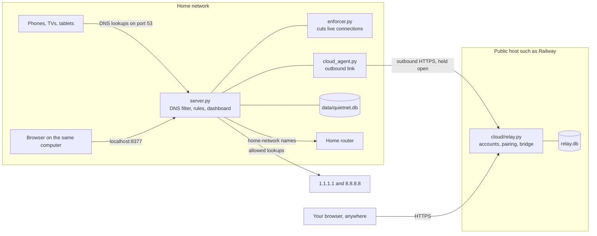
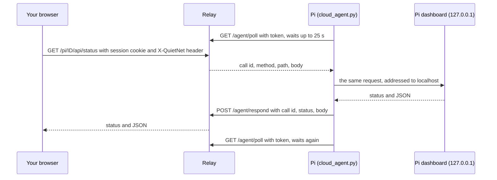

# How QuietNet works

This document explains how QuietNet is built, for someone who wants to change it or check what it does. The [README](../README.md) covers installing and using it.

Related documents: [Guide for agents](../AGENTS.md) · [API reference](API.md) · [Testing](TESTING.md) · [Known issues](KNOWN_ISSUES.md)

## The parts

QuietNet is two programs. One runs in the home, on a Raspberry Pi or a Mac. The other, the relay, is optional and runs on a public host so the home program can be reached from outside.



| File | Lines | Job |
| --- | --- | --- |
| `server.py` | ~5,400 | DNS filter, rules engine, the device tables, network scan, dashboard web server, start-up |
| `names.py` | ~1,080 | Finds names for the devices on the home network (see [Device names](#device-names)) |
| `enforcer.py` | ~980 | Steers a chosen device's traffic through the Pi and drops what is blocked |
| `cloud_agent.py` | ~370 | Holds an outbound connection to the relay and runs relayed requests locally |
| `cloud/relay.py` | ~2,950 | The relay: accounts, pairing codes (and the install command shown with them), and the bridge between browser and Pi |
| `static/index.html` | ~1,780 | The dashboard: one page, no build step, no outside scripts; its three looks are in its one style sheet |
| `services.json` | | The apps and services that can be blocked, and the addresses each uses |
| `junk_domains.txt` | | The built-in advert and tracker list |
| `install.sh` | ~860 | The one-line installer for a Pi: installs Docker if asked, downloads QuietNet, starts and pairs it (see [The installer](#the-installer)) |

Everything uses the Python standard library only. A test enforces this (`tests/test_packaging.py`).

## What happens to one lookup

Every device has a DNS setting: the address of the "phone book" it asks when it needs to find a site. A device pointed at QuietNet sends each lookup to port 53 on the QuietNet computer, over UDP (or TCP for large answers).

On Linux the IPv4 UDP listener asks to be told which of the computer's addresses each lookup was sent to (`IP_PKTINFO`: `ask_for_reply_address()`, `receive_lookup()`), and sends the answer from that same address (`send_answer()`). Without this the system would choose the address, and a lookup the enforcer redirected to the Pi (see the enforcer, step 3) could be answered from a different address of the Pi, which the firewall could not match to the redirect, so the device would throw the answer away. If the system won't send from that address, the answer goes out the usual way. TCP needs nothing: a connection always answers from the address it was made to.

QuietNet listens on every IPv4 address of the computer and, where the computer has IPv6, on every IPv6 address too (`start_dns6()`, IPv6-only sockets on the same port, so the two never clash), for devices the router has told to use an IPv6 address for DNS. If IPv6 can't be opened, it prints why and carries on with IPv4 alone; `S.dns_ipv6` says whether it is listening. Each is tried whatever happened to the other: if the IPv4 port can't be opened (`S.dns_error`), `start_dns()` still calls `start_dns6()`, so one fault does not take both. `start_dns6()` also starts the IPv6 watcher whenever the computer has IPv6 at all, even if the IPv6 port can't be opened, because the "IPv6 is off on your hub" check needs it.

Over IPv4 the router's address sharing keeps the internet away from the filter, but over IPv6 this computer's public address can be reached directly, and only the router's firewall (which some routers ship switched off) would stop strangers. So the IPv6 listeners answer only the home network (`v6_source_allowed()`, used by `udp_server()` on the IPv6 socket and by `TCPServer6.verify_request()`): `::1`, link-local (`fe80::/10`) and unique-local (`fc00::/7`) addresses, IPv4 home addresses written the IPv6 way, and public addresses inside the home network's own ranges. Anything else is dropped without an answer. The ranges come from this computer's own addresses (`own_ipv6()`: `/proc/net/if_inet6` on Linux, `ifconfig` on a Mac; a range narrower than `/64` is widened to `/64`). A background thread, `ipv6_watcher()`, reads them again every minute (`IPV6_RECHECK`), together with the IPv6 neighbour table (`ipv6_neighbour_table()`: `ip -6 neigh` on Linux, which is why the Pi image installs `iproute2`; `ndp -an` on a Mac). If that table can't be read (the tool is missing or reports a fault) nothing can be matched; `S.v6_neighbours_ok` records it and the home page says so, in place of IPv6 lookups being refused with no explanation. The same look also picks the IPv6 address "Set up a device" gives for DNS (`S.v6_dns`): a unique-local address if there is one, else a public one, never a temporary, failing or link-local one.

**Spotting the router's own IPv6 DNS server.** A router with IPv6 on (a BT Smart Hub, as it ships) names its own IPv6 DNS server in its router announcements, and devices use it as well as whatever they were told by hand, so some of their lookups skip QuietNet. `router_advert_listener()`, a background thread started by `main()`, opens a raw ICMPv6 socket (`open_ra_socket()`: Linux only, needs NET_RAW, which the container has; filtered to router announcements where the system allows) and only ever reads from it. If the socket can't be opened (a Mac, or no right to it) it returns quietly. Announcements must come from a link-local address with a hop limit of 255 (the socket asks the system for each one's hop limit; an announcement that passed through a router has less), and at most 20 a second are looked at (`RA_MAX_PER_SECOND`). `read_router_advert()` checks every length before using it and drops a badly formed announcement whole; it reads the router lifetime, the DNS servers, the address ranges and the sender's hardware address (its "source link-layer address", option 1; any size but the 8 bytes of Ethernet and Wi-Fi is passed over, and a group or all-zero address is not kept). `note_router_dns()` keeps each named DNS server until its lifetime runs out, an hour at most (`RA_HOLD_MAX`), and at most 16 (`RA_MAX_SERVERS`). Only an announcement with a router lifetime above 0 counts as the network having IPv6 (`S.ra_heard`), and only its ranges are remembered (`S.router_prefixes`): an Apple TV or HomePod mini acting as a Thread border router announces a unique-local range of its own with lifetime 0, precisely when the router's IPv6 is switched off. While the listener runs, `own_ipv6()` only offers devices a unique-local address inside a range a real router announces, so "Set up a device" never gives one that disappears when the HomePod is unplugged. `ipv6_dns_view()` builds the `ipv6` part of `/api/status`, and the dashboard warns on the home page and "Set up a device" when the router names a server that is not this computer. DNS servers handed out only by DHCPv6 are not seen (known issue 5).

**The hub's own IPv6 address.** For an announcement with a router lifetime above 0, the listener keeps the link-local address it came from and the hardware address it gave (`S.routers_v6`, shown as `ipv6.routers` in the status): each for an hour after it was last heard, 16 at most. Nothing acts on them yet. They are what a sender on the home network claimed about itself, kept for the later work on steering IPv6 (which must check them against the router's IPv4 hardware address before relying on them).

**"IPv6 is off on your hub".** The surest fix for every IPv6 gap is switching IPv6 off on the router, and "Set up a device" walks the owner through it (Allocation Mode off, or ULA on if there is no off switch) and what to do afterwards. `ipv6_dns_view()` confirms it worked (`hub_off`) only on evidence, so that not knowing never looks like being protected. All of these must hold: the announcement listener is running and has run for a full hour without a break (`S.ra_since`; `RA_HOLD_MAX`); this computer could hear the router for that whole hour (below); no real router was heard in that hour (`S.ra_heard_at`); this computer holds no public IPv6 range; that last point was looked at within the last three minutes (`S.v6_checked`, `V6_VIEW_FRESH`), not assumed because the watcher isn't running; and nothing on the home network is naming an IPv6 DNS server other than this computer (`router_dns_not_ours` is empty). A listener that never started, one that stopped, or a restart all leave it off.

*Could this computer hear the router?* An open socket is not proof. When IPv6 is switched off on the Pi's own network card (a system setting, `disable_ipv6`, that some guides for DNS filters recommend, and that NetworkManager's "IPv6: disabled" sets), Linux takes the card's IPv6 addresses away and throws away every IPv6 message arriving on it before any program sees it; the listener's socket still opens and then hears nothing for ever. So each look by the IPv6 watcher asks `can_hear_router()`, which finds the card the default route uses (`enforcer.interface_and_gateway()`) and has `ipv6_on_card()` read `/proc/net/if_inet6` for a link-local address (`fe80::`) on that very card that has passed its check. One on a Docker card or the loopback does not count. The answer is kept in `S.v6_can_hear` (true, false, or not known), and the moment a look first found it true in `S.v6_hear_since`; the hour is counted from the later of that and `S.ra_since`, and starts again whenever the address is lost or the answer isn't known. The status carries it as `can_hear`, and the page then says "QuietNet can't tell whether IPv6 is on in your home" with the reason. Devices are not marked "Can bypass over IPv6" in that state, because QuietNet can't know; the page says that too.

*A DNS server named without IPv6 internet.* A home router with no IPv6 route to the internet but a private (unique-local) range of its own still sends announcements, with a router lifetime of 0, and can name itself as IPv6 DNS server in them. That does not count as the network having IPv6 (`in_use` stays false, as for an Apple TV's Thread range), but devices use the server, so their lookups skip QuietNet. While any such server is named, `hub_off` stays false, `api_devices()` keeps the "Can bypass over IPv6" label on every device (`v6_bypass`), and "Set up a device" says something in the home still names an IPv6 DNS server that is not QuietNet. A named server is forgotten when its lifetime runs out, an hour at most, so this ends by itself once nothing names it. Whether a BT Smart Hub does this with Allocation Mode off and "ULA Enabled" on is not known (known issue 96). The hour is measured with `time.monotonic()`, not the clock: a Pi has no clock of its own and jumps forward when it learns the time after starting, which must not count as an hour. Until then the page says how long is left, or, where the listener can't run (a Mac, or no NET_RAW), that it cannot tell.

`answer_query()` in `server.py` handles each one:

1. **Read the question.** `parse_question()` pulls out the name and the record type. A packet it cannot read is never passed on: it gets a "format error" answer with the same id (`unreadable_reply()`), or no answer at all if it is too short to have a header or is itself an answer (answering answers could set two servers bouncing packets back and forth).
2. **Work out who asked.** `device_address()` files an IPv4 device reaching the IPv6 listener (`::ffff:192.168.1.23`) under its plain IPv4 address and drops any zone suffix (`%eth0`). Lookups from QuietNet's own computer (`127.0.0.1`, `::1`, or any of its own IPv6 addresses) are filed under its network address. A device asking from a real IPv6 address is matched to its IPv4 address by hardware address (`refresh_ipv6_view()`: each IPv6 neighbour is looked up among the IPv4 devices from the last scan and the current neighbour table) and filed under that, so all its own rules apply. If it can't be matched and any device is treated differently from the whole house (`device_rules_exist()`: an internet switch, a blocked service or an enabled schedule for a device or group, "Cut live connections" on for a device, or a device in a group, even a group with no rules), the answer is "refused". A refused device tries its next DNS server: QuietNet's IPv4 address, where its rules are known, or the router's own IPv6 server, which is a way round QuietNet but not an outage (known issue 5). With nothing of the kind set it is answered and filed under its IPv6 address, as a separate device (known issue 5). See [Matching IPv6 addresses to devices](#matching-ipv6-addresses-to-devices) below for freshness, the quick look for a new address, and why an address built from a hardware address proves nothing.
3. **Answer the "use the network's DNS" signals.** `use-application-dns.net` (`NO_SUCH_NAME_SIGNALS`) gets "no such name", which makes Firefox switch off its own secure DNS. `mask.icloud.com` and `mask-h2.icloud.com` (`BLOCKED_SIGNALS`) get the blocked answer, which makes Apple devices switch off iCloud Private Relay for the network. These answers are the same for every device, paused or not, whatever the rules say, and are recorded as blocked so the owner can see which devices tried to bypass QuietNet. Other `icloud.com` names are unaffected.

   **Then other DNS services.** A name in `OTHER_DNS_SERVICES` (`dns.google`, `cloudflare-dns.com`, `dns.quad9.net`, `dns.nextdns.io` and others: the encrypted DNS services a browser's "secure DNS" or Android's "Private DNS" can be set to use), or any name beneath one (`is_other_dns_service()`, ignoring capitals and a final dot), gets the blocked answer, paused or not, whatever the rules say, for every device the owner controls (`other_dns_blocked_for()`: "cut live connections" on, in a group, or an internet switch, blocked service or schedule of its own), so the device can't reach the service and falls back to ordinary DNS. Other devices get a real answer, through the usual steps, unless the owner has switched on "Stop every device using another DNS service" (`S.other_dns_all`, setting `other_dns_all`): a device set to use one of these services strictly (Android's Private DNS set to a name, an encrypted DNS profile on an iPhone or Mac) does not fall back, and would lose every name. It is recorded as blocked, and the time is kept against the device in memory (`S.other_dns`, at most `MAX_OTHER_DNS_DEVICES` devices) so the device list can flag it without reading the history. The activity list shows these names with `why` = `other_dns`, and the device page says the device tried to use another DNS service. This is not part of `decision()`, so the table below is unchanged. To add a service, add its name to `OTHER_DNS_SERVICES`.
4. **Decide whether the name is one QuietNet tracks.** Names ending `.local`, `.lan`, `.home`, `.internal` or `.arpa`, and names that are not valid web addresses (single words with no dot among them), are not checked against the rules or recorded. What happens to them:
   - If this device's internet is off right now (the kill switch, its own or its group's switch, or an all-internet schedule: `internet_cut()`), they get the blocked answer, so they can't be used to get data out. This includes home-network names such as `printer.local`, which stop working on that device too.
   - Otherwise, home-network names (`.local`, `.lan`, `.home`, `.internal`, `.home.arpa`, and single words with no dot such as `nas`, except when asked with one of the record types used to check DNS signatures, `SIGNATURE_TYPES`, which go to the internet, since a device checking signatures asks those about top-level names such as `com`) and reverse lookups of home or private addresses (10.x, 172.16–31.x, 192.168.x, 169.254.x, 127.x, and the IPv6 equivalents) go to the home router, never to the public servers (`is_home_name()`, `ask_router()`). The router's address is read from the routing table (Linux only) and looked up again every five minutes (`ROUTER_RECHECK`). If it isn't known (as on a Mac), or the router itself asked, the answer is "no such name"; if the router doesn't answer, "server failure". If the same question (name and type) arrives while QuietNet is still waiting on the router for it (`router_waiting`), the answer is "server failure" rather than a second ask, so a router that sends its lookups back to QuietNet by another route can't make the two ask each other for ever. Router answers are not remembered.
   - Anything else (reverse lookups of public addresses, names with odd characters) goes to the public servers as usual, and is not remembered either.
5. **Apply the rules.** `decision()` returns blocked or allowed, and why. See the next section.
6. **Record it.** The time, the device's address, the name and the verdict go onto a queue (`note_lookup()`), with the number of the device the lookup belongs to if the map of addresses to devices knows it (`S.addr_device`: one or two dictionary lookups, no database) and the address it really came from. A background thread writes the queue to the database once a second, each row against its device. See [One device, many addresses](#one-device-many-addresses).
7. **Answer.**
   - Blocked: the device is told the address is `0.0.0.0` (or `::` for IPv6), to be remembered for 60 seconds. Other record types get an empty answer. The upstream server is never contacted.
   - Allowed, but the device has "Cut live connections" on (`S.enforced`, and its rules are not paused) and the question can hand it IPv6 addresses (AAAA, or HTTPS and SVCB, which may carry IPv6 hints: `NO_IPV6_TYPES`): it gets "no error, no records", made fresh each time. The enforcer only steers and cuts IPv4, so with no IPv6 addresses the device's apps connect over IPv4, through the Pi, where they can be cut. This answer is never remembered, and comes before the remembered answers are looked at, so it can't reach other devices and their IPv6 answers can't reach this one. Other devices are answered as normal, unless the owner has turned on the optional "Give no device IPv6 addresses" switch, which does the same for every device (see below).
   - Allowed, and a remembered answer is at hand (see below): it is sent at once, with the asker's own id and question (keeping the letter case it asked with) and every lifetime reduced by the seconds it has spent in memory. Its addresses still count towards the enforcer's list.
   - Allowed, otherwise: the question goes to 1.1.1.1, falling back to 8.8.8.8. The answer's lifetime is cut to 120 seconds (`MAX_TTL`) so that a later block, bedtime or kill switch takes effect within about two minutes. The addresses in the answer are remembered in memory for the enforcer, and the answer itself is remembered for next time.
   - No reply from either upstream: the device is told "server failure".

**Remembered answers.** `answer_cache` holds answers from the internet for the shortest lifetime of any record in them (already cut to 120 seconds), filed under the name (lower case), the record type, the class, and what the question asked of the answer: whether it carried a settings record, whether that asked for signature records (the "DO" flag), and whether it asked the server not to check signatures (the "CD" flag; `cache_key()`, `question_settings()`). The internet's answer depends on all three, so an answer fetched for one kind of question is never handed to another; in particular an unchecked answer fetched for a device that turned checking off never reaches a device that relies on the checks. Up to 5,000 are kept (`MAX_CACHED_ANSWERS`; the oldest is dropped first). It is only looked at after `decision()` has allowed the name for the device asking, so it only ever replaces the trip to the internet: a block, a bedtime or the kill switch bites on the very next lookup. Every rule change (`rules_changed()`) clears it as well. Only good answers ("found" or "no such name") are kept, never failures, empty replies, answers marked as cut short, answers with no lifetime, or answers over 4,096 bytes (`MAX_CACHED_SIZE`; a TCP answer can be 64 KB, and this keeps the memory used small). Over UDP, a remembered answer bigger than the asking device said it can take (512 bytes, or the size in its settings record) is not given; the question goes to the internet as before, which tells the device to ask over TCP. Over TCP any size is given. It has its own small lock, `answer_cache_lock`.

Lookups over UDP are handled by a pool of 64 threads. At most 256 are in hand at once on each listener (`MAX_DNS_WAITING`), and at most 16 from any one device (`MAX_DNS_PER_DEVICE`), so one busy or broken device can't stop everyone else's; beyond that, new lookups are dropped and devices ask again. Lookups over TCP share 64 connections on each listener (`MAX_TCP_CLIENTS`), at most 8 from any one device (`MAX_TCP_PER_DEVICE`); more are closed at once. A device's share is counted per device, not per address, and once across the IPv4 and IPv6 listeners: both UDP listeners use one `Shares` counter (`UDP_SHARES`) and both TCP listeners another (`TCP_SHARES`), and `share_key()` files an IPv4 device asking over IPv6 under its IPv4 address, every address of this computer under one, and an IPv6 address matched to a device (`S.v6_devices`) under that device's IPv4 address. So a phone with four IPv6 addresses has one share, not five. An IPv6 address that can't be matched counts by itself. So does one behind a range extender: an extender shows several devices under its own hardware address, so all their IPv6 addresses match one IPv4 address, and counting them together would let one busy device use up the share of every device behind that extender. `refresh_ipv6_view()` notes those addresses (`S.v6_shared`: IPv6 neighbours whose hardware address is in `S.shared_macs`) and `share_key()` counts each by itself. Which rules such an address gets is unchanged (known issue 96). The share is handed back to the device it was taken from, even if the match changed while the lookup was in hand. It is a few set and dictionary lookups, with no database.

A device's name and rules are kept under its IP address, and follow the device by its hardware address when that address changes: see [When a device changes address](#when-a-device-changes-address). Its history is filed against the device itself, whatever address it has: see [One device, many addresses](#one-device-many-addresses).

### Matching IPv6 addresses to devices

`refresh_ipv6_view()` joins the IPv6 neighbour table to the IPv4 devices by hardware address, giving `S.v6_devices` (IPv6 address to IPv4 address). Three things keep it right:

- **A stale entry never beats a reachable one.** Linux keeps a neighbour entry long after a device has moved on, so a TV that moved from `.65` to `.67` is listed at both. `ipv4_by_hardware_address()` picks, for each hardware address, the entry confirmed just now, then one of unknown freshness, then a stale one; never simply the last line printed. Between two equally fresh it takes the address the device's rules are kept under (`S.dev_mac`), then the lower address, so the answer is the same every time. Any live entry beats the last scan. Both neighbour readers (`neighbour_table()`, `ipv6_neighbour_table()`) keep the fresher entry when one address is listed twice (`keep_fresher()`). For IPv6, reachable, stale, delay and probe entries are all kept (a private IPv6 address is not handed on to another device, so a stale entry is still right about whose it is); failed and unfinished entries are dropped.
- **A new address is looked for at once.** A phone makes itself a new IPv6 address about daily, and the watcher looks only every minute. A lookup from an unmatched IPv6 address asks the watcher to look now (`ask_for_ipv6_look()` sets a flag; nothing is run on the lookup's thread, and never inside `decision()`). When a look is under way or can start at once, the lookup waits for it, 0.4 seconds at most (`V6_ANSWER_WAIT`), and is then looked up again (`matched_ipv6_device()`). It does not wait when the watcher finished a look less than 2 seconds ago (`V6_QUICK_GAP`, the least time between looks), or when 8 lookups are waiting already (`V6_MAX_WAITING`), so made-up addresses can't tie up the answering threads. One address may set off 3 looks a minute (`V6_ASKS_PER_ADDRESS`), so a device that can never be matched doesn't keep the watcher busy. The unmatched gap for a new address shrinks from up to a minute to a few seconds.
- **An address built from a hardware address is a hint only.** Some devices build the second half of an IPv6 address from their hardware address (`eui64_mac()` reads it back, flipped bit included). Any device can put another's hardware address there, and a random address can look that way by chance, so it never decides whose rules a lookup gets: only the neighbour table does. The hint is shown to the owner on a card filed under an unmatched IPv6 address ("Probably the same device as ...", `same_as` in `/api/devices`), and only when a scan or the neighbour table has seen that hardware address.

### The optional "Give no device IPv6 addresses" switch

Off unless the owner turns it on (`S.no_ipv6_all`, saved as the `no_ipv6_all` setting; `POST /api/no-ipv6-switch`). On, every device gets "no error, no records" for the lookups in `NO_IPV6_TYPES`, as a device with "Cut live connections" already does (step 7 above), so apps connect over IPv4. It is never applied to a name only the home network can answer (`is_home_name()`: those never reach that step) or to QuietNet's own machine (`no_ipv6_for_everyone()`). It only affects lookups that reach QuietNet, and a service that works over IPv6 alone would stop working, which is why it is off by default. Switching it off takes effect on the next lookup.

## The order rules are checked in

`decision(domain, client, paused)` checks in this order and stops at the first match:

| # | Check | Result | Reason code |
| --- | --- | --- | --- |
| 1 | Kill switch is on | blocked | `kill` |
| 2 | Internet is switched off for this device or its group | blocked | `off` |
| 3 | An all-internet schedule is in force for this device, its group or the house | blocked | `schedule` |
| 4 | The name, or a parent of it, is on your **blocked** list (skipped while paused) | blocked | `you` |
| 4 | The name, or a parent of it, is on your **allowed** list | allowed | `allowed` |
| 5 | The name belongs to a service blocked for this device, its group or the house | blocked | `service` |
| 5 | The name belongs to a service blocked by a schedule in force | blocked | `schedule` |
| 6 | The name is on the advert list (skipped while paused, or if advert blocking is off) | blocked | `list` |
| 7 | Otherwise | allowed | none |

Checks 1 to 3 never apply to QuietNet's own computer (`is_this_computer()`: `127.0.0.1`, `::1` and its network address). Its lookups are its link to the relay, its clock and its list downloads; cutting them would mean a Pi under the kill switch could not be switched back on from outside. Checks 4 to 7 apply to it as to any device. The dashboard agrees: its device list never shows this computer as switched off (`internet_off_for()`), and `POST /api/internet` refuses to switch this computer's internet off, since it would have no effect. Checks 1 to 3 live in one place, `internet_cut()`, which `decision()` calls first.

Three answers sit outside this table, in `answer_query()`, and did not change it: the "use the network's DNS" signals (for every device) and the other DNS services (for devices the owner controls, or every device if chosen) are answered before `decision()` is asked (step 3 of "What happens to one lookup"), whatever the rules say; and a device with "Cut live connections" on (or every device, with the optional "Give no device IPv6 addresses" switch on) gets "no records" for IPv6 address lookups after `decision()` has allowed the name (step 7). Which rules `decision()` sees for a device also depends on whether they are paused because a different device now has its address (see "Scopes" below).

Points that follow from this order:

- **Step 4 walks from the most specific name upward.** For `a.b.example.com` it checks `a.b.example.com`, then `b.example.com`, then `example.com`. The first block or allow found wins, so an allow on `safe.example.com` beats a block on `example.com`.
- **An allow beats a service block.** If `youtube.com` is on the allowed list, a YouTube service block or homework schedule will not stop it. Only the kill switch, the internet switch and all-internet schedules come before allows.
- **Pause affects only steps 4 (your blocks) and 6 (adverts).** Service blocks, schedules, switched-off devices and the kill switch stay in force. Allows still apply while paused.
- **Unblocking an advert-list name creates an allow.** `unblock()` removes your block; if the advert list would still block the name, it adds the name to the allowed list so the unblock sticks.
- **Blocking a name removes allows beneath it.** `block("example.com")` deletes allows for `example.com` and anything under it.

### Names a device's own system needs

Some names look like junk and are not. A Samsung TV's app system lives under `samsungcloudsolution.net`; one of its sub-names has "log" in it, which the "possibly junk" word list (`SUSPECT`) matches, so the whole group used to read "Possibly junk" with a Block button beside it. Blocking the group stops the TV's apps opening.

`NEEDED` in `server.py` is a short table of such names: whole owner names, as the activity list groups them (`base_of()`), that a common household device (Samsung and LG TVs, Apple, Android and Google devices, Amazon Fire TV and Echo, Roku, Windows, PlayStation, Xbox, Nintendo Switch) needs for its own sign-in, app shop, "am I online?" check, clock or updates. Each maps to who needs it, as a short phrase. `needed_by(name)` returns the phrase, or `''`; only the whole name counts, never a sub-name.

The table is outside the order above and does not touch it. `decision()` never reads it: a needed name that is blocked is blocked like any other, and one that is not is decided like any other. It does three things:

1. **The label.** `/api/activity` and `/api/rules` carry the phrase as `needed`. The dashboard shows "Needed by Samsung TVs" where it would have shown "Possibly junk"; a name the advert list really blocks keeps "Advert / tracker"; sub-names keep their own labels when the group is opened. A group is called "Advert / tracker" when every name seen in it is on the advert list; a needed group is the exception (`activity_groups()`): it is called that only when its own whole name is on the list, so an idle Roku that looked up nothing but `logs.roku.com` does not make `roku.com` read as an advert.
2. **A question before a new block.** `POST /api/block` refuses a needed name with `409` unless the request carries `"sure": true` (`Web.handle_post`). The dashboard asks ("Samsung TVs need this address for their own system to work. Blocking it may stop them opening apps, signing in or updating. Block it anyway?") and sends the call again with `sure`. Because the check is the server's, it holds for the Block button on a device page, a name typed on the Blocked list page, and the same page served through the relay, which passes the `409` and its body back unchanged. Blocking one sub-name beneath a needed name does not ask. The question is the one place where Cancel, not the yes button, holds the keyboard, and Enter presses only the button it is on (`careful` in the page's `ask()`): a name is typed and sent with Enter, and a second Enter by habit must not be a yes. A held-down Enter answers no question at all. **The relay serves its own copy of `static/index.html`**, built into its image, so it must be redeployed with this change before the labels and the question appear away from home. A Pi that has the change behind a relay that has not shows the old page, which cannot ask: a whole needed name is then refused remotely, with a sentence (`needed_refusal()`) saying to block it from QuietNet's own page at home. A new relay page with an older Pi shows no labels, asks nothing and blocks as before.
3. **A note beside a block that exists.** On the Blocked list page and on a "Blocked by you" row of a device page, a needed name says who needs it and to unblock it if apps have stopped opening.

Keep the table short and sure (a test holds it between 20 and 40 names). A wrong entry costs only a needless question, but a long or sloppy list teaches people to ignore the question. An entry must be a whole owner name, needed by the device's own system and not by one app, and not mainly an advert or tracking name.

### Scopes

A rule applies to one of three scopes, written as text:

- `all`: the whole house
- `group:<id>`: a named group of devices
- `device:<ip>`: one device

A device is subject to all three at once: `all`, its own, and its group's (a device is in at most one group). Deleting a group deletes its service blocks, its internet switch and its schedules, and sets "New devices go into group" back to none if it named that group. Two exceptions, both set by `refresh_devices()` (below) and both read from memory by `scopes_for()`: an address whose rules are paused because a different device now has it (`S.paused_ips`) is subject to `all` only, plus the new-device group if the device there now was never seen before (`S.guest_group`), until the device the rules belong to comes back; and a device whose own rules could not be moved to its new address (`S.follow`) gets the scopes of the address they are kept under in place of its own.

### When a device changes address

Rules, names and groups are kept under a device's IPv4 address, but a phone or tablet can be given a different one: when it makes up a new private Wi-Fi address, or simply when the router hands out a different number. Its old address may then go to another device. So once a minute `refresh_devices()` (run by the address watcher, never on a lookup) reads the neighbour table and keeps each address's rules pointed at the right device:

- **Reading the neighbour table.** On Linux `neighbour_table()` runs `ip -4 neigh`, which says how fresh each entry is (falling back to `/proc/net/arp`, which doesn't); on a Mac, `arp -an`. Linux keeps old entries on a small network for a long time, so a device that has moved can still be listed at its old address. So when one hardware address is listed at several addresses and exactly one was confirmed just now (reachable, or being checked), only that one counts (`read_table()`).
- **Range extenders.** A Wi-Fi range extender that is not a mesh system often shows every device behind it with its own hardware address. A hardware address found at two or more addresses, each confirmed just now, on three looks (`SHARED_AFTER`) each within an hour of the last, is taken for one (`shared_macs`, `S.shared_macs`); once is not enough, since a phone that has just moved can show at both for a moment. Rules that belong to an extender's hardware address stay with their address and never move or pause, and rules at an address an extender now answers for keep applying. Both pages say why.
- **Which device owns the rules.** For every address that carries anything of its own (a name, a group, an internet switch, a blocked service, a schedule, "cut live connections"), the hardware address seen there is recorded in `device_mac` (and `S.dev_mac`). When "cut live connections" is on and its hardware address is already known, that one is used.
- **The device turns up at a new address.** If the new address carries no rules of its own (a name or group at most, of a device not on the network now, such as a visitor given the new-device group who has left), everything moves there (`move_rules()`): the name, the group, the device's own service blocks, internet switch and schedules, "cut live connections" with the hardware address to steer, and the note of which device it is. A name or group already at the new address is replaced, or removed if the moving device has none, and the note says so. The history stays filed under the address each lookup came from. A note is kept ("Wilf's iPad moved from 192.168.1.54 to 192.168.1.71; its rules moved with it") and shown on the home page. If the new address has rules of its own (or its device is still on the network), nothing is merged and both devices show a warning; while that lasts, the device's own rules apply to it at its new address (`S.follow`, worked out afresh every minute), "cut live connections" steers it there by its own hardware address (`live_cut_devices()`), and its old address is paused if a different device has it. So two devices that swap addresses each keep their own rules.
- **A different device takes the address.** If it has a private Wi-Fi address and first appeared since the rules' device was last seen, it may be that device with a new private address, given the same number back. The rules keep applying, and the home page and its page ask "Is it the same device?" (a `same` notice): "Yes" (`POST /api/move-rules` with the address twice) makes the rules belong to its hardware address; "No" (`POST /api/different-device`) pauses them. Otherwise the address's own rules, and its group's, are paused (`S.paused_ips`, kept in `device_mac.paused`): they stay stored for the device they belong to, `scopes_for()` gives a paused address the whole house's rules only (plus the new-device group for a device never seen before, kept in `device_mac.guest_mac` and `guest_gid` and dropped when it leaves), and the enforcer does not steer it. The device page says "This number now belongs to a different device; the rules for Wilf's iPad are paused until it comes back", with an "It's the same device" button. When the device comes back, at the same address or another free one, the rules apply again (or move with it).
- **New devices.** Every hardware address seen is recorded in `known_macs`. If the owner has chosen a group under "New devices go into group" (Groups page; setting `new_device_group`), a hardware address never seen before, at an address with nothing of its own (or only that same group, given to a device not on the network now), is put in that group and a note is kept. That keeps a child's phone covered when it switches to a new private Wi-Fi address. The first look after this was added only records what is there, and the devices already found by scans count as known. Only the hardware addresses on the network now are looked up each minute; addresses unseen for 30 days (`KNOWN_MACS_DAYS`) are forgotten, and at most 5,000 (`MAX_KNOWN_MACS`) are kept, the longest unseen going first, never one that rules belong to (`forget_old_macs()`).
- **"It may be the same device."** When a device with rules has not been seen for 15 minutes (`QUIET_AFTER`) and a device with a private Wi-Fi address, with nothing of its own but perhaps that group, appeared for the first time since about then (within three days), the home page and the new device's page say so, with a "Move the rules to this device" button (`POST /api/move-rules`).

Hardware addresses are written in lower case; malformed ones, all-zero ones (unfinished entries in the neighbour table) and group (broadcast and multicast) ones are ignored. This computer and the router are never moved, nothing is moved onto them, and a hardware address seen at either is ignored everywhere. `decision()` still reads only memory.

### One device, many addresses

**One device is one hardware address**, where one is known and it isn't shared. A network address is something a device uses for a while: a TV can move from `.65` to `.67`, a phone holds several IPv6 addresses and makes a new one about daily, and an address a device gave up can be handed to another. The history is filed against the device, so a device keeps its history across every address it has had, and an address that changes hands does not hand the history over with it. (Names, groups and rules are still kept under IPv4 addresses and moved as described above; only the history is filed against the device so far.)

**The tables.** `device` has one row per device, with a number that is never used twice and a `kind`: `hw` (known by its hardware address), `addr` (known only by a network address), `pi` (this computer) or `hub` (the home router). `device_hw` says which hardware address belongs to which device. `address_use` is a dated record of which device used which address: when an address turns up with another device a new row opens and the old one is no longer added to. It is for the history and for showing the owner, never for deciding whose rules apply. Each row of `queries` carries the number of the device it belonged to **when it was made**.

**Which device has which address now** is held in memory as `S.addr_device`, kept by looking at the neighbour tables, never on a lookup: `note_ipv4_addresses()` every 5 seconds (`ADDRESS_LOOK`, by the device keeper, and each minute by `refresh_devices()` with the table it already read) and `note_ipv6_addresses()` after each look at the IPv6 neighbours. Each builds a new dictionary and swaps it in whole. The safeguards that keep one device's lookups from being filed as another's:

- **Only an address confirmed just now is in the map.** Linux keeps a neighbour entry for a device that left for a long time, and that address may since have gone to another device. So an IPv4 address whose entry is stale is left out (its record in `address_use` simply stops being added to). A lookup from it is saved without a device and filed once a later look has confirmed who was there (the clean-up pass, below). On a system that gives no freshness (a Mac), every entry counts.
- **An address that turns up with a different hardware address belongs to that device from then on.** A new `address_use` row opens; the old device's history stays its own.
- **One hardware address at two confirmed addresses at once** may be a Wi-Fi range extender standing in for several devices, or a device that has just moved. The address the device already had stays its own; the other gets no device until the first is no longer confirmed. While that lasts the hardware address is unsettled (`S.hw_unsettled`) and its IPv6 addresses are not matched either. If neither address was its own before, neither is given to it. Lookups from the waiting address are filed under that address itself, never joined to the first device.
- **A hardware address known to be a range extender's** (`S.shared_macs`) gives each of its addresses a device of its own, of kind `addr`: "recognised by its number". Its IPv6 addresses are not matched.
- **A new hardware address is a new device.** A phone that makes itself a new private Wi-Fi address shows as a new device. Nothing is ever merged automatically.
- **An IPv6 address belongs to the device whose hardware address the IPv6 neighbour table gives it**, so a phone's many addresses come to one device. A stale IPv6 entry still counts, since a device's own IPv6 address is not handed on. An address built from a hardware address proves nothing and is not looked at.
- **This computer and the home router are fixed devices.** `127.0.0.1`, `::1`, this computer's network address and its own IPv6 addresses always belong to `pi`. The router's IPv4 address, and any address with the hardware address seen at the router's IPv4 address, belong to `hub`; that hardware address is never an ordinary device.

**How a lookup gets its device.** When it is made, from the map (`device_of_lookup()`): the address it came from decides, and failing that the address it was judged under. If the map can't say, the history writer asks it once more as it saves the row, a second or so later (`history_row()`). A row still without a device is saved without one.

**The clean-up pass** (`tidy_history()`, each minute) files those rows, 500 at a time, letting go of `db_lock` between steps. A row goes to the device whose `address_use` record covers the moment it was made: confirmed at the address before and again after. A lookup made up to 90 seconds (`ADDRESS_GRACE`) before a device was first confirmed at an address is that device's too, since a device must join and ask for something before it can be seen. A row nobody can be matched to after 3 minutes (`ADDRESS_WAIT`) is filed under its address (an `addr` device), which keeps it apart from every device that has had that address. Until a row is filed, the dashboard counts it towards the device that has its address now.

**Forgetting.** Each hour `forget_old_devices()` forgets address records and devices not seen for 30 days (as long as history is kept, so a forgotten device has no history left), and beyond 20,000 address records and 5,000 devices the longest unseen. No new device is made once 10,000 are remembered. The two fixed devices stay. A forgotten device that comes back gets a new number.

**Moving an older household over.** A database from before the device tables is not touched by `init_db()`, which runs before the filter is answering: building the new index on two million rows takes a while, and a slow or failing start would leave the house without DNS. `main()` starts the device keeper only after the filter and the enforcer are running, and it calls `move_to_devices()`.

The move first waits, up to two minutes (`MOVE_ADDRESS_WAIT`), until this computer knows its own address on the home network. A Pi can start QuietNet before its Wi-Fi is connected (after a power cut, say), and step 3 decides once and for all which old history is this computer's and which the router's: done with no address, both would be filed under ordinary devices that are not shown. The keeper comes round every 5 seconds, so the move starts within moments of the address being found, and just before it the router is looked for afresh, so that "no router", found while the network was down and otherwise trusted for five minutes, is not what the move goes by. After the two minutes the move goes ahead regardless: a computer with no network must still get its device tables. Nothing else waits for this: until the move is done QuietNet runs on the old tables, as it does after a failed move. Then:

1. **Room.** If the data folder has less free space than twice the size of the database (`space_for_move()`), nothing is touched, the home page says so, and it is tried again every hour.
2. **A copy.** The whole database is copied to `quietnet.db.before-devices` in the data folder (`copy_database()`: the database's own copying tool, on a connection of its own, in one step, so nothing waits for it; written under another name and forced to disk before it takes its real name). The copy holds the household's whole history from before the move, so it is not kept for good: `forget_old_copy()` deletes it once it is 30 days old (`KEEP_DAYS`, counted from the move; the device keeper looks each hour), and at once when everyone's history is forgotten (`clear_history()`). Forgetting one device's history leaves the copy alone, so that device's older lookups stay in it until then. A copy left by a move that failed, or a part-written one, is deleted when the file is 30 days old.
3. **One transaction** for everything else (`build_devices()`): the new tables, the history's new column and index, a `hw` device for every hardware address in `known_macs`, `device_mac` and `seen` (not range extenders', not the router's), and for each address in the old history, which device it is given to. That is the device its rules were recorded for (`device_mac`; certain), unless they are paused because another device has the address now; then the hardware address most recently seen there (`known_macs`), then the one the last scan found there (`seen`); both of those are a best guess and are marked so in `moved_address`. An address with no hardware address to go by, IPv6 addresses in the old history among them, becomes an `addr` device (5,000 of them at most: a history with more was filled by something making addresses up, and the rest are filed against no device). The version of the tables and the time of the move are saved in `settings`.
4. **Any error rolls the whole transaction back.** The database is then exactly as it was, QuietNet carries on with the old tables (`S.devices_ready` stays false: rows are saved as before, the device list is by address), and the home page says so. It is tried again at the next start.
5. **Old history gets its device afterwards** (`fill_old_history()`): 2,000 rows at a time, newest first, with a pause and the lock let go between steps; it carries on after a restart. It does not call itself finished until 10 seconds after the move (`FILL_SETTLE`): the history writer holds each lookup for a second before saving it, so lookups made in the last moments before the move, or while it held the database, are saved just after it with a time from before it and no device, and only the fill handles such rows. On a small history, done in a blink, it therefore looks again each second until the writer has caught up. The old tables do not say when an address changed hands, so every old row goes to the device its address was given to; a few rows from before a change will sit with the wrong device until they are 30 days old. Until a row is done the dashboard shows it under the device that has its address now.

`db_lock` is held for the transaction in step 3, so the dashboard and the history writer wait while the index is built. Lookups are still answered and still blocked: they never take that lock. Nor does the look that matches a new IPv6 address to its device (`refresh_ipv6_view()` reads the last scan on the read-only connection), so a lookup from an IPv6 address not matched yet is still matched, and judged under its device's rules, while the move runs. Rules, names and groups are not touched by the move.

**Going back to an older QuietNet** after the move: stop QuietNet, put `quietnet.db.before-devices` in place of `quietnet.db` (and delete `quietnet.db-wal` and `quietnet.db-shm` if they are there), then start the older version. Everything recorded or changed after the move is lost, because it lives only in the new database. An older version started on the moved database without doing this still works (it ignores the new tables), but lookups it records carry no device. When the newer version is started again it does not warn about this; most of those lookups are then filed under their addresses and show on no device's card (see issue 97 in KNOWN_ISSUES.md). QuietNet deletes the copy 30 days after the move, or when everyone's history is forgotten, so going back this way is possible only until then; it can be removed by hand sooner to free the space.

**What the dashboard is given.** `GET /api/devices` lists one entry per device, with its number, kind, hardware addresses and addresses, and `GET /api/activity` and `POST /api/clear-history` take the number (`docs/API.md`). The page still shows and controls each card by its address, passing the number along where it has one. Every address that carries a name, a group or rules is listed, whoever has it now: on the card of the device listed under it, or else as an entry of its own, so a rule put on the card of a device that was away at the time can still be seen and removed after the device has come back at another address. No address is listed twice. A device with no address of its own now (it has left, and its address went to another device) is listed only when asked for (`?all=1`), so that a page from before the device tables, which an older relay may still serve, is never handed a card it cannot open.

### Schedules

A schedule has a scope, a set of weekdays (0 = Monday), a start and end time, and either "all internet off" or a list of services. Times are the QuietNet computer's local clock. In the Pi container that clock is set by `docker-compose.yml`, which shares the Pi's own time zone file (`/etc/localtime`) with the container and sets `TZ` to read it; the image includes the time zone tables (`tzdata`). Without this, the container would run on UTC and schedules would be out by an hour or more.

When the end is earlier than the start, the window runs overnight. The whole window belongs to the day it started: a Sunday 21:00–07:00 schedule covers Sunday evening and Monday morning. The list of schedules in force is worked out at most once every five seconds.

## The enforcer

A DNS block stops a device finding an address. It does nothing to a connection already open, such as a film mid-stream. The enforcer closes that gap for devices you choose, one at a time. It runs on Linux only and needs root or the `NET_RAW` and `NET_ADMIN` container rights.

Every two seconds, and at once whenever a change is saved on the dashboard (`Enforcer.poke()`), it asks `server.enforcement_plan()` what to do. Working out the plan means asking `decision()` about every name looked up recently, for every enforced device, so each answer is remembered (`S.plan_cache`) and worked out again only for names not seen before, or when something has changed: any rule (each change calls `rules_changed()`, which bumps `S.rules_version`), the pause, the schedules in force, the enforced devices or this computer's address. The whole plan is worked out afresh at least once a minute regardless. The addresses for each blocked name are always read fresh. Then the enforcer:

1. **Hands back anyone who has left the plan.** A device switched off, or one whose address now belongs to a different device, is told the router's real hardware address at once (three times). If the router's hardware address isn't known yet, the device stays listed and forwarding stays on, so it keeps its internet, and the next tick tries again.
2. **Checks it is safe to steer.** It turns on the kernel's packet forwarding and turns off "redirect" messages (which would tell a device to go straight to the router), reading each setting from `/proc/sys` and saving the old value. Then it reads forwarding back. If forwarding is still off, as it is in a container that may not change it, steering would cut the device off, so it doesn't steer, and says why on the device page (`status()["problem"]`). It also asks every firewall tool present (`nft`, `iptables`, `iptables-legacy`) whether another firewall would drop passed-on traffic: Docker's "drop" forwarding rule, or a chain that drops or rejects everything, as firewalld's does. In the kernel each firewall table decides on its own, and an accept in one table does not override a drop in another, so `forward_blockers()` judges every `ip` and `inet` table's forwarding chain separately (leaving out QuietNet's own table, and `ip6`, `bridge` and `arp` tables, which never see the IPv4 traffic QuietNet passes on). It reads each chain's rules in order: an accept for traffic coming in and going out on the Pi's own network connection clears that chain; a drop or reject that applies to all traffic, before any such accept, blocks it. It follows jumps and gotos that apply to all traffic, and ignores those that only some traffic takes. As in the kernel, a chain reached by a goto that runs out of rules goes back to the last jump and carries on after it (firewalld's zone chains end that way), and only ends at the forwarding chain's own policy when no jump came before. Any table still blocking counts as unsafe. The device page names every table in the way, each with a command that suits it (`nft_advice()`, `iptables_advice()`): an `iptables -I DOCKER-USER` accept for Docker's table, an `iptables -I FORWARD` accept for a chain made with `iptables` without Docker (such as ufw's), and an `nft insert rule` accept naming the real table and chain for anything else (such as firewalld's). The commands are joined so one run clears every blocker. They last until that firewall reloads or the Pi restarts (known issue 4), and the message says so (`lasting_note()`); when Docker's chain is among them it adds that running the installer again makes the Docker part permanent (its `quietnet-forward` service, below). It fails closed: if a firewall tool that is present can't list its rules, that also counts as unsafe (the one exception: `iptables-legacy` reporting that the old firewall isn't loaded at all, which means it holds no rules). The Pi image includes the `iptables` commands for this reading, since Docker on some Pis keeps its rules where `nft` can't see them. A clean result is remembered for 30 seconds; a failure is asked again next tick.
3. **Drops what is blocked.** It loads a small firewall table (`nft`, or `iptables` if `nft` is missing). Each `nft` load deletes the previous table and defines the new one as a single step, because loading a table that already exists would add to it and leave old rules behind. With `iptables`, every command waits for the firewall lock, the chain and the jump into it are re-checked every tick (if either had to be put back, or the chain no longer holds the rules loaded, they are loaded again), and the rules only count as loaded if every command worked. While no device has ever been enforced, or once the last one's rules have been emptied, no `iptables` commands run at all; if removing the chain failed, it is emptied on a later tick. For a device whose internet is off (the kill switch, its internet switch, or an "all internet" schedule), it drops everything not addressed to the Pi itself. Otherwise it drops only the addresses that QuietNet handed out, in the last six hours, for names blocked for that device by you, by a service block or by a schedule, except addresses it shares with a name that device is allowed (below). The advert list is left out, because advert names often share addresses with ordinary sites. Pausing advert blocking pauses your own blocks here too.

   **Shared addresses.** Big services answer many names from the same front doors: `youtube.com`, Google search, Classroom, Docs and Gmail all come from Google's, and Cloudflare, Fastly and Akamai each carry many unrelated sites. Dropping such an address would cut sites the device is allowed. So `enforcement_plan()` does not drop an address a blocked name was given if, in the same six hours, a name that device is allowed was given the same address (by QuietNet, to any device). The blocked name is still blocked by DNS, so new connections to it fail; only the address-level cut of a connection already open is left out. Addresses that only blocked names use are still dropped, and so are the addresses of names that carry only one service's video (`ALWAYS_CUT_BY_ADDRESS`: YouTube's `googlevideo.com`, Netflix's `nflxvideo.net`, Twitch's `ttvnw.net`), even when an allowed name shares them: Google's caches inside the internet provider's network serve YouTube video and Chrome, Play Store and Android downloads (`gvt1.com`) from the same addresses, and sparing those would let a video already playing carry on. A download from the same cache stops too while the block is on. With each name's remembered answer the plan keeps which enforced devices it is cut for and which it is allowed for (a name blocked by the advert list is neither). It then collects the addresses about to be dropped and makes one pass over the remembered names (`S.resolved`, at most 4,000 names of 64 addresses each), checking each against that set, so the address-to-names view is worked out from the name-to-addresses one each time and never stored. This all happens in the plan, every two seconds, never in `decision()`. A device cut off entirely (internet off, the kill switch, an "all internet" schedule) is unaffected: everything is dropped. How many addresses were spared, and for what (up to five service names, or the blocked names themselves), is kept per enforced device in `S.shared_left` and shown on the device page.

   For every steered device, whatever its plan, the `nft` table also stops it using another DNS server (known issue 8). Ordinary DNS (UDP and TCP port 53) it sends to any address but the Pi, such as 8.8.8.8 or the router, is redirected to the Pi's own address and the port QuietNet answers on (`dns_redirect`, a `nat` chain on the `prerouting` hook, priority -100), so the household's rules apply to it; the answers go back looking as if they came from the server the device asked. Private DNS and DNS over QUIC (TCP and UDP port 853) are dropped, so the device falls back to ordinary DNS. Only traffic arriving from steered devices is matched: the Pi's own lookups (including those it sends to the router for home-network names) never pass the `prerouting` step, and the router and the Pi are never steered. The redirect is left out while the Pi only knows itself as `127.0.0.1`, or if QuietNet couldn't open its DNS port. Every address and the port are checked (`ipaddress`, and 1 to 65535) before they go into the text; a bad one is refused with an error. The table is replaced in one step as before, and deleting it on shutdown or after a crash removes the redirect with everything else. With `iptables` (only when `nft` is missing; the Pi image has `nft`) port 853 is dropped too, but ordinary DNS is **not** redirected: that would need rules kept in a second `iptables` table and cleared alongside the first, and `status()["dns_redirect"]` is `false` to say so.

   The whole `nft` text for two steered devices, one with its internet off and one with YouTube blocked, with the Pi at 192.168.1.60 answering on port 53, looks like this (`nft_ruleset()`):

   ```
   table inet quietnet
   delete table inet quietnet
   table inet quietnet {
     chain forward {
       type filter hook forward priority -150; policy accept;
       ip saddr { 192.168.1.23, 192.168.1.54 } tcp dport 853 drop
       ip saddr { 192.168.1.23, 192.168.1.54 } udp dport 853 drop
       ip saddr 192.168.1.23 ip daddr != 192.168.1.60 drop
       ip saddr 192.168.1.54 ip daddr { 142.250.1.1, 142.250.1.2 } drop
     }
     chain dns_redirect {
       type nat hook prerouting priority -100; policy accept;
       ip saddr { 192.168.1.23, 192.168.1.54 } ip daddr != 192.168.1.60 udp dport 53 dnat ip to 192.168.1.60:53
       ip saddr { 192.168.1.23, 192.168.1.54 } ip daddr != 192.168.1.60 tcp dport 53 dnat ip to 192.168.1.60:53
     }
   }
   ```

   The first two lines make sure there is a table to delete and delete it, so the third defines it afresh; `nft` applies the text as one step. The `forward` chain only ever drops (its policy is accept), so traffic that matches nothing passes as normal. The `dns_redirect` chain is left out when nobody is steered, when there is no port to send to, or while the Pi only knows itself as `127.0.0.1`. Shutdown and crash recovery run `nft delete table inet quietnet`, which removes both chains.
4. **Steers the device.** It sends the device an ARP message saying "the router's address is at the Pi's hardware address". The device then sends its outgoing traffic to the Pi. The message is repeated every tick because devices forget it. It only steers a device whose hardware address matches the one recorded when enforcing was switched on (filled in the first time it is seen, if it wasn't known then).

Between ticks, it listens for a steered device asking "who is the router?". It answers at once, again within a third of a second, and again at about 1.0, 1.1 and 1.6 seconds (`ANSWER_AT`). One thread sends all these answers; a device that asks again before its answers have gone out just has its plan restarted, so a flood of questions (which anyone on the network could forge) costs one entry per steered device, not a thread per question. A device believes the most recent answer, but Linux ignores a second answer for about a second after the first, so if the real router answered first, only the later answers stick. Without them the device would go straight to the router for up to two seconds after every question. In a two-container test, a device that had been cut off for a while got nothing through in 60 to 146 seconds of trying. In the first few seconds after the kill switch is turned on, though, up to about three seconds of traffic can still get through (known issue 45).

It never steers the router, the Pi itself, or anything outside the Pi's own network (`target_problem`). The Pi's own address is not fixed: `address_watcher()` in `server.py` looks it up again every 10 seconds while it is still `127.0.0.1` (a Pi may start before its network is ready), and every minute after that. A new address is passed to the enforcer and counts as a rule change; a lost network keeps the last good address. When the enforcer is running, the dashboard refuses those addresses when enforcing is switched on; otherwise it can only refuse this computer and addresses that are never devices, and the enforcer skips the rest later. A device-specific problem (a different device on the address) is reported for that device alone (`status()["problems"]`); a problem that stops all steering is in `status()["problem"]`.

Only the outgoing direction passes through the Pi. Replies travel from the router to the device directly.

**Notes on disk.** Which devices are steered and which settings were changed are written to `enforcer_state.json` in the data folder as they happen. At start-up `_recover()` removes any leftover firewall table, adopts the leftovers as its own, and hands those devices back. If the enforcer can't start at all, it still removes the table; if no devices were steered it also restores the settings and removes the notes, but if devices were steered it leaves every setting as it is and keeps the notes, since they can't be handed back without the network. If it can't start only because the network isn't up yet, it keeps looking every 15 seconds.

When the last device is released, the kernel settings are put back. On shutdown, `_teardown()` tells every device the router's real hardware address five times, from the Pi's own hardware address (switches and Wi-Fi ignore frames that claim to come from another machine). It then removes the firewall table and restores the settings. If devices couldn't be handed back, forwarding is left on and the notes kept for the next start. The program waits for this to finish before it exits, both on Ctrl-C and on `docker stop`.

Limits: it steers and cuts IPv4 only. To make up for this, a device it is on gets no IPv6 addresses from QuietNet's DNS (step 7 of "What happens to one lookup"), so its new connections use IPv4. That helps only for lookups that reach QuietNet: while the router's IPv6 is on, the device's lookups to the router's own IPv6 DNS server, encrypted DNS over IPv6, and anything it reaches over IPv6 never pass through the Pi, and a connection it already had over IPv6 is not cut. So while the network has IPv6 (`in_use` in the `ipv6` part of `/api/status`), every device but the Pi itself is marked "can bypass QuietNet over IPv6" (`v6_bypass` in `/api/devices`), steered or not, and the device page and the live-cut card say so plainly (known issues 5 and 93). Switching IPv6 off on the router closes it. When another firewall on the Pi stops all steering (`_forward_blocker()`), `status()["firewall"]` (`firewall_fix()`) gives the firewalls in the way and the commands that fix it, and the dashboard's home page shows them with the note that a command run by hand lasts until the next restart and, for Docker's firewall, that re-running the install command makes it permanent; it blocks by address, so an address a blocked service shares with a site the device is allowed is left to the DNS block (above), and one it shares with a site the device has not been given in the last six hours is dropped until that site is looked up; and it relies on the device using QuietNet for DNS, since that is how QuietNet learns which addresses belong to which name.

## Remote access

A Pi at home cannot usually accept connections from the internet. So the Pi connects outward to the relay and waits, and the relay passes browser requests down that connection.



**Pairing.** On the relay website you create a QuietNet and get a code such as `A1B2-C3D4`, valid for 15 minutes. Opening the page after that issues a fresh one. For a new Pi, the page shows the one-line install command with the relay's address and the code filled in (see [The installer](#the-installer)), which passes them to the container as `QUIETNET_CLOUD` and `QUIETNET_PAIR`. For a Pi already running QuietNet, you enter the code and the relay's address on the Pi's dashboard (or set `QUIETNET_CLOUD` and `QUIETNET_PAIR` yourself). The Pi sends the code to `/agent/pair` and gets back a 48-character token, which it saves in `data/cloud.json`. The relay keeps only a SHA-256 hash of the token (`token_record()`), so a copy of `relay.db` can't be used to pose as a Pi; it works out the hash from each request's token, finds the Pi through its index and compares in constant time. The code is then cleared and cannot be used again.

**Only https:// to another computer.** A relay address typed without a scheme gets `https://`. One starting `http://` (whatever the capital letters) is refused before anything is sent, unless the host is `localhost`, `127.0.0.1` or `::1` (a relay on the same computer, for development): `insecure_relay()` in `cloud_agent.py`. The refusal is final, so a `QUIETNET_PAIR` code with such an address is not tried again. A Pi paired with such an address by an older version never contacts it: its Remote access card shows the error until it is paired again with `https://` or forgotten. A Pi started with `QUIETNET_PAIR` keeps trying its code if the relay is busy, limiting, unreachable or gives an answer it can't read: after 5 seconds, then 10, 20, 40, and then every minute (`PAIR_RETRY_MAX`). It stops only when pairing works or the relay says the code is wrong, used or expired. The Remote access card and the log say when the next try is.

**Certificates.** The Pi checks the relay's HTTPS certificate on every call, and this is never switched off. Python from python.org on a Mac has no certificate list of its own until "Install Certificates.command" is run, so if Python's list is empty, `tls_context()` in `cloud_agent.py` borrows the system's own (`/etc/ssl/cert.pem` on a Mac, and the usual files on Linux). If a certificate still can't be checked, the message names that fix rather than saying the relay can't be reached. The community advert list download in `server.py` uses the same shared settings, so it works on that Python too.

**Keeping the link up.** Any error in the Pi's link, including a cut-off or unreadable answer during a relay restart, is caught. The link tries again after 1 second, then 2, 4 and up to 30, and the Remote access card says what happened.

**The bridge.** `Bridge` in `relay.py` keeps a queue of waiting calls per Pi. A browser request is queued and its thread waits up to 30 seconds for the answer. The Pi handles up to eight calls at once, each in its own thread, so the several calls a dashboard page makes don't queue behind each other. A Pi can only answer calls that were sent to it. Its answers may be up to 16 MB (a week of a busy device's history is large), but only for a call that is really waiting for that Pi (named in an `X-QuietNet-Call` header), and anyone can pair a Pi of their own, so a token alone isn't enough. Room for large answers (over 64 KB) is shared out by `BigAnswers`: one at a time per account, across all its Pis (so pairing extra Pis of your own gets you no more room), and at most 48 MB across every account (`BIG_ANSWER_BUDGET`). An answer waits up to 10 seconds for room; if none comes, the Pi gets `503` and the browser is told at once that the answer was too large to pass on right now. Room is taken from the stated size and given back once the browser has the answer, or straight away if it has given up; reading stops if the browser stops waiting, and every request body must arrive within 30 seconds (`BODY_SECONDS`). A request's first line and headers must arrive within 10 seconds (`HEADER_SECONDS`, which also covers the wait for the next request on a kept-open connection), or the connection is dropped, so a sender trickling header bytes can't hold one of the 300 places for ever. Only one copy of each answer is kept. An answer bigger than 12 MB is replaced on the Pi by a short "too much to send" message, so the browser hears at once. Each Pi may have one poll waiting at a time (a new one ends the old one), and at most 150 Pis wait at once (`MAX_POLLS`), so waiting Pis can never take every thread from browsers. A Pi not heard from for 40 seconds is treated as offline. Removing a QuietNet also forgets its queue.

**Limits on the relay as a whole.** `RelayServer` handles at most 300 connections at once (`MAX_CONNECTIONS`); one beyond that gets a short "busy" reply, with the usual protective headers, and is closed. An account may hold at most 10 QuietNets, paired or waiting (`MAX_PIS_PER_ACCOUNT`), and pair at most 20 a day. If the relay ever answers a poll with 401, the Pi discards its token and must be paired again.

**Accounts and sessions.** Who may sign up is set by `QUIETNET_SIGNUP`: `first` (the default: only while no account exists, so the person who set the relay up), `open` or `closed`; the start-up log says which is in force. In `first` mode the new account's row is added only if there are still no accounts, in the same statement, so two sign-ups arriving together on a new relay can't both get in; the one that loses gets the usual answer. Signing up shows the sign-in form with a note, and the answer is the same whether or not the email already had an account (an existing account is left untouched), so the form can't be used to find out who has one. Every sign-up try counts towards the hourly limit. Signing up does not sign you in: you then sign in with that email and password. A session cookie is `user.number.expiry.signature`. `number` is the account's session number (`users.session_gen`), and the signature covers the first three parts and the account's password record. Signing out adds one to the number (`end_sessions()`), so every copy of that account's cookie, in any browser, stops working; a change to the password record does the same. Checking a session is one small database read. Cookies in the older three-part form count as signed out.

**Limits that survive a restart.** The counts behind the limits on guessing (`Throttle`) are kept in memory and also written to a `throttle` table in `relay.db` on every change, and read back at start-up (`Throttle.load()`), dropping anything older than a day (the longest window any limit uses). At most 1,000 times are kept per name and 10,000 names at once; under a flood the oldest half of the names is forgotten, in the database too.

**Not running as root.** The relay's container starts as root, because Railway mounts its storage volume owned by root. At start-up, `main()` opens the listening port first (so a port below 1024 still works), then `drop_privileges()` hands the data folder and the relay's own files in it (`relay.db` and the files SQLite keeps beside it, `DATA_FILES`) to the `nobody` user and group (65534), or to `QUIETNET_RUN_AS=uid:gid`, drops the extra groups, the group and the user in that order, and checks root is really gone (it refuses to start if not, or if the system refuses any of those changes, with a plain message naming `QUIETNET_RUN_AS`). Handing over never follows a link, and touches only those names, and only when each is a plain file with no other names (`hand_over()`): otherwise a fault in the relay, once running as `nobody`, could leave a link to a system file such as `/etc/shadow` in the folder for the next start, still as root, to hand over. Only then is the database opened. Every start-up line (including which sign-up setting and licence gate are in force) is written with `say()`, which flushes it at once, and the relay's image sets `PYTHONUNBUFFERED=1`: the host reads the output through a pipe, where Python would otherwise hold the lines back, and lose them if the relay is stopped first. If the folder can't be handed over, it stays root and warns, rather than be unable to use its database. Started as an ordinary user, it changes nothing.

**Licences.** Each account has at most one licence, in the `licences` table (one row per account, a public id such as `L-7F3A9C`, a stored state, plan, seats, end date and payment grace date). `licence_state(row, now)` works out the state that applies right now and what it allows (`remote`, `updates`, `pair`); every check calls it, and nothing else reads the stored state. The time-based steps are applied there, not stored: `active` or `trial` counts as `expired` 3 days after its end date (a renewal may not have been heard yet), `cancelling` (stored as `active` with `cancel_at_period_end`) from the end date itself, and `past_due` once its grace ends (`grace_until`, or 14 days after the end date). An end date of 0 means no end. An account with no row is `none`.

The checks ("gates") are: `pi_request` (after `my_pi()`, so another account's Pi is still "not found"; the page becomes the paused page and `/api/` calls get `402`), `POST /pis/new` (pairing allowed and a seat free) and `POST /agent/pair` (pairing allowed and a seat free). Each goes through `licence_gate()`, which holds **the off switch**: with `QUIETNET_LICENCE_GATE` anything but `on` (the default), every gate lets the request through and only notes what it would have refused. Refusals are noted the same way with the gate on: one log line and one `licence_log` row, at most once an hour for each account and gate (kept in memory, `_gate_noted`), so a dashboard's many calls and a Pi's polls can't flood the log or the database. The home page refuses nothing itself. It only decides what to show: `Relay.home()` and `Relay.add_pi_section()` read `gate_on()` and `account_licence()` (that is, `licence_state()`) to mark a Pi "Remote access paused", to swap the add form for a sentence, and to show a waiting Pi why it can't pair in place of its code (which is then not renewed). They log nothing, because the gates behind them (`pi_request`, `POST /pis/new` and `POST /agent/pair`) do the logging when the person goes on. `licence_log` keeps the newest 1000 lines per account that the account's own browser or Pi caused (gate notes and rescues); the owner's own lines are always kept. The Licence card warns in a licence's last 7 days (not for plans that renew by themselves). The Licence card and the poll answers always show the real state; only `remote` and `updates` in the poll answer say what will actually be allowed, so with the gate off they are true whatever the state.

**Seats.** Seats in use are the account's paired Pis. A new Pi may be added while paired Pis plus Pis waiting with a code still in date are fewer than the seats; a Pi may pair while paired Pis are fewer (not counting an entry it replaces). In `agent_pair` the seat count, the look again at any entry being replaced, and marking the entry paired all happen while holding `db_lock`, and the update applies only to an entry still unpaired with its code in date, so pairing several codes at the same moment can't go past the seats and one code sent twice pairs once. When waiting Pis (not paired ones) are what fill the seats, the refusal says so ("1 is paired and 1 is waiting to be paired"), so it agrees with "Pis: 1 of 2" on the Licence card. Downloads and their 60-day seats come in a later phase.

**Install id and copied SD cards.** A Pi may send its install id (32 random lower-case hex characters, made on the Pi, never from hardware) when it pairs; anything else is ignored, so older Pis pair as before. It is stored on the Pi's entry. Pairing with an install id another paired entry of the same account already has is that Pi pairing again: the old entry is removed (and forgotten by the bridge, so its token stops working) and its seat reused, but only if the old entry is offline. If it is online, the SD card was most likely copied, and pairing is refused with a sentence telling the person to run the installer with `--new-identity`.

**What the Pi hears.** Every poll answer, idle or a real call, carries a `licence` object (version 1: state, remote, updates, end date, grace date for `past_due`, seats (left out when there is no licence), seats used, the relay's clock) and `latest` when `QUIETNET_LATEST` holds a version number. Polling is otherwise unchanged for every paired Pi, licensed or not: the same poll slots and the same 25-second wait, and always `200` for a licence reason. Pis before 0.6 ignore the new keys: their agent hands on only an answer with an `id` and uses only its id, method, path and body. Each poll's `X-QuietNet-Agent` header is recorded on the Pi's entry (`2` from 0.6, anything else 1), written only when it changes.

**Rescue.** On a Pi with no screen the relay is the only easy way in, so a lapse must never leave a device's internet switched off with no way back. The paused page keeps two buttons, each a signed-in form posting to `/pi/<id>/rescue` (refused cross-site, then `user()` and `my_pi()`): "Turn the internet back on for every device" and "Pause blocking for an hour". `Relay.rescue` sends one of the fixed calls in `RESCUE_CALLS`, picked by the button and the Pi's agent kind, through the bridge like any relayed call, whatever the licence and whether the gate is on or off. Nothing from the browser goes into the call's path or body. A 0.6 Pi gets `POST /api/rescue {"what": "internet-on"}`; an older Pi has no `/api/rescue`, so it gets `POST /api/kill {"on": false}` (the kill switch only); both get `POST /api/pause {"minutes": 60}` for the second button. Every rescue is written to `licence_log`. Each account may press 20 times an hour (`RESCUE_LIMIT_PER_ACCOUNT`, throttle name `rescue:<user id>`); beyond that the answer is `429`, with nothing sent and nothing logged, so pressing in a loop can't fill the disk.

**What never happens.** No licence code runs on the Pi's blocking: the relay only tells the Pi its state. A lapsed or revoked Pi stays paired, keeps its token and keeps polling. No answer is ever `401` for a licence reason (today's Pis take `401` to mean "unpaired" and delete their token). The rescue buttons work in every state.

**Legacy licences.** The first time the `licences` table is made in a database that already has accounts, every one of them gets a `legacy` licence, `active`, ending 90 days later, with seats equal to its number of Pis (paired or waiting), at least 2. Checking that the table is missing, making it and the grants are one transaction (`add_licence_tables()`), so this happens exactly once: a restart never grants or extends again. Accounts made later have no licence (`none`) until the owner grants one.

**The owner's command line.** `python relay.py licence show|list|grant|revoke|restore|seats ...` (see `docs/API.md`) runs inside the relay's container. It checks the command, then gives up root exactly as the server does (`drop_privileges()`) before it opens `relay.db`, because SQLite files left owned by root could not be written by the running relay. It finds the account by its current email and writes a `licence_log` row for each change; `list` reads every account, so the owner can find ones whose emails they don't know (for example from a time sign-up was open), and changes nothing. There is no web page for licences on purpose.

**The install command on the relay's page.** Each "Waiting to be paired" card in `Relay.home()` shows, first, "New Pi? Run this one line on it:" and the command made by `install_command()`: `curl -fsSL <INSTALL_URL> | sh -s -- --relay <relay address> --code <code>`. Below it come the manual steps for a Pi already running QuietNet, with the code in large type. An account with no QuietNets is told to name a Pi, create a code and run the line shown (`GETTING_STARTED`). The relay never fetches the installer itself; only the Pi does. `INSTALL_URL` is `QUIETNET_INSTALL_URL`, or the `install.sh` on GitHub's `main` branch. The relay's own address comes from `relay_address()`, read on every request, in this order: `QUIETNET_RELAY_URL` (trailing `/` removed; used only if `usable_relay_url()` accepts it: `https://`, or `http://` to exactly `localhost` or `127.0.0.1`, written in small letters, so the page never offers a line the installer would refuse), then `https://` plus `RAILWAY_PUBLIC_DOMAIN` (which Railway sets), then `https://` plus the request's `Host` header. Because the command is pasted into a shell on someone's Pi, and the `Host` header comes from whoever sent the request, each candidate is used only if it is a plain address: letters, digits, dots and dashes with an optional port (`HOST_RE`, `RELAY_URL_RE`). If none is, the command shows `https://your-relay-address` with a note to replace it. The whole command is passed through `html.escape()`. The page has no script: the command box selects all of itself on a click (CSS `user-select: all`).

**The dashboard's look (theme).** The dashboard (`static/index.html`) has the same three looks: Calm (sections down the side, the default), Household (a band of section tabs, devices and groups as large cards, the whole-house controls on the right) and Control room (always dark, dense rows, the day's figures across the top). The markup uses shared class names only, with no colours or inline styles; the one style sheet holds each look's colours, sizes and spacing as custom properties under `[data-theme="..."]` on the root element, and lays the same markup out its own way (grid areas for the page frame). Calm and Household each have a dark set of colours used when the device is set to dark. A small script placed before the style sheet reads the `qn_theme` cookie and sets `data-theme` before the page is drawn, so the wrong colours never flash; it accepts only `calm`, `household` and `control`, and anything else means calm. The Appearance section, last on "Set up a device" and reached from the Appearance button in the header, offers the three as radio buttons; picking one sets the attribute at once and writes the cookie (`setTheme()`: a year, `Path=/`, `SameSite=Lax`, `Secure` over https). The choice is a display preference only: it is never sent to the API. On the Pi the cookie belongs to `localhost`; through the relay it is the relay's own cookie, so one choice sets the look of both. Nothing is loaded for the looks: no font files and no outside style sheets. Each look names system font stacks (`--font-body`, `--font-head`, `--font-mono`: the device's own sans-serif, a rounded face for Household's headings where the device has one, and its monospace face), standing in for the mockups' Inter, Space Grotesk and JetBrains Mono (known issue 90). Household and Control room each set every colour and size name that Calm (the root default) sets, so switching never leaves Calm's value behind; only the body and monospace font stacks are shared from the root.

**The relay's look (theme).** The relay's pages come in the same three looks as the dashboard: Calm (the default), Household and Control room. The page template (`PAGE` and `RELAY_CSS` in `relay.py`) holds all three, written against the same colour names as the dashboard (`--accent`, `--surface` and so on) under `[data-theme="..."]`; Calm and Household follow the device's light or dark setting and Control room is always dark. `page()` writes the look into `<html data-theme="...">` on the server, from the `qn_theme` cookie read by `Relay.theme()` and checked against `THEMES` by `theme_name()` (anything else means calm), so the relay's pages need no script, and still have none. Error pages (`send_error`) and the sign-in pages use it too. The Appearance card on the home page posts to `/theme` (`choose_theme()`), which only sets the cookie (a year, `SameSite=Lax`, not `HttpOnly`) and goes back to `/`; it is guarded like the relay's other forms (signed in, and `Sec-Fetch-Site`). The dashboard opened through the relay is on the same website, so its own early script reads the same cookie, and one choice sets the look of both. The bar the relay adds to that dashboard (`serve_dashboard()`) takes its colours from the dashboard's `--bar-` colour names, with Calm's as the fallback, and says whether the Pi is online.

**What the relay stores.** Email addresses, password records (PBKDF2-SHA256, 240,000 rounds, a fresh salt each), each account's session number, the list of Pis with a hash of each token (never the token itself) and each Pi's install id and agent kind, each account's licence and its log, recent wrong guesses and attempts for the limits, and one signing secret. History and rules stay on the Pi and pass through only while a page is open.

## The installer

`install.sh` at the top of the repository puts QuietNet on a Raspberry Pi, or any Debian or Ubuntu style Linux, with one line:

```bash
curl -fsSL https://raw.githubusercontent.com/lpobjoy/QuietNet/main/install.sh | sh -s -- --relay https://RELAY --code A1B2-C3D4
```

(`--relay` and `--code` are optional, and must be given together.) It is plain POSIX `sh`, so it runs under dash (Debian's `sh`), busybox ash and bash. Everything is inside functions, and the only line that does anything is the last, `{ main "$@"; exit $?; }`: a download cut off part-way is either a syntax error or defines functions and stops, and never runs half the steps.

**Options.** `--relay URL`, `--code CODE`, `--yes` (answer yes to every question), `--ref NAME` (branch or tag, default `main`), `--uninstall`, `--help`; each also as `--opt=value`. An unknown option prints the usage and exits with code 2; a bad value gets a short message and exits 2. From the environment: `QUIETNET_DIR` (default `/opt/quietnet`), `QUIETNET_REPO` (default `lpobjoy/QuietNet`), `QUIETNET_REF` (the default for `--ref`). `QUIETNET_SYSROOT` and `QUIETNET_TTY` exist only for the tests: they move `/etc` and the terminal into a test folder.

**Checks before anything runs.** Every value from the command line or environment is checked before it is used, so nothing in it can be read by the shell or Docker as anything but what it is meant to be:

- The relay address may hold only letters, digits and `. : / _ -`. A bare host gets `https://`; trailing slashes are dropped. `http://` is accepted only for `localhost` and `127.0.0.1` (so `http://localhost.evil` is refused), matching what `cloud_agent.py` insists on.
- The code must look like `A1B2-C3D4`; small letters are turned into capitals.
- `--ref` may hold letters, digits, dots, dashes, underscores and slashes, with no `..` and no leading `-` or `/`. `QUIETNET_REPO` must be `owner/name`.
- `QUIETNET_DIR` must be a full path of ordinary characters, and not `/` or a top-level folder such as `/usr` or `/opt`, because it is replaced on every update.

**What it does, in order** (`main()`):

1. Refuses anything but Linux (on a Mac it points to `Start QuietNet.command`); warns on an original Pi Zero or Pi 1 (armv6).
2. Works out how to get administrator rights: none needed as root, otherwise `sudo` for every step that needs it, every `docker` command included, so the person need not be in the `docker` group. When it will use `sudo`, it runs `sudo true` once at the start, with sudo's own messages showing, and stops if that fails (not allowed to use sudo, or no terminal to type the password on: it suggests `ssh -t`). With neither root nor sudo, it stops and says to run as root.
3. Makes a temporary folder (`mktemp -d`), removed when the installer exits however it exits.
4. **Docker.** If `docker` is missing it asks (on `/dev/tty`, because when piped from curl the script's own input is the script) whether to install it, then downloads `https://get.docker.com` into the temporary folder and runs it as root. With no terminal and no `--yes` it stops and explains. If Docker's script fails it points to Docker's own install guides for Debian and Raspberry Pi OS, and for Ubuntu. It then requires `docker compose version` to work, naming the package for each kind of system (`docker-compose-plugin` from Docker's packages, `docker-compose-v2` on Ubuntu; Debian's own `docker.io` has no plugin, so it points to Docker's guide rather than Debian's old `docker-compose`), and if the Docker service isn't answering tries `systemctl start docker` once.
5. **Name clash.** If a container called `quietnet` exists from a different Compose project (or with no project label), it stops, naming the folder it was started from and how to stop it, and noting that its history would not carry over. A container from project `quietnet` (the installer's own, or one started with `docker compose up` in a folder called `QuietNet`) is simply taken over, data volume and all.
6. **Download.** Fetches `https://codeload.github.com/<repo>/tar.gz/<ref>` with `curl` (with retries) or `wget`, unpacks it in the temporary folder, and checks it holds a single folder with `server.py`, `Dockerfile` and `docker-compose.yml`. A failed download changes nothing on the Pi.
7. **Install the files.** Replaces only a folder that is missing, empty, or already holds QuietNet (`server.py` and `docker-compose.yml`); a folder with anything else stops the install (`dir_is_ours`). These checks run as root, so a folder the person cannot read never looks empty, and a folder that cannot be listed is never replaced. A folder holding `data/` or `.git` (a working copy of QuietNet, with its own history and rules) is never replaced either. The new files are copied into a fresh sibling folder (`/opt/quietnet.new.XXXXXX`), then swapped in with two moves; if the second move fails, the old folder is moved back. Nothing outside QuietNet's own folders is deleted.
8. **Port 53.** Reads `ss -lntup` as root. systemd-resolved (spotted by name or by its `127.0.0.53`/`127.0.0.54` address) can be switched off there: after asking, it writes `/etc/systemd/resolved.conf.d/quietnet.conf` (`DNSStubListener=no`), re-points `/etc/resolv.conf` from `stub-resolv.conf` to `/run/systemd/resolve/resolv.conf` if it was a link to the former, so the Pi's own lookups keep working, and restarts systemd-resolved. A running QuietNet's own listener is ignored. Any other program on port 53 (Pi-hole, dnsmasq) stops the install, naming it. Without `ss` it warns and carries on.
9. **Forwarding.** Writes `net.ipv4.ip_forward=1` to `/etc/sysctl.d/90-quietnet.conf` (skipped if already there) and applies it with `sysctl --system`, or `sysctl -w` if that fails. This is only needed for "Cut live connections", but costs nothing otherwise.
10. **Docker's firewall** (`allow_forwarding_through_docker`). Docker sets the rule for passed-on traffic to "drop", which would stop "Cut live connections" (known issue 4). The installer finds the network connection the Pi reaches its router on from `ip -4 route show default`, and checks its name strictly (1 to 15 letters, digits, dots, dashes or underscores, not starting with a dash or dot; anything else is skipped with a note). After asking (or with `--yes`), it writes `/etc/systemd/system/quietnet-forward.service`, a oneshot service (`After=` and `Requires=docker.service`, `WantedBy=docker.service`, `RemainAfterExit=yes`) whose only command is `iptables -C DOCKER-USER -i IF -o IF -j ACCEPT || iptables -I DOCKER-USER -i IF -o IF -j ACCEPT`, so it adds the rule only when it is missing and never adds a second copy. It then runs `systemctl daemon-reload` and `systemctl enable --now quietnet-forward.service`. Because the service is wanted by Docker's, the rule comes back every time Docker starts. The rule lets through only traffic that comes in on that one connection and goes straight back out on it: nothing from the internet and nothing to containers. The file's first line marks it as the installer's. A file of the same name exactly matching what it would write is left as it is (and switched on); one the installer wrote for a different connection is replaced after asking; one without the mark (made by hand) is left alone with a note. It is skipped, with a note, without `systemctl` or `iptables` (looked for on the person's path and on root's, since it lives in `/usr/sbin`), without a default route, with no terminal and no `--yes`, or if the person says no; none of these stops the install. The installer itself never runs `iptables`.
11. **Start.** `docker compose -p quietnet up -d --build` in the install folder. With a relay, `QUIETNET_CLOUD` and `QUIETNET_PAIR` are set for that one command only (through `env`), never written to a file; `docker-compose.yml` passes them into the container. Commands that might read input are given `/dev/null`.
12. Waits up to 30 seconds for the container to be running, or stops and points to `docker logs quietnet`.
13. Prints the Pi's home-network address (from `ip -4 route get 1.1.1.1`, or `hostname -I` skipping IPv6, `127.x` and `172.17.x`), says to set it as the router's DNS server and to reserve that address for the Pi, gives the dashboard address with the `ssh -L 8377:localhost:8377 <user>@<address>` tunnel line for reaching it from another computer, and, when pairing, says the Pi should appear on the relay's page within a minute.

**Where things go.** Program files: `/opt/quietnet` (or `QUIETNET_DIR`). Compose project name: `quietnet`, so the container is `quietnet` and the household's history and rules are in the Docker volume `quietnet_quietnet-data`, never in the program folder. That is why re-running the installer is an update: the folder is replaced, the image rebuilt and the container recreated, and the volume is kept.

**What it changes on the Pi** besides its own folder and container: Docker itself, if it was missing and the person agreed (with whatever Docker's script changes); `/etc/sysctl.d/90-quietnet.conf`; if the person agreed, `/etc/systemd/system/quietnet-forward.service` (switched on) and the rule it adds to Docker's `DOCKER-USER` chain; and, only if systemd-resolved held port 53 and the person agreed, `/etc/systemd/resolved.conf.d/quietnet.conf` and the `/etc/resolv.conf` link.

**Uninstall** (`--uninstall`, which can't be combined with `--relay` or `--code`) runs `docker compose -p quietnet down --rmi local` in the install folder, or `docker rm -f quietnet` if the folder is gone. It leaves a `quietnet` container from another project, or with no project label, alone (with a warning), and removes the install folder only if it is QuietNet's. It keeps the data volume and prints the command to delete it, and if the forwarding, `quietnet-forward` or systemd-resolved files exist, says how to undo each (for `quietnet-forward`: `sudo systemctl disable --now quietnet-forward && sudo rm /etc/systemd/system/quietnet-forward.service`; the rule it added goes at the next restart). Like the other two, it is not removed by the uninstall itself, since it may be the owner's own.

**Pairing on a re-run.** `cloud_agent.py` uses `QUIETNET_CLOUD` and `QUIETNET_PAIR` only while the Pi is not paired, so `--relay` and `--code` on a re-run pair only a Pi that isn't paired yet; the closing message says so. The code is in no file, but Docker keeps it in the container's settings until the next run without `--code` (known issue 88).

## Security model

| Threat | Defence | Where |
| --- | --- | --- |
| A web page you visit tries to call the local dashboard | The dashboard listens on `127.0.0.1` only and refuses any request whose `Host` is not `localhost` or `127.0.0.1` | `Web.local_only` |
| Another website shows the dashboard inside itself and tricks someone into clicking | Both servers send `X-Frame-Options: DENY` and `frame-ancestors 'none'` on every answer | `Web.end_headers`, `Relay.end_headers` |
| A web page posts a forged form to the local dashboard | Changes must be sent as exactly `application/json` (a type that merely *mentions* it, such as `text/plain; application/json`, is refused, since browsers send that without asking), which a cross-site page cannot do without permission the server never gives; and if the browser says which page sent the change, it must be on this computer (any port, for SSH tunnels) | `Web.json_from_our_page` |
| A web page signs you out of the relay by sending your browser to `/logout` | Opening `/logout` only shows a "Sign out?" page. Signing out is a form post that must carry a token made from the session cookie and the relay's secret, which another site can't read. (An `Origin` check wouldn't work: with `Referrer-Policy: no-referrer`, browsers send `Origin: null` even from the relay's own pages) | `sign_out_token`, `Relay.sign_out_page`, `Relay.sign_out` |
| A web page makes your signed-in browser call the relay | Relayed API calls need an `X-QuietNet: 1` header that another site cannot add; the cookie is `SameSite=Lax` and `HttpOnly` | `Relay.pi_request`, `set_cookie` |
| Someone else's account reaches your Pi | Every `/pi/<id>/…` request checks the Pi belongs to the signed-in user, before any licence check, so another account's Pi is "not found" whatever its licence | `Relay.my_pi` |
| A crafted request getting past the licence gate | The rescue route is the only call that reaches a Pi without a licence, and it takes only one of two words; the call it sends is fixed text, never a path or body from the browser. Other `/pi/<id>/…` paths are refused while remote access is paused | `Relay.rescue`, `RESCUE_CALLS`, `Relay.pi_request` |
| A licence lapse unpairing Pis or cutting a household's internet | No licence reason ever answers `401`; lapsed Pis stay paired and poll as before; the two rescue buttons work in every state; nothing licence-related runs on the Pi | `licence_gate`, `Relay.agent_poll`, `Relay.rescue` |
| A stolen or edited session cookie | The cookie is `user.number.expiry.signature`, signed with a secret kept in the relay's database over the account's password record; it lasts 14 days. Signing out bumps the account's session number, which ends every copy of its cookie in every browser; a password change does the same | `make_session`, `read_session`, `end_sessions` |
| Another site signing a visitor in to the attacker's account (login forgery), or posting the relay's other forms | A form post whose `Sec-Fetch-Site` header is `cross-site` or `same-site` is refused with `403`; pages can't change or remove that header. Applies to `/login`, `/signup`, `/logout`, `/pis/new`, `/theme`, `/pis/<id>/delete` and `/pi/<id>/rescue`. Requests without the header (older browsers such as Safari before 16.4, and programs) are let through, so those browsers are still exposed to login forgery (known issue 7) | `Relay.from_another_site` |
| A copy of `relay.db` used to pose as someone's Pi | Pi tokens are stored only as a SHA-256 hash; a token stored as plain text by an older version is hashed at start-up | `token_record`, `hash_old_tokens`, `Relay.agent` |
| Finding out who has an account | Sign-up gives the same answer, and takes as long, whether or not the email already has one; an unknown email at sign-in takes as long to refuse as a wrong password | `Relay.do_signup`, `Relay.do_login` |
| A hostile value reaching the firewall | `/api/enforce` and `/api/move-rules` accept only real IPv4 addresses; addresses to drop come from parsed DNS answers; the firewall text itself checks every device address and the Pi's own through `ipaddress.IPv4Address`, and the redirect port must be a whole number from 1 to 65535, refusing anything else with an error | `Web.handle_post`, `answer_ips`, `enforcer._checked_ipv4`, `enforcer._redirect_target` |
| Text injected into the dashboard | The page escapes every value it inserts, ids and counts included, with `esc()` or `num()`; the relay escapes Pi names | `static/index.html`, `relay.py` |
| Guessing passwords or pairing codes | Wrong guesses are counted and capped, per account and overall; wrong pairing codes per network address (20 in 10 minutes) and overall (200), so one stranger can't stop everyone pairing; the counts are kept in `relay.db`, so restarting the relay doesn't reset them; pairing codes last 15 minutes; an unknown email takes as long to refuse as a wrong password | `Throttle`, `Relay.do_login`, `Relay.agent_pair` |
| Keeping the relay busy checking passwords | Every sign-in counts, right or wrong: 30 per account and 60 per network address in 15 minutes (a browser that signed in before has its own cap of 30 and skips the per-address one). At most four passwords are checked at once; a sign-in that waits 5 seconds for a turn is told the relay is busy | `Relay.do_login`, `PASSWORD_CHECKS_AT_ONCE` |
| Swamping the relay | At most 300 connections, 150 waiting Pis, one poll per Pi, 10 seconds for the headers and 30 for a body to arrive, one large answer per account and 48 MB of them in all; 10 QuietNets per account | `RelayServer`, `poll_slots`, `Bridge.poll`, `Relay.handle_one_request`, `read_body`, `BigAnswers`, `Relay.new_pi` |
| A stranger locking the owner out by guessing wrongly on purpose | A browser that has signed in to the account before carries a signed `qn_known` cookie and gets its own looser limit (20 wrong guesses in 15 minutes) instead of the shared ones; it still needs the right password. The cookie can only be had by signing in, is signed over the password record (a new password voids old ones), and is removed at sign-out | `known_device_token`, `Relay.do_login`, `Relay.sign_out` |
| Steering the router, the Pi itself or another network | The enforcer only steers ordinary addresses on the Pi's own network, and the dashboard refuses others | `enforcer.target_problem`, `Web.handle_post` |
| Floods of lookups or slow connections | At most 256 lookups in hand, and 16 from any one device (more are dropped; devices retry); at most 64 TCP connections, 8 from any one device, each with 8 seconds to send its question; relay connections that stall for 30 seconds are dropped; history capped at two million rows, trimmed 5,000 rows at a time so the trim never holds up DNS answers | `udp_server`, `TCPServer.take_slot`, `recv_exact`, `Relay.timeout`, `prune_history` |
| Using names the filter doesn't check to get data out while a device's internet is off | Unchecked names (home endings, reverse lookups, odd characters) get the blocked answer while internet is off; unreadable packets are never passed on | `answer_query`, `internet_cut`, `unreadable_reply` |
| Home-network names reaching public servers | Home names, single-word names and reverse lookups of private addresses go only to the home router; a question already waiting on the router gets "server failure" rather than a second ask, so the two can't loop | `is_home_name`, `ask_router` |
| Devices taking their lookups past QuietNet | Firefox's secure-DNS signal name gets "no such name", Apple's Private Relay names and the well-known encrypted DNS services are blocked, for every device, whatever the rules, and a device that tries one is flagged. For steered devices, ordinary DNS to any other server is redirected to QuietNet and port 853 is dropped. Not covered: unsteered devices using another server by address, secure DNS set up by address alone, VPNs (known issue 93) | `NO_SUCH_NAME_SIGNALS`, `BLOCKED_SIGNALS`, `OTHER_DNS_SERVICES`, `answer_query`, `enforcer.nft_ruleset` |
| A forged or malformed router announcement | Read only from link-local senders with a hop limit of 255, at most 20 a second and 2,048 bytes each; every length checked and a badly formed announcement dropped whole; at most 16 servers kept, each for an hour at most. It only feeds a warning on the dashboard (escaped); nothing is sent and no rule changes | `router_advert_listener`, `parse_router_advert`, `note_router_dns` |
| A device taking on another device's rules by getting its address | Each address's rules are tied to the hardware address seen there; when a different one appears they are paused, and the enforcer does not steer it | `refresh_devices`, `scopes_for`, `enforcement_plan` |
| The Pi's relay token crossing the internet unprotected | A relay address starting `http://` is refused unless the host is this computer; a saved one is never contacted | `cloud_agent.insecure_relay` |
| A fault in the relay being used with root's powers | The relay hands its data folder to `nobody` (or `QUIETNET_RUN_AS`) and stops being root before it opens the database or answers any request | `drop_privileges` |
| A forged `Host` header putting shell commands into the install line the relay shows | The relay's address is used only if it is letters, digits, dots, dashes and a port; otherwise a placeholder is shown. The whole line is HTML-escaped | `relay_address`, `usable_relay_url`, `HOST_RE`, `RELAY_URL_RE`, `Relay.home` |
| Hostile values reaching the installer's shell commands, or the installer deleting the wrong folder | Every option and setting is checked against a short list of allowed characters before anything runs; the install folder can't be `/` or a top-level folder, and is replaced only if it is empty or already QuietNet's, checked as root; a folder that cannot be listed, or that holds `data/` or `.git`, is never replaced | `check_relay`, `check_code`, `check_ref`, `check_repo`, `check_dir`, `dir_is_ours` in `install.sh` |
| What the installer downloads being changed | Not defended: it installs whatever is on GitHub's `main` branch (or `--ref`), with no signature check, over HTTPS only (known issue 86) | `download_source` in `install.sh` |
| A device on the home network feeding QuietNet hostile names or packets | Every packet reader is bounded and stops at anything malformed; names are tidied to plain text of at most 40 characters and escaped in the dashboard; a device may name only its own address (Bonjour answers, announcements and NetBIOS names are believed only from the address they are about); UPnP descriptions are fetched only from the answering device's own address, without redirects, at most 16 KB of headers and 64 KB of description, the whole exchange in 2 seconds, and refused if they declare a document type or entities; the whole naming round has a 5-second budget | `names.py` |
| A forged DNS answer | The filter accepts an answer only from the server it asked, with the matching id and the same question | `forward_udp`, `same_question` |
| Very large requests | Bodies over 64 KB are refused unread (except a paired Pi's answers to the relay, up to 16 MB) | `MAX_BODY` in both servers, `MAX_ANSWER` |
| Other accounts on the same machine reading history or tokens | The data folders and `cloud.json` are readable by their owner only | `init_db`, `CloudAgent._save` |

Two things to keep in mind:

- **The relay has full control of a paired Pi.** Anything the dashboard can do, a request from the relay can do, including the kill switch and the enforcer. Host the relay yourself and protect that account.
- **Anyone on the home network can use the DNS filter.** It listens on every network address of the computer, IPv4 and IPv6. Over IPv6 it answers only home addresses (see "Listening" above); over IPv4 it relies on the router's address sharing. It should not be exposed to the internet.

Gaps in these defences are listed in [Known issues](KNOWN_ISSUES.md).

## What is stored

### On the Pi: `data/`

| File | Contents |
| --- | --- |
| `quietnet.db` | SQLite database, described below |
| `quietnet.db.before-devices` | Only on a household moved over from before the device tables: a copy of the database from just before that move, history included. See [One device, many addresses](#one-device-many-addresses) for how to go back to it. QuietNet deletes it 30 days after the move, or when everyone's history is forgotten; safe to delete by hand sooner |
| `community_list.txt` | The downloaded community advert list, one address per line |
| `cloud.json` | Relay address, token and Pi id, once paired |

Tables in `quietnet.db`:

| Table | Holds |
| --- | --- |
| `queries` | Every lookup: time, the address it was judged under (`client`), name, blocked or not, and the number of the device it belonged to when it was made (`device`; empty for the few minutes until it is filed, 0 for "no device"). Pruned to 30 days and two million rows, every 10 minutes. Three indexes: by address then time (activity by address, and each address's newest lookup), by time (today's totals, and finding old rows to prune), and by device then time (`q_device_ts`: a device's history, last lookup and counts for today, and finding rows not filed yet) |
| `device` | One row per device: number (never used twice), kind (`hw`, `addr`, `pi`, `hub`), a key (`hw:<hardware address>`, `addr:<address>`, `pi`, `hub`), first and last seen. `name` is there but empty: names are still kept in `devices` |
| `device_hw` | Which hardware address belongs to which device, first and last seen |
| `address_use` | Which device used which address, and when it was first and last confirmed there. Rows older than 30 days are forgotten; 20,000 at most |
| `moved_address` | Only filled on a household moved over from before the device tables: which device each address in the old history was given to, and whether that rests on certain evidence (the rules' recorded owner) or a best guess |
| `blocked`, `allowed` | Your own address rules |
| `service_blocks` | (scope, service) pairs |
| `internet_off` | Scopes whose internet is off. The scope `all` is the kill switch |
| `schedules` | Timed rules |
| `groups`, `device_group` | Group names and which device is in which |
| `devices` | Names you gave devices |
| `seen` | Devices found by the network scan: address, hardware address, host name |
| `enforced` | Devices with "cut live connections" on |
| `device_mac` | Which device (hardware address) the rules and name under each address belong to, whether they are paused because a different device has the address, and the new device there and the group it gets while they are (`guest_mac`, `guest_gid`). See [When a device changes address](#when-a-device-changes-address) |
| `known_macs` | Hardware addresses seen on the network, with where, and when first and last: those seen in the last 30 days, at most 5,000, and any that rules belong to |
| `shared_macs` | Hardware addresses seen at two addresses at once, and how many looks found them so: three make it a range extender |
| `events` | Notes of what QuietNet did to devices' rules by itself (moved, paused, put in the new-device group), the newest 200 |
| `settings` | `junk_on`, `paused_until`, `new_device_group`, `macs_seeded`, `other_dns_all`, `no_ipv6_all`, and for the device tables `devices_version` (their shape, 1), `devices_moved_at` (when an older household was moved over) and `devices_fill` (`pending` until every older history row has its device, then `done`) |

Rules are also held in memory (the `State` object) and reloaded from the database at start-up by `init_db()`. Every change writes both, holding `db_lock`, and calls `rules_changed()` so the enforcer's remembered plan is worked out again. A freshly downloaded community list calls it too, since it changes block decisions.

**Locks.** `db_lock` guards the database and the rules in memory. Answering a lookup never takes it: `decision()` reads only memory, recorded lookups go onto a queue for the log writer, and the addresses remembered for the enforcer (`S.resolved`) have their own small lock, `resolved_lock`. So a dashboard question, a history trim or a history clear can't hold up DNS answers. Remembered answers (`answer_cache_lock`) and the questions waiting on the home router (`router_waiting_lock`) also have small locks of their own, and never take `db_lock`.

The dashboard's history questions (today's totals in `/api/status`, the device list's last lookups and 24-hour counts, the activity list and its marker) use a second connection to the same file, `read_db`, opened read-only (`PRAGMA query_only=1`, so the database refuses any change sent through it) and guarded by its own `read_lock` (`read_sql()`). The write-ahead log lets it read while the main connection writes, and it sees everything the main connection has saved, so a slow history question never holds up a rule change, the log writer or another dashboard call. It is reopened whenever `init_db()` runs. Reads of the small tables (rules, devices, groups, the scan's findings) still use the main connection and `db_lock`; they are quick. The network scan waits for device names before taking `db_lock`, and holds it only to save what it found.

**History questions.** The device list asks three, each answered from an index (a test checks the query plans). Each device's last lookup and its counts for the last day (`DEVICE_HISTORY_SQL`) are found by hopping from one device number to the next in the device-then-time index and reading that device's figures from the index alone, so the work grows with the number of devices and the size of the last day, not the size of the history. The last day's lookups not filed against a device yet are counted by address (`UNFILED_COUNTS_SQL`; few, except in the moments after an older household is moved over, when the newest rows are filed first). And each address's newest lookup is read with the device it is filed against (`NEWEST_BY_ADDRESS_SQL`, hopping from address to address), so a waiting lookup shows as its device's latest. On an older database not moved over yet, the list by address uses `LAST_SEEN_SQL`, which hops through the address-then-time index the same way. A device's activity is read through the device-then-time index (`DEVICE_ACTIVITY_SQL`), plus the waiting lookups from each address it has now through the address-then-time index (`UNFILED_ACTIVITY_SQL`). Pruning runs as two steps, each 5,000 rows at a time with the lock let go between steps: rows older than 30 days, found through the time index (`PRUNE_OLD_SQL`), then any rows beyond two million, found by row number (`PRUNE_SURPLUS_SQL`). Clearing one device's history (`clear_history()`) works the same way: 5,000 of its rows at a time, by its number through the device-then-time index (`CLEAR_BY_NUMBER_SQL`, then `CLEAR_UNFILED_SQL` for waiting lookups from the addresses it has now) or by address through the address-then-time index (`CLEAR_DEVICE_SQL`), letting go of the lock between steps, and only rows already there when the clear began. The clear runs in a thread of its own and `POST /api/clear-history` answers at once, since a busy device's clear can take longer than the relay waits (30 seconds). While it runs, the device's page may briefly show part of its history. Clearing everyone's is a single statement, done before the answer, which the database does quickly by emptying the table.

**Activity marker.** Each answer to `/api/activity` that was asked with `since` carries a marker (`activity_marker()`): a short hash of the device and time window, the row number of the device's newest entry and the time of its oldest inside the window (one index step each: `NEWEST_FOR_DEVICE_SQL`, `OLDEST_IN_WINDOW_SQL`), and everything that changes a block decision or label (the rules version, the pause, the advert switch, the schedules in force and the advert lists' sizes). When the page sends back the current marker, the answer is "unchanged" and the list is not built. "Newest" is found by time, so an entry saved with an earlier time than the newest already there would not change the marker until a newer one arrives. Asked with a device number, the marker is made from the device's own newest and oldest entries (`NEWEST_FOR_NUMBER_SQL`, `OLDEST_FOR_NUMBER_SQL`), the newest entry under each address it has now, and a count that goes up whenever waiting or older history is filed against devices (`S.history_filed`), since filing can move a lookup onto or off a device's list.

**Advert count.** The number of names on both advert lists together is worked out when either list is loaded or downloaded (`count_junk()`), not on every status call.

### On the relay: `relay.db`

`users` (email, password record, session number `session_gen`), `pis` (id, owner, name, token hash, pairing code and when it was issued, last seen, `install_id`, `agent`), `licences` (one per account: public id, state, plan, seats, end date, payment grace date, set-to-cancel flag, reason; columns for a licence key and Stripe ids are there but unused until later), `licence_log` (licence id, account, time, what happened: grants, changes, rescues, refusals), `throttle` (each limit's name and its recent times, as a JSON list), `meta` (the signing secret). `pis` has indexes on the token, the pairing code and the owner. The new columns and tables, the indexes, and the hashing of any plain-text tokens are all added at start-up to an existing database too. No addresses or household activity are stored for licences.

## Background work

`server.py` starts these threads:

| Thread | Does |
| --- | --- |
| Web server | One thread per dashboard request |
| UDP listener | Receives lookups and hands each to a pool of 64 workers |
| TCP server | One thread per TCP lookup |
| Log writer | Saves recorded lookups once a second, each against its device where the map knows it; prunes old history every 10 minutes |
| Name refresher | Every two minutes, and soon after a scan, asks the devices on the network for their names (see [Device names](#device-names)) |
| Name listeners | Hear Bonjour announcements and the DHCP requests devices broadcast when they join or rejoin (each only if it can be opened; on Linux the DHCP one reads packets through a filter and never takes port 67) |
| IPv6 watcher | Whenever this computer has IPv6, whether or not the filter could listen on it: every minute (`IPV6_RECHECK`), or within seconds of a lookup from an unmatched IPv6 address (never more often than every `V6_QUICK_GAP` seconds), reads this computer's IPv6 addresses and ranges, the address to give devices for DNS, and the IPv6 neighbour table, to match IPv6 devices to their IPv4 address (`refresh_ipv6_view()`); then notes which device has which IPv6 address, for the history (`note_ipv6_addresses()`) |
| Router announcement listener | Linux only, when the raw ICMPv6 socket can be opened: reads the router's IPv6 announcements and notes the DNS servers they name, and a real router's link-local and hardware addresses (`router_advert_listener()`). Never sends anything |
| Address watcher | Looks up this computer's network address every 10 seconds until it has one, then every minute; each time, also keeps devices' rules with them when they change address (`refresh_devices()`) |
| Device keeper | Started after the filter and the enforcer. First moves an older household's data into the device tables if that is still to do (`move_to_devices()`). Then every 5 seconds reads the IPv4 neighbour table to keep the map of addresses to devices right (`note_ipv4_addresses()`), each minute files waiting lookups against their device (`tidy_history()`), and each hour forgets devices long gone (`forget_old_devices()`). See [One device, many addresses](#one-device-many-addresses) |
| History fill | Only after an older household is moved over, until it has finished: gives older history rows their device, 2,000 at a time (`fill_old_history()`) |
| Enforcer | Ticks every two seconds (Linux with the right permissions only) |
| Cloud agent | Polls the relay when paired |
| Scan, list download | Started on demand from the dashboard |

The **network scan** knocks on every address of the home network and lists the devices that answer. On Linux it reads the network's real size from the routing table; elsewhere it assumes the usual 254 addresses. A network bigger than 1,024 addresses (`MAX_SCAN`) is scanned only in the block of 1,024 around this computer, and the answer says so (`S.scan_info`: the network, how many addresses, and whether it was capped).

The **dashboard page** refreshes the status, devices and controls every four seconds, but only when the previous refresh has finished, no dialog is open and the browser tab is visible; it catches up as soon as the tab is shown again. An open device's activity list is fetched every 30 seconds on the timer (`ACTIVITY_EVERY`), and at once whenever the person opens a device or changes something. An answer that arrives after the person has moved to another device or time period is ignored. The activity fetch always sends `since`: the marker from the last answer if it came with the same device and time period, or empty otherwise (and after a device is opened afresh). On `{"unchanged": true}` the list already shown is kept; a plain list from an older Pi through the relay is still accepted. The page's script uses nothing newer than Safari 12 understands. At start-up it measures whether the browser honours flex `gap` (Safari before 14.1 does not), and if not adds the class `nogap` to the page, whose style rules space rows with margins instead. When the last scan was cut short (`scan.capped`), the Devices page says that only the addresses nearest this computer were checked.

## Device names

Most home routers (BT's Smart Hub among them) answer few or no "which name has this address?" questions, so a reverse lookup alone leaves most devices unnamed. `names.py` asks the devices themselves, in the ways they already answer, and suggests the best name it hears. The dashboard shows the suggestion, marked as one, with a **Use this name** button that saves it as an ordinary device name. Nothing is named without the owner pressing it.

**Where names come from, best first** (when two disagree, the first wins):

| Source | Shown as | How | Good for |
| --- | --- | --- | --- |
| DHCP | `DHCP` | Hears the requests devices broadcast when they join or rejoin the network, and reads the name (option 12) and software label (option 60) from them, also from the 'file' and 'server name' fields when the device says it put options there (option 52). On Linux it reads a copy of arriving packets through a packet socket with a system filter that passes only UDP to port 67, so it never takes the port; elsewhere it binds 255.255.255.255:67. Matched to an address by hardware address. Nothing is ever sent on port 67 or 68 | Most phones, tablets and laptops, but only when they join or rejoin (switching on, restarting, reconnecting to Wi-Fi) while QuietNet is running. Lease renewals go straight to the router and are not heard |
| Bonjour (mDNS) | `Bonjour` | Asks "which name has this address?" on UDP 5353: once to the Bonjour group address 224.0.0.251 (20 devices per packet) and once straight to each device, from a passing port, with the "answer me directly" bit set. Also listens to the group for devices announcing their own address, and for the device-information record (the owner's own name for the device and its model) | Apple devices, many printers, TVs, smart speakers and Linux computers |
| Windows network (NetBIOS) | `Windows network` | Sends each device the "what are your names?" question on UDP 137 and takes the first name unique to it with the "workstation" ending | Windows computers, network drives, Samba |
| UPnP (SSDP) | `UPnP` | One "who is there?" call (`M-SEARCH`, `ssdp:all`) to 239.255.255.250:1900 per round. Each device that answers gives the address of a short description, which is downloaded and its friendly name, maker and model read | TVs, Sonos, games consoles, routers |
| The router | `router` | A reverse lookup through the system's resolver (`reverse_name`), as before; the network scan stores what it finds | Whatever the router knows |

**Tidying.** Names are tidied for people (`tidy_name`): control characters and invisible marks are removed; from names with no spaces the home endings (`.local`, `.lan`, `.home`, `.internal`, `.home.arpa`, `.localdomain`) and the home domain (from `/etc/resolv.conf`) are dropped, and anything after a remaining dot; dashes become spaces only when every part between them is at least three characters and starts with a letter (`Lewiss-iPhone` becomes `Lewiss iPhone`, `DESKTOP-4F2K1JQ` stays); at most 40 characters; a bare address, or a word such as `localhost`, is no name; so is a name a machine made up (`looks_generated`): 12 or more hexadecimal digits once dashes, underscores and colons are taken out (the identity numbers Google Cast devices use as their Bonjour name, bare hardware addresses), or a word ending in 12 or more of them (`Sonos-000E58A1B2C3`), so the next source's friendly name wins. Bonjour's device-information name (such as "Lewis's MacBook Pro") is preferred to its network name.

**Detail.** Alongside the name, `hint_detail` gives a model or maker, but only one a device reported about itself: Bonjour's model, UPnP's maker and model, or DHCP's software label (`MSFT 5.0` is shown as "Runs Windows", `android-dhcp-…` as "Runs Android", anything else as given). There is no table of hardware makers. A device with no name or detail whose hardware address has the "locally administered" bit set gets the note "Private Wi-Fi address, so probably a phone, tablet or laptop": phones, tablets and laptops make up such an address for each Wi-Fi network.

**One round.** `hint_refresher` passes every device in the neighbour table (except this computer) to `NAMER.round()`. Only private IPv4 addresses are asked about, at most 256. Each source runs on its own thread and the round waits at most `ROUND_SECONDS` (5 seconds); a source still busy then is left behind, and not started again until it finishes. Inside, Bonjour and NetBIOS listen for 2 seconds, UPnP for 1.5 seconds, then downloads up to 16 descriptions, 8 at a time. Reverse lookups run 16 at a time. Nothing here runs on a lookup or a dashboard request. What each source said is kept per device for 6 hours (phones answer only when awake), with the device's hardware address: if the address passes to a different device, its old name is dropped. Bonjour announcements heard between rounds are kept with the time they were heard and the hardware address that had the address then (or, if that was not yet known, at the next round); they are used only for that device, and only for 6 hours from when they were heard, however many rounds pass. A UPnP description is reused for an hour; its address is noted as soon as a download starts, and a failed one is not tried again for an hour. A finished network scan starts a round at once (`NAMES_WANTED`).

**Everything heard is untrusted.** Packet readers stop quietly at anything malformed: names may use "pointers" to earlier text, but each must point further back than the last (so they can't loop), at most 16 of them, and a name is at most 255 bytes; at most 64 records per packet, 512 packets per listening window and 9,000 bytes per packet; DHCP options are read with a fixed limit and every length checked. Names are only ever text, and the dashboard escapes them. A device may only give a name for its own address: a Bonjour answer to "which name has this address?" is believed only when it comes from that address (so a Mac asleep behind a Bonjour Sleep Proxy is named once it wakes), and the same holds for announcements and NetBIOS answers. The tables of things heard hold at most 1,024 entries each.

**UPnP downloads** go only to exactly the address the answer came from, which must be a device on the home network (`location_allowed`): plain `http://`, no user name, no other host. Redirects are not followed (anything but `200 OK` is refused), the headers may be at most 16 KB and the body at most 64 KB, an answer sent in pieces (`chunked`) is refused, and the whole exchange, from connecting to the last byte, must finish within 2 seconds however slowly it arrives. It is done over a plain connection with the time left set before every read (`fetch_description`), because Python's own web client limits each read, not the whole answer. A document declaring its own type or entities (`<!DOCTYPE`, `<!ENTITY`), or containing zero bytes, is refused before it is read as XML.

**What the Pi sends and listens to.** Every two minutes: a Bonjour question to 224.0.0.251:5353 and to each device's port 5353; a NetBIOS question to each device's port 137; one UPnP call to 239.255.255.250:1900 and, for devices that answer, an HTTP request to their own description address (at most hourly each); and reverse lookups. It listens on 224.0.0.251:5353 (bound to the group address, so the system's own Bonjour service, avahi or mDNSResponder, keeps every message sent straight to it) and for DHCP requests: on Linux through a packet socket with a system filter (`DHCP_FILTER`: UDP to port 67 only), which needs the container's NET_RAW permission and never takes port 67, so a DHCP server on the Pi (dnsmasq, a hotspot) can start before or after QuietNet; elsewhere on 255.255.255.255:67 (broadcasts only, so a DHCP server on the same computer still gets the requests sent to it). On Linux, if the packet socket or its filter can't be opened there is no DHCP listener: it never falls back to taking port 67. If a listener can't be opened (its port is in use, or it needs admin rights, as on a Mac for port 67), the log says so once and names are still found the other ways. `--no-device-names` turns all of this off; the tests use it.

## Settings

Command line, `server.py`: `--dns-port` (default 53), `--web-port` (default 8377), `--no-browser`, `--no-device-names` (don't ask the home network for device names).

| Environment variable | Used by | Meaning |
| --- | --- | --- |
| `QUIETNET_DATA` | `server.py` | Folder for the database and lists. Default: `data/` beside the program |
| `QUIETNET_BIG_ROWS` | `tests/test_devices.py` | Tests only: how many history rows the big-history test builds. Default 2,000,000 |
| `QUIETNET_CLOUD` | `cloud_agent.py` | Relay address, used only if the Pi is not yet paired |
| `QUIETNET_PAIR` | `cloud_agent.py` | Pairing code, used once at first start |
| `PORT` | `relay.py` | Port to listen on. Default 8080 |
| `QUIETNET_RELAY_DATA` | `relay.py` | Folder for `relay.db`. Default: `data/` beside the program |
| `QUIETNET_STATIC` | `relay.py` | Path to the dashboard page, if not in the usual place |
| `QUIETNET_SIGNUP` | `relay.py` | Who may create an account: `first` (the default: only while there are no accounts), `open` or `closed`. Unset or empty means `first`. Any other value counts as `closed`, with a warning at start-up. The start-up log says which is in force |
| `QUIETNET_LICENCE_GATE` | `relay.py` | `on` enforces licences (remote access, adding and pairing Pis). Anything else, including unset, means off: everything is let through and what would have been refused is logged. The start-up log says which |
| `QUIETNET_LATEST` | `relay.py` | The newest QuietNet version, such as `0.6` or `0.6.1`, told to paired Pis in poll answers. Anything that isn't a plain version number is ignored, with a warning at start-up |
| `QUIETNET_RUN_AS` | `relay.py` | `uid:gid` to run as once root is given up at start-up. Default `65534:65534` (nobody). `0:0` keeps root. A value it can't read means nobody, with a warning |
| `QUIETNET_RELAY_URL` | `relay.py` | The relay's own public web address, shown in the install command on the home page. Used only if it is `https://` plus a plain host and optional port, or `http://` to exactly `localhost` or `127.0.0.1` (`usable_relay_url`), the same rule as `install.sh`. Unset or unusable: `RAILWAY_PUBLIC_DOMAIN`, then the request's `Host` header |
| `RAILWAY_PUBLIC_DOMAIN` | `relay.py` | Set by Railway. The relay's address for the install command when `QUIETNET_RELAY_URL` is unset |
| `QUIETNET_INSTALL_URL` | `relay.py` | Where the install command fetches `install.sh` from. Default: `https://raw.githubusercontent.com/lpobjoy/QuietNet/main/install.sh`. Read once at start-up |
| `QUIETNET_DIR`, `QUIETNET_REPO`, `QUIETNET_REF` | `install.sh` | Install folder (default `/opt/quietnet`), GitHub repository (default `lpobjoy/QuietNet`) and branch or tag (default `main`). See [The installer](#the-installer) |
| `TZ` | Pi container | Time zone for schedules and the clock. `docker-compose.yml` sets it to `:/etc/localtime`, the Pi's own zone, shared into the container. Set it by name (`TZ=Europe/London docker compose up -d`) to choose another. Never leave it empty, which means UTC |

Fixed values worth knowing, all near the top of their files:

| Value | Setting | File |
| --- | --- | --- |
| Upstream DNS servers | `UPSTREAMS` = 1.1.1.1, 8.8.8.8 | `server.py` |
| Lookups in hand, overall and per device | `MAX_DNS_WAITING` = 256, `MAX_DNS_PER_DEVICE` = 16 | `server.py` |
| TCP connections, overall and per device | `MAX_TCP_CLIENTS` = 64, `MAX_TCP_PER_DEVICE` = 8 | `server.py` |
| Answers remembered | `MAX_CACHED_ANSWERS` = 5,000, each at most `MAX_CACHED_SIZE` = 4,096 bytes | `server.py` |
| "Use the network's DNS" signal names | `NO_SUCH_NAME_SIGNALS` = `use-application-dns.net`; `BLOCKED_SIGNALS` = `mask.icloud.com`, `mask-h2.icloud.com` | `server.py` |
| Other DNS services, blocked for every device with the names beneath them | `OTHER_DNS_SERVICES` (Google, Cloudflare, Quad9, OpenDNS, NextDNS, CleanBrowsing, AdGuard, Mullvad, DNS.SB, Control D) | `server.py` |
| Lookups that get "no records" for a device with "Cut live connections" on, or for every device with "Give no device IPv6 addresses" on | `NO_IPV6_TYPES` = AAAA (28), SVCB (64), HTTPS (65) | `server.py` |
| Router announcements | `RA_MAX_PER_SECOND` = 20, `RA_READ_BYTES` = 2,048, `RA_MAX_SERVERS` = 16, `RA_HOLD_MAX` = 3,600 s (also the hour of listening before "IPv6 is off on your hub") | `server.py` |
| The quick look for a new IPv6 address | `V6_QUICK_GAP` = 2 s between looks, `V6_ANSWER_WAIT` = 0.4 s a lookup may wait, `V6_MAX_WAITING` = 8 waiting at once, `V6_ASKS_PER_ADDRESS` = 3 a minute, `V6_MAX_ASKERS` = 512 | `server.py` |
| When a device with rules counts as gone quiet, and how new a replacement must be | `QUIET_AFTER` = 15 minutes, `NEW_DEVICE_DAYS` = 3 | `server.py` |
| Notes of what QuietNet did to devices' rules | `MAX_EVENTS` = 200 kept; `MAX_NOTICES` = 10 "may be the same device" notices at once | `server.py` |
| Which device has which address | `ADDRESS_LOOK` = 5 s between looks at the IPv4 neighbour table; `ADDRESS_GRACE` = 90 s before a device was first confirmed at an address that a lookup still counts as its own; `ADDRESS_WAIT` = 180 s before an unmatched lookup is filed under its address; `ADDRESS_RECENT` = a day an address stays listed with a device | `server.py` |
| Filing history against devices | `TIDY_EVERY` = 60 s between clean-up passes, `TIDY_BATCH` = 500 rows a step; after an older household is moved over, `FILL_BATCH` = 2,000 rows a step with `FILL_PAUSE` = 0.05 s between; `MOVE_RETRY` = an hour before the move is tried again after too little free space | `server.py` |
| Devices and address records remembered | `MAX_DEVICES` = 5,000 (no new one is made beyond twice that), `MAX_ADDRESS_USE` = 20,000, both forgotten after `KEEP_DAYS` unseen; `MAX_LISTED_ADDRESSES` = 32 listed with one device | `server.py` |
| The copy kept before an older household is moved to the device tables | `BEFORE_DEVICES` = `quietnet.db.before-devices`, in the data folder | `server.py` |
| Private DNS and DNS over QUIC port, dropped for steered devices | `DOT_PORT` = 853 | `enforcer.py` |
| Home-network endings sent to the router | `HOME_ENDINGS` = `.local`, `.lan`, `.home`, `.internal`, `.home.arpa` | `server.py` |
| How often the router's address is looked up | `ROUTER_RECHECK` = 300 s | `server.py` |
| Most addresses one scan covers | `MAX_SCAN` = 1,024 | `server.py` |
| History kept | `KEEP_DAYS` = 30 | `server.py` |
| Longest answer lifetime | `MAX_TTL` = 120 s | `server.py` |
| Community list source | `COMMUNITY_URL` (StevenBlack hosts) | `server.py` |
| Session length | `SESSION_HOURS` = 14 days | `relay.py` |
| Browser wait for the Pi | `CALL_TIMEOUT` = 30 s | `relay.py` |
| Pi poll wait | `POLL_TIMEOUT` = 25 s | `relay.py` |
| Pi counted offline after | `OFFLINE_AFTER` = 40 s | `relay.py` |
| Pairing code lifetime | `PAIR_CODE_MINUTES` = 15 | `relay.py` |
| Wrong passwords before a wait | `LOGIN_LIMIT_PER_EMAIL` = 5 in 15 minutes | `relay.py` |
| Wrong pairing codes before a wait | `PAIR_LIMIT_PER_ADDRESS` = 20 in 10 minutes from one network address; `PAIR_LIMIT_OVERALL` = 200 in 10 minutes | `relay.py` |
| Sign-ins, right or wrong | `LOGIN_TRIES_PER_EMAIL` = 30, `LOGIN_TRIES_PER_ADDRESS` = 60, `LOGIN_TRIES_KNOWN_BROWSER` = 30, each in 15 minutes | `relay.py` |
| Password checks at once | `PASSWORD_CHECKS_AT_ONCE` = 4, each waiting up to 5 s | `relay.py` |
| Connections at once | `MAX_CONNECTIONS` = 300, of which waiting Pis `MAX_POLLS` = 150 | `relay.py` |
| Time for a request's first line and headers to arrive | `HEADER_SECONDS` = 10 | `relay.py` |
| Time for a request body to arrive | `BODY_SECONDS` = 30 | `relay.py` |
| Large answers held at once | One per account; `BIG_ANSWER_BUDGET` = 48 MB in all; `BIG_ANSWER_WAIT` = 10 s | `relay.py` |
| QuietNets per account | `MAX_PIS_PER_ACCOUNT` = 10; successful pairings `PAIR_LIMIT_PER_ACCOUNT` = 20 a day | `relay.py` |
| Largest request body | `MAX_BODY` = 64 KB | `server.py`, `relay.py` |
| Names a device's own system needs, asked about before a block | `NEEDED` (about 30 names, each with who needs it) | `server.py` |

## Adding a blockable service

Add an entry to `services.json`:

```json
{"id": "bluesky", "name": "Bluesky", "cat": "Social", "domains": ["bsky.app", "bsky.social"]}
```

`id` is lower-case letters and digits and must be unique. List base addresses only; everything beneath each one is covered. An address may belong to one service only. `tests/test_packaging.py` checks all of this.
