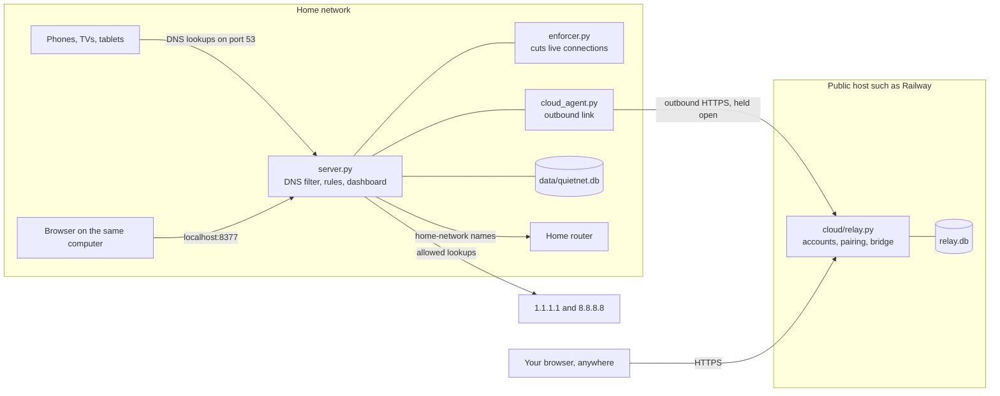
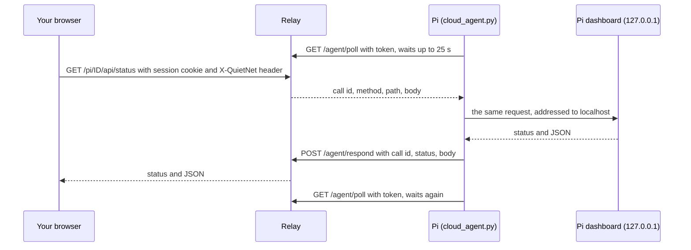

# How QuietNet works

This document explains how QuietNet is built, for someone who wants to change it or check what it does. The [README](../README.md) covers installing and using it.

Related documents: [Guide for agents](../AGENTS.md) · [API reference](API.md) · [Testing](TESTING.md) · [Known issues](KNOWN_ISSUES.md)

## The parts

QuietNet is two programs. One runs in the home, on a Raspberry Pi or a Mac. The other, the relay, is optional and runs on a public host so the home program can be reached from outside.



| File | Lines | Job |
| --- | --- | --- |
| `server.py` | ~1,850 | DNS filter, rules engine, network scan, dashboard web server, start-up |
| `enforcer.py` | ~870 | Steers a chosen device's traffic through the Pi and drops what is blocked |
| `cloud_agent.py` | ~330 | Holds an outbound connection to the relay and runs relayed requests locally |
| `cloud/relay.py` | ~1,160 | The relay: accounts, pairing codes, and the bridge between browser and Pi |
| `static/index.html` | ~750 | The dashboard: one page, no build step, no outside scripts |
| `services.json` | | The apps and services that can be blocked, and the addresses each uses |
| `junk_domains.txt` | | The built-in advert and tracker list |

Everything uses the Python standard library only. A test enforces this (`tests/test_packaging.py`).

## What happens to one lookup

Every device has a DNS setting: the address of the "phone book" it asks when it needs to find a site. A device pointed at QuietNet sends each lookup to port 53 on the QuietNet computer, over UDP (or TCP for large answers).

`answer_query()` in `server.py` handles each one:

1. **Read the question.** `parse_question()` pulls out the name and the record type. A packet it cannot read is never passed on: it gets a "format error" answer with the same id (`unreadable_reply()`), or no answer at all if it is too short to have a header or is itself an answer (answering answers could set two servers bouncing packets back and forth).
2. **Decide whether the name is one QuietNet tracks.** Names ending `.local`, `.lan`, `.home`, `.internal` or `.arpa`, and names that are not valid web addresses, are not checked against the rules or recorded. What happens to them:
   - If this device's internet is off right now (the kill switch, its own or its group's switch, or an all-internet schedule: `internet_cut()`), they get the blocked answer, so they can't be used to get data out. This includes home-network names such as `printer.local`, which stop working on that device too.
   - Otherwise, home-network names (`.local`, `.lan`, `.home`, `.internal`, `.home.arpa`) and reverse lookups of home or private addresses (10.x, 172.16–31.x, 192.168.x, 169.254.x, 127.x, and the IPv6 equivalents) go to the home router, never to the public servers (`is_home_name()`, `ask_router()`). The router's address is read from the routing table (Linux only) and looked up again every five minutes (`ROUTER_RECHECK`). If it isn't known (as on a Mac), or the router itself asked, the answer is "no such name"; if the router doesn't answer, "server failure".
   - Anything else (reverse lookups of public addresses, names with odd characters) goes to the public servers as usual.
3. **Apply the rules.** `decision()` returns blocked or allowed, and why. See the next section.
4. **Record it.** The time, the device's address, the name and the verdict go onto a queue. A background thread writes the queue to the database once a second.
5. **Answer.** Lookups from QuietNet's own computer (`127.0.0.1`, `::1`, or its network address) are treated as coming from its network address.
   - Blocked: the device is told the address is `0.0.0.0` (or `::` for IPv6), to be remembered for 60 seconds. Other record types get an empty answer. The upstream server is never contacted.
   - Allowed: the question goes to 1.1.1.1, falling back to 8.8.8.8. The answer's lifetime is cut to 120 seconds (`MAX_TTL`) so that a later block, bedtime or kill switch takes effect within about two minutes. The addresses in the answer are remembered in memory for the enforcer.
   - No reply from either upstream: the device is told "server failure".

Lookups over UDP are handled by a pool of 64 threads. At most 256 are in hand at once (`MAX_DNS_WAITING`), and at most 16 from any one device (`MAX_DNS_PER_DEVICE`), so one busy or broken device can't stop everyone else's; beyond that, new lookups are dropped and devices ask again. Lookups over TCP share 64 connections with no per-device share (known issue 80).

A device is identified by its IP address. If the router hands a device a different address, its name and rules do not follow it. The README advises reserving addresses in the router.

## The order rules are checked in

`decision(domain, client, paused)` checks in this order and stops at the first match:

| # | Check | Result | Reason code |
| --- | --- | --- | --- |
| 1 | Kill switch is on | blocked | `kill` |
| 2 | Internet is switched off for this device or its group | blocked | `off` |
| 3 | An all-internet schedule is in force for this device, its group or the house | blocked | `schedule` |
| 4 | The name, or a parent of it, is on your **blocked** list (skipped while paused) | blocked | `you` |
| 4 | The name, or a parent of it, is on your **allowed** list | allowed | `allowed` |
| 5 | The name belongs to a service blocked for this device, its group or the house | blocked | `service` |
| 5 | The name belongs to a service blocked by a schedule in force | blocked | `schedule` |
| 6 | The name is on the advert list (skipped while paused, or if advert blocking is off) | blocked | `list` |
| 7 | Otherwise | allowed | none |

Checks 1 to 3 never apply to QuietNet's own computer (`is_this_computer()`: `127.0.0.1`, `::1` and its network address). Its lookups are its link to the relay, its clock and its list downloads; cutting them would mean a Pi under the kill switch could not be switched back on from outside. Checks 4 to 7 apply to it as to any device. The dashboard agrees: its device list never shows this computer as switched off (`internet_off_for()`), and `POST /api/internet` refuses to switch this computer's internet off, since it would have no effect. Checks 1 to 3 live in one place, `internet_cut()`, which `decision()` calls first.

Points that follow from this order:

- **Step 4 walks from the most specific name upward.** For `a.b.example.com` it checks `a.b.example.com`, then `b.example.com`, then `example.com`. The first block or allow found wins, so an allow on `safe.example.com` beats a block on `example.com`.
- **An allow beats a service block.** If `youtube.com` is on the allowed list, a YouTube service block or homework schedule will not stop it. Only the kill switch, the internet switch and all-internet schedules come before allows.
- **Pause affects only steps 4 (your blocks) and 6 (adverts).** Service blocks, schedules, switched-off devices and the kill switch stay in force. Allows still apply while paused.
- **Unblocking an advert-list name creates an allow.** `unblock()` removes your block; if the advert list would still block the name, it adds the name to the allowed list so the unblock sticks.
- **Blocking a name removes allows beneath it.** `block("example.com")` deletes allows for `example.com` and anything under it.

### Scopes

A rule applies to one of three scopes, written as text:

- `all`: the whole house
- `group:<id>`: a named group of devices
- `device:<ip>`: one device

A device is subject to all three at once: `all`, its own, and its group's (a device is in at most one group). Deleting a group deletes its service blocks, its internet switch and its schedules.

### Schedules

A schedule has a scope, a set of weekdays (0 = Monday), a start and end time, and either "all internet off" or a list of services. Times are the QuietNet computer's local clock. In the Pi container that clock is set by `docker-compose.yml`, which shares the Pi's own time zone file (`/etc/localtime`) with the container and sets `TZ` to read it; the image includes the time zone tables (`tzdata`). Without this, the container would run on UTC and schedules would be out by an hour or more.

When the end is earlier than the start, the window runs overnight. The whole window belongs to the day it started: a Sunday 21:00–07:00 schedule covers Sunday evening and Monday morning. The list of schedules in force is worked out at most once every five seconds.

## The enforcer

A DNS block stops a device finding an address. It does nothing to a connection already open, such as a film mid-stream. The enforcer closes that gap for devices you choose, one at a time. It runs on Linux only and needs root or the `NET_RAW` and `NET_ADMIN` container rights.

Every two seconds, and at once whenever a change is saved on the dashboard (`Enforcer.poke()`), it asks `server.enforcement_plan()` what to do. Working out the plan means asking `decision()` about every name looked up recently, for every enforced device, so each answer is remembered (`S.plan_cache`) and worked out again only for names not seen before, or when something has changed: any rule (each change calls `rules_changed()`, which bumps `S.rules_version`), the pause, the schedules in force, the enforced devices or this computer's address. The whole plan is worked out afresh at least once a minute regardless. The addresses for each blocked name are always read fresh. Then the enforcer:

1. **Hands back anyone who has left the plan.** A device switched off, or one whose address now belongs to a different device, is told the router's real hardware address at once (three times). If the router's hardware address isn't known yet, the device stays listed and forwarding stays on, so it keeps its internet, and the next tick tries again.
2. **Checks it is safe to steer.** It turns on the kernel's packet forwarding and turns off "redirect" messages (which would tell a device to go straight to the router), reading each setting from `/proc/sys` and saving the old value. Then it reads forwarding back. If forwarding is still off, as it is in a container that may not change it, steering would cut the device off, so it doesn't steer, and says why on the device page (`status()["problem"]`). It also asks every firewall tool present (`nft`, `iptables`, `iptables-legacy`) whether another firewall would drop passed-on traffic: Docker's "drop" forwarding rule, or a chain that drops or rejects everything, as firewalld's does. In the kernel each firewall table decides on its own, and an accept in one table does not override a drop in another, so `forward_blockers()` judges every `ip` and `inet` table's forwarding chain separately (leaving out QuietNet's own table, and `ip6`, `bridge` and `arp` tables, which never see the IPv4 traffic QuietNet passes on). It reads each chain's rules in order: an accept for traffic coming in and going out on the Pi's own network connection clears that chain; a drop or reject that applies to all traffic, before any such accept, blocks it. It follows jumps and gotos that apply to all traffic, and ignores those that only some traffic takes. As in the kernel, a chain reached by a goto that runs out of rules goes back to the last jump and carries on after it (firewalld's zone chains end that way), and only ends at the forwarding chain's own policy when no jump came before. Any table still blocking counts as unsafe. The device page names every table in the way, each with a command that suits it (`nft_advice()`, `iptables_advice()`): an `iptables -I DOCKER-USER` accept for Docker's table, an `iptables -I FORWARD` accept for a chain made with `iptables` without Docker (such as ufw's), and an `nft insert rule` accept naming the real table and chain for anything else (such as firewalld's). The commands are joined so one run clears every blocker. They last until that firewall reloads (known issue 4). It fails closed: if a firewall tool that is present can't list its rules, that also counts as unsafe (the one exception: `iptables-legacy` reporting that the old firewall isn't loaded at all, which means it holds no rules). The Pi image includes the `iptables` commands for this reading, since Docker on some Pis keeps its rules where `nft` can't see them. A clean result is remembered for 30 seconds; a failure is asked again next tick.
3. **Drops what is blocked.** It loads a small firewall table (`nft`, or `iptables` if `nft` is missing). Each `nft` load deletes the previous table and defines the new one as a single step, because loading a table that already exists would add to it and leave old rules behind. With `iptables`, every command waits for the firewall lock, the chain and the jump into it are re-checked every tick (if either had to be put back, or the chain no longer holds the rules loaded, they are loaded again), and the rules only count as loaded if every command worked. While no device has ever been enforced, or once the last one's rules have been emptied, no `iptables` commands run at all; if removing the chain failed, it is emptied on a later tick. For a device whose internet is off (the kill switch, its internet switch, or an "all internet" schedule), it drops everything not addressed to the Pi itself. Otherwise it drops only the addresses that QuietNet handed out, in the last six hours, for names blocked for that device by you, by a service block or by a schedule. The advert list is left out, because advert names often share addresses with ordinary sites. Pausing advert blocking pauses your own blocks here too.
4. **Steers the device.** It sends the device an ARP message saying "the router's address is at the Pi's hardware address". The device then sends its outgoing traffic to the Pi. The message is repeated every tick because devices forget it. It only steers a device whose hardware address matches the one recorded when enforcing was switched on (filled in the first time it is seen, if it wasn't known then).

Between ticks, it listens for a steered device asking "who is the router?". It answers at once, again within a third of a second, and again at about 1.0, 1.1 and 1.6 seconds (`ANSWER_AT`). One thread sends all these answers; a device that asks again before its answers have gone out just has its plan restarted, so a flood of questions (which anyone on the network could forge) costs one entry per steered device, not a thread per question. A device believes the most recent answer, but Linux ignores a second answer for about a second after the first, so if the real router answered first, only the later answers stick. Without them the device would go straight to the router for up to two seconds after every question. In a two-container test, a device that had been cut off for a while got nothing through in 60 to 146 seconds of trying. In the first few seconds after the kill switch is turned on, though, up to about three seconds of traffic can still get through (known issue 45).

It never steers the router, the Pi itself, or anything outside the Pi's own network (`target_problem`). The Pi's own address is not fixed: `address_watcher()` in `server.py` looks it up again every 10 seconds while it is still `127.0.0.1` (a Pi may start before its network is ready), and every minute after that. A new address is passed to the enforcer and counts as a rule change; a lost network keeps the last good address. When the enforcer is running, the dashboard refuses those addresses when enforcing is switched on; otherwise it can only refuse this computer and addresses that are never devices, and the enforcer skips the rest later. A device-specific problem (a different device on the address) is reported for that device alone (`status()["problems"]`); a problem that stops all steering is in `status()["problem"]`.

Only the outgoing direction passes through the Pi. Replies travel from the router to the device directly.

**Notes on disk.** Which devices are steered and which settings were changed are written to `enforcer_state.json` in the data folder as they happen. At start-up `_recover()` removes any leftover firewall table, adopts the leftovers as its own, and hands those devices back. If the enforcer can't start at all, it still removes the table; if no devices were steered it also restores the settings and removes the notes, but if devices were steered it leaves every setting as it is and keeps the notes, since they can't be handed back without the network. If it can't start only because the network isn't up yet, it keeps looking every 15 seconds.

When the last device is released, the kernel settings are put back. On shutdown, `_teardown()` tells every device the router's real hardware address five times, from the Pi's own hardware address (switches and Wi-Fi ignore frames that claim to come from another machine). It then removes the firewall table and restores the settings. If devices couldn't be handed back, forwarding is left on and the notes kept for the next start. The program waits for this to finish before it exits, both on Ctrl-C and on `docker stop`.

Limits: it works on IPv4 only; it blocks by address, so two services sharing an address are both affected; and it relies on the device using QuietNet for DNS, since that is how QuietNet learns which addresses belong to which name.

## Remote access

A Pi at home cannot usually accept connections from the internet. So the Pi connects outward to the relay and waits, and the relay passes browser requests down that connection.



**Pairing.** On the relay website you create a QuietNet and get a code such as `A1B2-C3D4`, valid for 15 minutes. Opening the page after that issues a fresh one. You enter the code and the relay's address on the Pi's dashboard (or set `QUIETNET_CLOUD` and `QUIETNET_PAIR`). The Pi sends the code to `/agent/pair` and gets back a 48-character token, which it saves in `data/cloud.json`. The code is then cleared and cannot be used again. A Pi started with `QUIETNET_PAIR` keeps trying its code if the relay is busy, limiting, unreachable or gives an answer it can't read: after 5 seconds, then 10, 20, 40, and then every minute (`PAIR_RETRY_MAX`). It stops only when pairing works or the relay says the code is wrong, used or expired. The Remote access card and the log say when the next try is.

**Certificates.** The Pi checks the relay's HTTPS certificate on every call, and this is never switched off. Python from python.org on a Mac has no certificate list of its own until "Install Certificates.command" is run, so if Python's list is empty, `tls_context()` in `cloud_agent.py` borrows the system's own (`/etc/ssl/cert.pem` on a Mac, and the usual files on Linux). If a certificate still can't be checked, the message names that fix rather than saying the relay can't be reached.

**Keeping the link up.** Any error in the Pi's link, including a cut-off or unreadable answer during a relay restart, is caught. The link tries again after 1 second, then 2, 4 and up to 30, and the Remote access card says what happened.

**The bridge.** `Bridge` in `relay.py` keeps a queue of waiting calls per Pi. A browser request is queued and its thread waits up to 30 seconds for the answer. The Pi handles up to eight calls at once, each in its own thread, so the several calls a dashboard page makes don't queue behind each other. A Pi can only answer calls that were sent to it. Its answers may be up to 16 MB (a week of a busy device's history is large), but only for a call that is really waiting for that Pi (named in an `X-QuietNet-Call` header), and anyone can pair a Pi of their own, so a token alone isn't enough. Room for large answers (over 64 KB) is shared out by `BigAnswers`: one at a time per account, across all its Pis (so pairing extra Pis of your own gets you no more room), and at most 48 MB across every account (`BIG_ANSWER_BUDGET`). An answer waits up to 10 seconds for room; if none comes, the Pi gets `503` and the browser is told at once that the answer was too large to pass on right now. Room is taken from the stated size and given back once the browser has the answer, or straight away if it has given up; reading stops if the browser stops waiting, and every request body must arrive within 30 seconds (`BODY_SECONDS`). A request's first line and headers must arrive within 10 seconds (`HEADER_SECONDS`, which also covers the wait for the next request on a kept-open connection), or the connection is dropped, so a sender trickling header bytes can't hold one of the 300 places for ever. Only one copy of each answer is kept. An answer bigger than 12 MB is replaced on the Pi by a short "too much to send" message, so the browser hears at once. Each Pi may have one poll waiting at a time (a new one ends the old one), and at most 150 Pis wait at once (`MAX_POLLS`), so waiting Pis can never take every thread from browsers. A Pi not heard from for 40 seconds is treated as offline. Removing a QuietNet also forgets its queue.

**Limits on the relay as a whole.** `RelayServer` handles at most 300 connections at once (`MAX_CONNECTIONS`); one beyond that gets a short "busy" reply, with the usual protective headers, and is closed. An account may hold at most 10 QuietNets, paired or waiting (`MAX_PIS_PER_ACCOUNT`), and pair at most 20 a day. If the relay ever answers a poll with 401, the Pi discards its token and must be paired again.

**What the relay stores.** Email addresses, password records (PBKDF2-SHA256, 240,000 rounds, a fresh salt each), the list of Pis with their tokens, and one signing secret. History and rules stay on the Pi and pass through only while a page is open.

## Security model

| Threat | Defence | Where |
| --- | --- | --- |
| A web page you visit tries to call the local dashboard | The dashboard listens on `127.0.0.1` only and refuses any request whose `Host` is not `localhost` or `127.0.0.1` | `Web.local_only` |
| Another website shows the dashboard inside itself and tricks someone into clicking | Both servers send `X-Frame-Options: DENY` and `frame-ancestors 'none'` on every answer | `Web.end_headers`, `Relay.end_headers` |
| A web page posts a forged form to the local dashboard | Changes must be sent as exactly `application/json` (a type that merely *mentions* it, such as `text/plain; application/json`, is refused, since browsers send that without asking), which a cross-site page cannot do without permission the server never gives; and if the browser says which page sent the change, it must be on this computer (any port, for SSH tunnels) | `Web.json_from_our_page` |
| A web page signs you out of the relay by sending your browser to `/logout` | Opening `/logout` only shows a "Sign out?" page. Signing out is a form post that must carry a token made from the session cookie and the relay's secret, which another site can't read. (An `Origin` check wouldn't work: with `Referrer-Policy: no-referrer`, browsers send `Origin: null` even from the relay's own pages) | `sign_out_token`, `Relay.sign_out_page`, `Relay.sign_out` |
| A web page makes your signed-in browser call the relay | Relayed API calls need an `X-QuietNet: 1` header that another site cannot add; the cookie is `SameSite=Lax` and `HttpOnly` | `Relay.pi_request`, `set_cookie` |
| Someone else's account reaches your Pi | Every `/pi/<id>/…` request checks the Pi belongs to the signed-in user | `Relay.my_pi` |
| A stolen or edited session cookie | The cookie is `user.expiry.signature`, signed with a secret kept in the relay's database; it lasts 14 days | `make_session`, `read_session` |
| A hostile value reaching the firewall | `/api/enforce` accepts only a real IPv4 address; addresses to drop come from parsed DNS answers | `Web.handle_post`, `answer_ips` |
| Text injected into the dashboard | The page escapes every value it inserts, ids and counts included, with `esc()` or `num()`; the relay escapes Pi names | `static/index.html`, `relay.py` |
| Guessing passwords or pairing codes | Wrong guesses are counted and capped, per account and overall; wrong pairing codes per network address (20 in 10 minutes) and overall (200), so one stranger can't stop everyone pairing; pairing codes last 15 minutes; an unknown email takes as long to refuse as a wrong password | `Throttle`, `Relay.do_login`, `Relay.agent_pair` |
| Keeping the relay busy checking passwords | Every sign-in counts, right or wrong: 30 per account and 60 per network address in 15 minutes (a browser that signed in before has its own cap of 30 and skips the per-address one). At most four passwords are checked at once; a sign-in that waits 5 seconds for a turn is told the relay is busy | `Relay.do_login`, `PASSWORD_CHECKS_AT_ONCE` |
| Swamping the relay | At most 300 connections, 150 waiting Pis, one poll per Pi, 10 seconds for the headers and 30 for a body to arrive, one large answer per account and 48 MB of them in all; 10 QuietNets per account | `RelayServer`, `poll_slots`, `Bridge.poll`, `Relay.handle_one_request`, `read_body`, `BigAnswers`, `Relay.new_pi` |
| A stranger locking the owner out by guessing wrongly on purpose | A browser that has signed in to the account before carries a signed `qn_known` cookie and gets its own looser limit (20 wrong guesses in 15 minutes) instead of the shared ones; it still needs the right password. The cookie can only be had by signing in, is signed over the password record (a new password voids old ones), and is removed at sign-out | `known_device_token`, `Relay.do_login`, `Relay.sign_out` |
| Steering the router, the Pi itself or another network | The enforcer only steers ordinary addresses on the Pi's own network, and the dashboard refuses others | `enforcer.target_problem`, `Web.handle_post` |
| Floods of lookups or slow connections | At most 256 lookups in hand, and 16 from any one device (more are dropped; devices retry); at most 64 TCP connections, each with 8 seconds to send its question; relay connections that stall for 30 seconds are dropped; history capped at two million rows, trimmed 5,000 rows at a time so the trim never holds up DNS answers | `udp_server`, `TCPServer`, `recv_exact`, `Relay.timeout`, `prune_history` |
| Using names the filter doesn't check to get data out while a device's internet is off | Unchecked names (home endings, reverse lookups, odd characters) get the blocked answer while internet is off; unreadable packets are never passed on | `answer_query`, `internet_cut`, `unreadable_reply` |
| Home-network names reaching public servers | Home names and reverse lookups of private addresses go only to the home router | `is_home_name`, `ask_router` |
| A forged DNS answer | The filter accepts an answer only from the server it asked, with the matching id and the same question | `forward_udp`, `same_question` |
| Very large requests | Bodies over 64 KB are refused unread (except a paired Pi's answers to the relay, up to 16 MB) | `MAX_BODY` in both servers, `MAX_ANSWER` |
| Other accounts on the same machine reading history or tokens | The data folders and `cloud.json` are readable by their owner only | `init_db`, `CloudAgent._save` |

Two things to keep in mind:

- **The relay has full control of a paired Pi.** Anything the dashboard can do, a request from the relay can do, including the kill switch and the enforcer. Host the relay yourself and protect that account.
- **Anyone on the home network can use the DNS filter.** It listens on every network address of the computer. It should not be exposed to the internet.

Gaps in these defences are listed in [Known issues](KNOWN_ISSUES.md).

## What is stored

### On the Pi: `data/`

| File | Contents |
| --- | --- |
| `quietnet.db` | SQLite database, described below |
| `community_list.txt` | The downloaded community advert list, one address per line |
| `cloud.json` | Relay address, token and Pi id, once paired |

Tables in `quietnet.db`:

| Table | Holds |
| --- | --- |
| `queries` | Every lookup: time, device address, name, blocked or not. Pruned to 30 days and two million rows, every 10 minutes. Two indexes: by device then time (the device page, and each device's last lookup), and by time (today's totals, and finding old rows to prune) |
| `blocked`, `allowed` | Your own address rules |
| `service_blocks` | (scope, service) pairs |
| `internet_off` | Scopes whose internet is off. The scope `all` is the kill switch |
| `schedules` | Timed rules |
| `groups`, `device_group` | Group names and which device is in which |
| `devices` | Names you gave devices |
| `seen` | Devices found by the network scan: address, hardware address, host name |
| `enforced` | Devices with "cut live connections" on |
| `settings` | `junk_on` and `paused_until` |

Rules are also held in memory (the `State` object) and reloaded from the database at start-up by `init_db()`. Every change writes both, holding `db_lock`, and calls `rules_changed()` so the enforcer's remembered plan is worked out again.

**Locks.** `db_lock` guards the database and the rules in memory. Answering a lookup never takes it: `decision()` reads only memory, recorded lookups go onto a queue for the log writer, and the addresses remembered for the enforcer (`S.resolved`) have their own small lock, `resolved_lock`. So a dashboard question, a history trim or a history clear can't hold up DNS answers. They can still hold up other dashboard calls and the log writer for a moment (known issue 82). The network scan waits for device names before taking `db_lock`, and holds it only to save what it found.

**History questions.** Each device's last lookup (`LAST_SEEN_SQL`, for the device list) is found by hopping from one device to the next in the device-then-time index, reading one row for each, so the work grows with the number of devices, not the size of the history. Pruning runs as two steps, each 5,000 rows at a time with the lock let go between steps: rows older than 30 days, found through the time index (`PRUNE_OLD_SQL`), then any rows beyond two million, found by row number (`PRUNE_SURPLUS_SQL`).

**Advert count.** The number of names on both advert lists together is worked out when either list is loaded or downloaded (`count_junk()`), not on every status call.

### On the relay: `relay.db`

`users` (email, password record), `pis` (id, owner, name, token, pairing code and when it was issued, last seen), `meta` (the signing secret). `pis` has indexes on the token, the pairing code and the owner, added at start-up to an existing database too.

## Background work

`server.py` starts these threads:

| Thread | Does |
| --- | --- |
| Web server | One thread per dashboard request |
| UDP listener | Receives lookups and hands each to a pool of 64 workers |
| TCP server | One thread per TCP lookup |
| Log writer | Saves recorded lookups once a second; prunes old history every 10 minutes |
| Name refresher | Every two minutes, asks the network for the host names of known devices |
| Address watcher | Looks up this computer's network address every 10 seconds until it has one, then every minute |
| Enforcer | Ticks every two seconds (Linux with the right permissions only) |
| Cloud agent | Polls the relay when paired |
| Scan, list download | Started on demand from the dashboard |

The **network scan** knocks on every address of the home network and lists the devices that answer. On Linux it reads the network's real size from the routing table; elsewhere it assumes the usual 254 addresses. A network bigger than 1,024 addresses (`MAX_SCAN`) is scanned only in the block of 1,024 around this computer, and the answer says so (`S.scan_info`: the network, how many addresses, and whether it was capped).

The **dashboard page** refreshes the status, devices and controls every four seconds, but only when the previous refresh has finished, no dialog is open and the browser tab is visible; it catches up as soon as the tab is shown again. An open device's activity list is fetched every 30 seconds on the timer (`ACTIVITY_EVERY`), and at once whenever the person opens a device or changes something. An answer that arrives after the person has moved to another device or time period is ignored. The page's script uses nothing newer than Safari 12 understands.

## Settings

Command line, `server.py`: `--dns-port` (default 53), `--web-port` (default 8377), `--no-browser`.

| Environment variable | Used by | Meaning |
| --- | --- | --- |
| `QUIETNET_DATA` | `server.py` | Folder for the database and lists. Default: `data/` beside the program |
| `QUIETNET_CLOUD` | `cloud_agent.py` | Relay address, used only if the Pi is not yet paired |
| `QUIETNET_PAIR` | `cloud_agent.py` | Pairing code, used once at first start |
| `PORT` | `relay.py` | Port to listen on. Default 8080 |
| `QUIETNET_RELAY_DATA` | `relay.py` | Folder for `relay.db`. Default: `data/` beside the program |
| `QUIETNET_STATIC` | `relay.py` | Path to the dashboard page, if not in the usual place |
| `QUIETNET_SIGNUP` | `relay.py` | Who may create an account: `open` (default), `first` (only while there are no accounts) or `closed`. Any other value counts as `closed`, with a warning at start-up |
| `TZ` | Pi container | Time zone for schedules and the clock. `docker-compose.yml` sets it to `:/etc/localtime`, the Pi's own zone, shared into the container. Set it by name (`TZ=Europe/London docker compose up -d`) to choose another. Never leave it empty, which means UTC |

Fixed values worth knowing, all near the top of their files:

| Value | Setting | File |
| --- | --- | --- |
| Upstream DNS servers | `UPSTREAMS` = 1.1.1.1, 8.8.8.8 | `server.py` |
| Lookups in hand, overall and per device | `MAX_DNS_WAITING` = 256, `MAX_DNS_PER_DEVICE` = 16 | `server.py` |
| Home-network endings sent to the router | `HOME_ENDINGS` = `.local`, `.lan`, `.home`, `.internal`, `.home.arpa` | `server.py` |
| How often the router's address is looked up | `ROUTER_RECHECK` = 300 s | `server.py` |
| Most addresses one scan covers | `MAX_SCAN` = 1,024 | `server.py` |
| History kept | `KEEP_DAYS` = 30 | `server.py` |
| Longest answer lifetime | `MAX_TTL` = 120 s | `server.py` |
| Community list source | `COMMUNITY_URL` (StevenBlack hosts) | `server.py` |
| Session length | `SESSION_HOURS` = 14 days | `relay.py` |
| Browser wait for the Pi | `CALL_TIMEOUT` = 30 s | `relay.py` |
| Pi poll wait | `POLL_TIMEOUT` = 25 s | `relay.py` |
| Pi counted offline after | `OFFLINE_AFTER` = 40 s | `relay.py` |
| Pairing code lifetime | `PAIR_CODE_MINUTES` = 15 | `relay.py` |
| Wrong passwords before a wait | `LOGIN_LIMIT_PER_EMAIL` = 5 in 15 minutes | `relay.py` |
| Wrong pairing codes before a wait | `PAIR_LIMIT_PER_ADDRESS` = 20 in 10 minutes from one network address; `PAIR_LIMIT_OVERALL` = 200 in 10 minutes | `relay.py` |
| Sign-ins, right or wrong | `LOGIN_TRIES_PER_EMAIL` = 30, `LOGIN_TRIES_PER_ADDRESS` = 60, `LOGIN_TRIES_KNOWN_BROWSER` = 30, each in 15 minutes | `relay.py` |
| Password checks at once | `PASSWORD_CHECKS_AT_ONCE` = 4, each waiting up to 5 s | `relay.py` |
| Connections at once | `MAX_CONNECTIONS` = 300, of which waiting Pis `MAX_POLLS` = 150 | `relay.py` |
| Time for a request's first line and headers to arrive | `HEADER_SECONDS` = 10 | `relay.py` |
| Time for a request body to arrive | `BODY_SECONDS` = 30 | `relay.py` |
| Large answers held at once | One per account; `BIG_ANSWER_BUDGET` = 48 MB in all; `BIG_ANSWER_WAIT` = 10 s | `relay.py` |
| QuietNets per account | `MAX_PIS_PER_ACCOUNT` = 10; successful pairings `PAIR_LIMIT_PER_ACCOUNT` = 20 a day | `relay.py` |
| Largest request body | `MAX_BODY` = 64 KB | `server.py`, `relay.py` |

## Adding a blockable service

Add an entry to `services.json`:

```json
{"id": "bluesky", "name": "Bluesky", "cat": "Social", "domains": ["bsky.app", "bsky.social"]}
```

`id` is lower-case letters and digits and must be unique. List base addresses only; everything beneath each one is covered. An address may belong to one service only. `tests/test_packaging.py` checks all of this.
